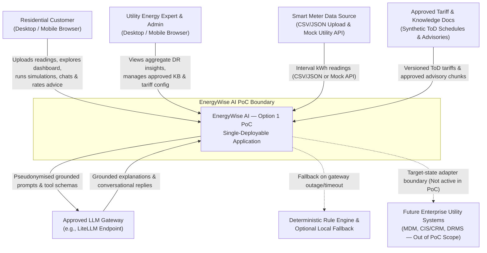
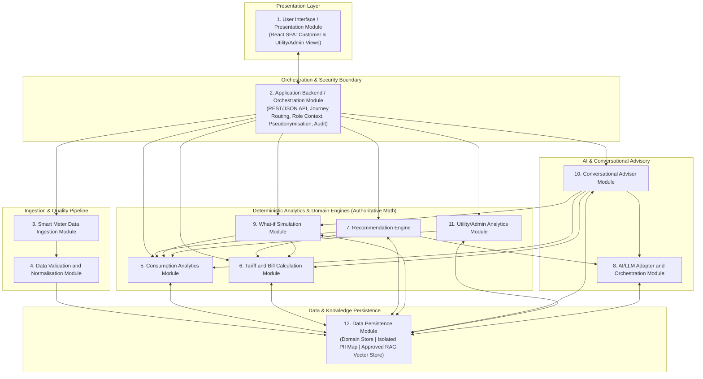
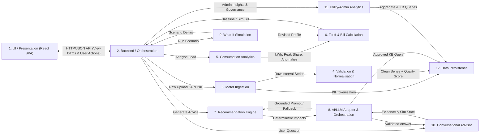
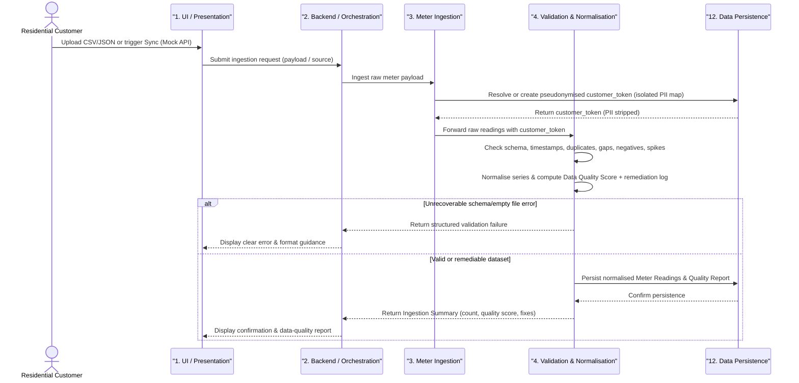
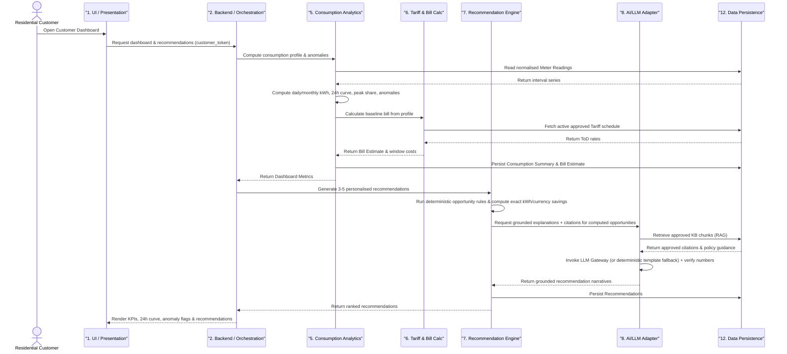
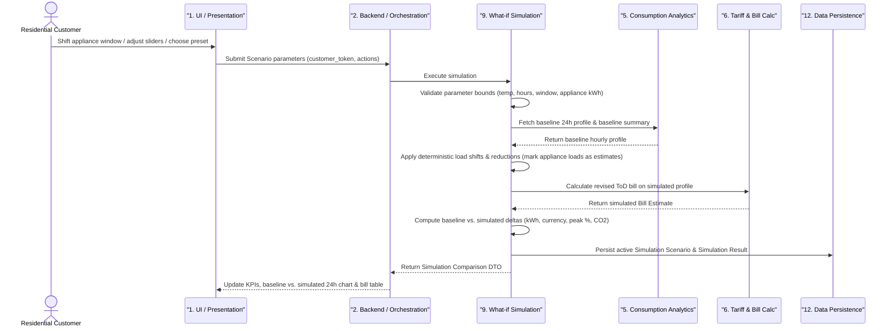
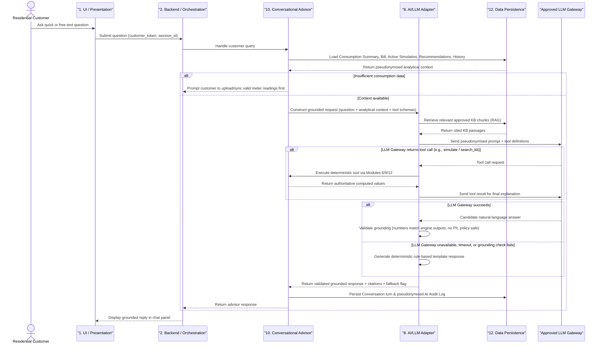
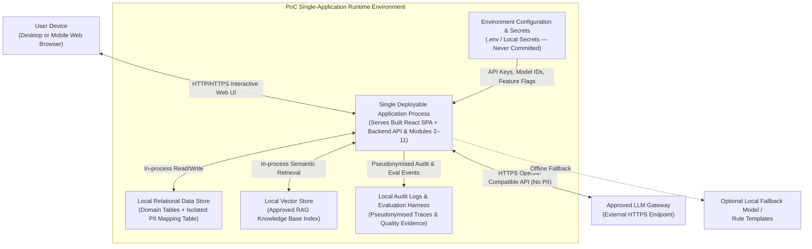
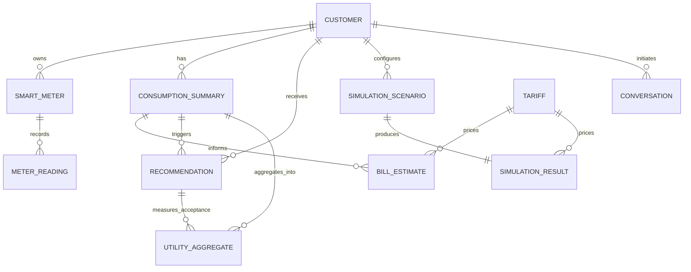

# EnergyWise AI — Detailed High-Level Design (HLD)
## Option 1: PoC Single-Application Architecture

---

## Document Control

| Attribute | Value |
| :--- | :--- |
| **Document Title** | EnergyWise AI — Detailed High-Level Design (Option 1: PoC Single-Application Architecture) |
| **Document ID** | `EW-HLD-OPT1-001` |
| **Version** | `1.1 (Updated for React UI Stack Decision)` |
| **Date** | 2026-11-27 |
| **Author / Role** | Lead Solution Architect & Technical Design Authority (TDA) |
| **Target Audience** | Technical Design Authority, Solution Architecture Review Board, LLD & Engineering Team, Delivery & QA Leads |
| **Status** | Draft for Architecture Sign-Off |

### Revision History

| Version | Date | Author | Summary of Changes |
| :--- | :--- | :--- | :--- |
| `0.1` | 2026-11-27 | Solution Architecture | Initial synthesis of use case, simplified requirements, tech stack draft, and UI prototype |
| `1.0` | 2026-11-27 | Lead Solution Architect / TDA | Complete Option 1 PoC HLD covering logical modules, 8 Mermaid views, E2E flows, data domains, calculation boundaries, AI guardrails, security, integrations, NFRs, deployment, RAC, ADRs, and LLD handover |
| `1.1` | 2026-11-27 | Lead Solution Architect / TDA | Updated PoC presentation stack from Streamlit to React SPA (served by the single PoC backend) across logical architecture, deployment, NFRs, risks, ADRs, LLD handover, and open decisions |

### Controlling Baseline & Source Traceability

> [!NOTE]
> The workspace did not contain separate prior Solution Options (D2) or Option 1 HLD (D3) files. Accordingly, this document establishes the consolidated **Option 1 PoC HLD** directly aligned to the five project baseline artefacts supplied at commissioning, plus the subsequent team decision confirming **React** over Streamlit for the PoC UI:
> 1. **Problem Statement / Use Case:** *AI-Driven Energy Consumption Optimization Advisor for Utilities* (Business Situation, Constraints, Data Considerations, Solution Expectations).
> 2. **Framework & Lab Governance:** *AI Friday Season 3 – Supplementary Guide* (D1–D5 structure, AI lab gateway `https://genailab.tcs.in`, approved models, privacy/synthetic-data rules).
> 3. **Functional & NFR Baseline:** *Simplified Requirements · EnergyWise AI v0.2* (referencing `FR-01`–`FR-17`, `NFR-01`–`NFR-12`).
> 4. **Indicative PoC Technology Stack:** *Tech Stack · EnergyWise AI Draft v0.1* (Python 3.12 modular backend engines, SQLite, Chroma, LiteLLM gateway, offline fallback, synthetic generator), **updated per team decision to use React for the PoC UI instead of Streamlit**.
> 5. **Experience Baseline:** *EnergyWise AI UI Prototype* (Customer & Utility Energy Expert/Admin personas, load curve, appliance load shifter, sliders, RAG recommendations, grounded advisor chat, tariff breakdown, DR console, KB governance).

---

## Table of Contents

1. [Architecture Objective & Scope Boundaries](#1-architecture-objective--scope-boundaries)
2. [Proposed Logical Architecture](#2-proposed-logical-architecture)
3. [Architecture Diagrams](#3-architecture-diagrams)
4. [End-to-End Business Flows](#4-end-to-end-business-flows)
5. [Data Architecture](#5-data-architecture)
6. [Business Calculation Boundaries](#6-business-calculation-boundaries)
7. [AI Design & Guardrails](#7-ai-design--guardrails)
8. [Security, Privacy and Data Quality](#8-security-privacy-and-data-quality)
9. [Integration Architecture](#9-integration-architecture)
10. [Non-Functional Design Considerations](#10-non-functional-design-considerations)
11. [Deployment Overview](#11-deployment-overview)
12. [Risks, Assumptions and Constraints](#12-risks-assumptions-and-constraints)
13. [Architecture Decisions](#13-architecture-decisions)
14. [HLD-to-LLD Handover](#14-hld-to-lld-handover)
15. [Capability Traceability & Open Decisions](#15-capability-traceability--open-decisions)

---

## 1. Architecture Objective & Scope Boundaries

### 1.1 Architecture Objective

The objective of **Option 1: PoC Single-Application Architecture** is to deliver a **lightweight, modular, single-deployable web application** that proves the complete **EnergyWise AI** end-to-end business journey rapidly and safely, while establishing clean internal module boundaries so deterministic calculation engines and AI orchestration logic can be carried forward into the future enterprise target state without throwaway rewrites.

The PoC application must demonstrate ten core capabilities across two primary personas (**Residential Customer** and **Utility Energy Expert / Administrator**):

1. **Smart meter data ingestion:** Accept time-series interval kWh data via CSV/JSON upload and a mocked utility smart-meter API pull.
2. **Data validation and quality checks:** Detect and remediate timestamp issues, duplicates, missing intervals, extreme spikes, and negative values; produce a transparent data-quality score and remediation log.
3. **Consumption analysis:** Compute daily, monthly, and 24-hour load profiles, identify baseline usage patterns, and (where time permits in PoC) provide plain-statistical next-month usage forecasts.
4. **Peak/off-peak usage analysis:** Classify consumption into Time-of-Day (ToD) tariff windows (highlighting evening peak hours, e.g., 18:00–22:00 / tariff peak window) and quantify peak share.
5. **Estimated bill calculation:** Deterministically calculate baseline and simulated bills using configured ToD/slab tariffs.
6. **Consumption anomaly identification:** Flag abnormal demand spikes and elevated overnight standby loads directly on consumption visualisations.
7. **Personalised energy-saving recommendations:** Generate 3–5 tailored recommendations stating what was observed, why it matters, recommended action, deterministic kWh and currency savings, confidence level, approved source citation, and customer 👍/👎 feedback capture.
8. **What-if simulation:** Allow customers to test shifting flexible appliances/loads between ToD windows, adjusting AC temperature setpoint or runtime hours, reducing overnight standby load, or applying presets, comparing baseline vs. simulated outcomes in real time.
9. **Conversational AI advisor:** Provide quick-prompt and free-text Q&A grounded strictly in the customer's pseudonymised consumption, tariff schedule, active what-if simulation, and approved knowledge base, with deterministic rule-based fallback if AI services are unavailable.
10. **Utility/admin dashboard:** Provide a read-only aggregate insights view (aggregate load curve, shiftable peak kWh potential, segment DR acceptance/opt-in metrics) and governance over approved advisory documents and tariff configuration.

### 1.2 PoC Scope vs. Future Enterprise Capabilities

To prevent scope creep during PoC delivery while preserving architectural alignment with the Target-State (D3) architecture, scope boundaries are explicitly partitioned below:

| Capability Area | Option 1 PoC Scope (In Scope) | Future Enterprise Target Scope (Out of PoC Scope) |
| :--- | :--- | :--- |
| **Deployment Topology** | Single-deployable application: React SPA UI served by a single Python backend hosting orchestration, deterministic modules, and AI adapter | Independently hosted/CDN-backed React SPA, containerized FastAPI BFF, and independent ingestion/analytics services |
| **Customer Persona & Auth** | Residential synthetic customers selected via persona/dataset switcher; no sign-in (`FR-15` deferred) | Residential + Commercial/SME (`FR-14` demand-charge tariffs), SSO/OAuth2 authentication, explicit consent management |
| **Meter Data Ingestion** | CSV/JSON file upload + mocked utility smart-meter API adapter using seeded synthetic data | Automated scheduled/streamed ingestion from utility Head-End / MDM APIs via event queues |
| **Appliance Disaggregation** | Customer-declared / synthetic flexible appliance profiles explicitly labelled as *estimates* (no IoT sensors) | Optional smart-plug/HEMS telemetry or NILM enrichment if approved |
| **Tariff & Knowledge Governance** | Versioned synthetic ToD tariff config & curated local KB documents with approval metadata (`NFR-12`) | Enterprise CMS/workflow approval pipeline with regulatory tariff sync |
| **Utility Operations** | Read-only aggregate demand/DR readiness insights (`FR-12`); no live grid/customer dispatch | Live Demand Response Management System (DRMS) dispatch, customer nudges, and CSR integration (`FR-17`) |
| **Persistence & Vector Store** | Embedded single-node relational store (e.g., SQLite) + local vector store (e.g., Chroma) | Managed relational + time-series DB (PostgreSQL + TimescaleDB), separate PII vault, managed vector DB |
| **AI Provider Integration** | Approved lab LLM gateway (`https://genailab.tcs.in`) with deterministic rule fallback; no model training | Enterprise AI Gateway with HA routing, centralized FinOps/monitoring, and automated eval pipelines |

---

## 2. Proposed Logical Architecture

The application is structured as **twelve (12) logically separated modules** packaged within a single deployable unit (a built **React SPA** served by a single **Python backend** hosting Modules `2`–`12` in-process). Module `1` communicates with Module `2` via clean HTTP/JSON API contracts, while backend modules communicate exclusively through explicit in-process interfaces and typed DTOs, enforcing a strict **Separation of Concerns**:

- **Presentation** handles rendering, user interaction, and input capture only.
- **Orchestration** coordinates workflows, enforces persona/role context, and manages audit trails.
- **Deterministic Domain & Analytics Modules** hold **100% authority** over math, data quality, tariffs, bills, simulations, and aggregates.
- **AI & Advisory Modules** handle retrieval, prompt construction, LLM gateway communication, grounding verification, and deterministic fallback—never performing unverified arithmetic.
- **Persistence** encapsulates structured storage, PII isolation, and knowledge-base retrieval.

### 2.1 Logical Module Inventory & Responsibilities

| # | Logical Module | Core Responsibilities | Primary Interactions |
| :-: | :--- | :--- | :--- |
| **1** | **User Interface / Presentation Module** | Responsive **React SPA** rendering desktop/mobile views for Customer (dashboard, 24h chart, anomaly markers, interactive what-if controls, bill breakdown, recommendations with 👍/👎, advisor chat) and Utility/Admin (aggregate insights, KB & tariff governance view). Captures uploads, simulation inputs, and chat prompts. | Calls `Application Backend / Orchestration Module` over HTTP/JSON APIs. |
| **2** | **Application Backend / Orchestration Module** | Central application coordinator and API boundary (serving the built React UI and REST/JSON endpoints in PoC). Routes UI requests to domain journeys (A–F), enforces role/persona context (Customer vs. Utility/Admin), enforces PII pseudonymisation boundaries before downstream calls, coordinates multi-step workflows, and emits pseudonymised audit events. | Orchestrates Modules `3`–`12`; serves `1`. |
| **3** | **Smart Meter Data Ingestion Module** | Accepts customer CSV/JSON uploads or pulls interval readings from a mocked utility smart-meter API adapter. Extracts raw meter identifiers, delegates PII stripping/pseudonymisation mapping to persistence boundary, and hands raw time-series payloads for validation. | Invoked by `2`; calls `4` and `12` (PII vault boundary). |
| **4** | **Data Validation and Normalisation Module** | Validates schema, interval granularity (15-min or 60-min), timestamp monotonicity/timezones, duplicate records, missing gaps, negative values, and outlier spikes. Normalises readings into canonical hourly/interval series, calculates a Data Quality Score (0–100), and produces a structured remediation log. | Invoked by `2`/`3`; writes clean series & quality metadata via `12`. |
| **5** | **Consumption Analytics Module** | Computes baseline metrics from normalised readings: total/daily/monthly kWh, 24-hour average/typical load profiles, Time-of-Day window totals, peak share %, anomaly markers (spikes, elevated overnight standby), and optional statistical baseline forecasts. | Reads normalised readings from `12`; serves `2`, `6`, `7`, `9`, `10`, `11`. |
| **6** | **Tariff and Bill Calculation Module** | Authoritative billing engine. Loads approved versioned ToD/slab tariff schedules, maps each interval or window consumption to tariff rates, and computes baseline bills, simulated bills, window cost breakdowns, and financial savings deltas. | Reads Tariff config from `12`; called by `2`, `5`, `7`, `9`. |
| **7** | **Recommendation Engine** | Evaluates consumption metrics, anomalies, and tariff structure using deterministic rules to identify top 3–5 savings opportunities (e.g., peak-to-off-peak load shifting, AC setpoint/runtime reduction, standby elimination). Computes exact kWh, currency savings, and confidence scores; attaches approved KB citations; delegates narrative polish to Module `8` (or deterministic templates on fallback); records 👍/👎 feedback. | Consumes `5`, `6`; calls `8` for grounded narrative explanation; stores recommendations & feedback via `12`. |
| **8** | **AI/LLM Adapter and Orchestration Module** | Sole gateway to approved LLM endpoints (and local fallback wording model if enabled). Manages prompt assembly, tool/function definitions, RAG semantic retrieval from approved KB, post-generation **numerical grounding & PII-leak checks**, timeout/error handling, and automatic fallback to deterministic template explanations. | Called by `7` and `10`; retrieves KB chunks via `12`; invokes external Approved LLM Gateway. |
| **9** | **What-if Simulation Module** | Deterministic scenario engine. Validates user parameters (appliance window shifts, percentage load shifts, AC setpoint °C, peak AC runtime trim, standby cut %, or presets), applies mathematical adjustments to baseline 24h/period load profiles, invokes Module `6` for cost recalculation, computes baseline-vs-simulated deltas (kWh, ₹, peak %, CO₂ estimate), and flags appliance values as estimates. | Invoked by `2`; uses `5` & `6`; persists scenario/results via `12`. |
| **10** | **Conversational Advisor Module** | Manages conversational session state and Q&A lifecycle. Classifies intent, fetches pseudonymised customer context (Consumption Summary, Bill Estimate, active Simulation Result, Recommendations), executes read-only analytical tool calls (e.g., run simulation comparison or KB lookup), invokes `8` to produce grounded answers, handles unsupported/insufficient-data guardrails, and logs conversation turns. | Invoked by `2`; reads context from `5`, `6`, `9`, `12`; delegates LLM call/fallback to `8`. |
| **11** | **Utility/Admin Analytics Module** | Computes cross-customer aggregate insights strictly from pseudonymised/aggregated consumption and simulation/feedback records (total feeder load curve, shiftable peak capacity, segment opt-in/acceptance rates). Also exposes governance views for approved KB advisories and tariff metadata (`NFR-12`). Never exposes individual customer PII. | Invoked by `2`; reads aggregate/config data from `12` and `5`. |
| **12** | **Data Persistence Module** | Encapsulates all storage operations across structured domain data (profiles, readings, summaries, tariffs, bills, recommendations, feedback, simulations, conversations, audit logs), an **isolated PII Identity Mapping store** (unreachable by AI/analytics modules), and the **Approved Knowledge Base Vector Store** (for RAG retrieval). | Used by `2`, `3`, `4`, `5`, `6`, `7`, `8`, `9`, `10`, `11` under strict access boundaries. |

---

## 3. Architecture Diagrams

All diagrams use consistent module names from Section 2 and are syntactically validated Mermaid definitions.

### 3.1 System Context Diagram

### 3.2 Logical Application Architecture

### 3.3 Component Interactions

### 3.4 Smart Meter Data Ingestion Flow (Journey A)

### 3.5 Consumption Analytics and Recommendation Flow (Journeys B & C)

### 3.6 What-if Simulation Flow (Journey D)

### 3.7 Conversational AI Flow (Journey E)

### 3.8 Deployment Overview (PoC)

---

## 4. End-to-End Business Flows

### 4.1 Journey A — Customer Uploads Meter Data

1. **Trigger:** Customer opens the application and selects either **Upload CSV/JSON** or **Sync Meter** (mock utility smart-meter API pull).
2. **Submission:** `UI / Presentation Module` transmits the raw payload (or mock meter ID) to `Application Backend / Orchestration Module`.
3. **Ingestion & Pseudonymisation:** `Smart Meter Data Ingestion Module` parses the source format. Direct identifiers (customer name, address, phone, email, raw meter ID) are isolated in the `Data Persistence Module` PII mapping table and replaced with an opaque `customer_token` and `meter_token`.
4. **Validation & Normalisation:** `Data Validation and Normalisation Module` verifies required fields (timestamp, kWh), sorts chronologically, resolves timezone/interval alignment (15-min to hourly roll-up if required), removes exact duplicates, detects missing gaps, flags/caps negative values, and detects extreme statistical spikes.
5. **Quality Scoring:** Module 4 assigns a Data Quality Score (0–100) and records a human-readable remediation log (e.g., *"3 duplicate rows removed; 2 missing intervals interpolated; 1 negative reading corrected"*).
6. **Persistence:** Clean normalised readings and the quality report are stored via `Data Persistence Module` keyed solely by `customer_token`.
7. **Confirmation:** `UI / Presentation Module` displays ingestion confirmation, record count, quality score badge, and remediation summary, then triggers Journey B to refresh the dashboard.
8. **Failure Handling:** If the file is corrupt, lacks required columns, or falls below the minimum usable threshold, Module 4 returns a structured validation error and Journey B is not invoked on invalid data.

### 4.2 Journey B — Customer Views Consumption

1. **Trigger:** Customer selects a profile/period or completes Journey A.
2. **Retrieve Data:** `Application Backend / Orchestration Module` requests consumption analysis for `customer_token` and selected period (e.g., last 30 days / 720 hourly readings).
3. **Analyse Consumption:** `Consumption Analytics Module` loads normalised readings from `Data Persistence Module` and computes total kWh, daily average, 24-hour typical weekday/period load curve, Time-of-Day window totals, peak hour share % (e.g., 18:00–22:00), and anomaly flags (peak spikes and elevated overnight baseline/standby).
4. **Calculate Metrics:** `Tariff and Bill Calculation Module` loads the active approved ToD tariff schedule and deterministically calculates total estimated bill and cost per tariff window.
5. **Persist & Display:** Computed `Consumption Summary` and `Bill Estimate` are stored for downstream modules (`7`, `9`, `10`, `11`) and rendered on the dashboard: KPI cards (Monthly kWh, Estimated Bill, Peak Hour Share, Simulated Savings), 24-hour load chart with shaded peak ToD band and anomaly markers, and the Tariff & Bill Breakdown view.

### 4.3 Journey C — Customer Receives Recommendations

1. **Trigger:** Dashboard load completes or customer requests refreshed advice.
2. **Analyse Consumption:** `Recommendation Engine` reads the customer's `Consumption Summary`, anomalies, and `Bill Estimate`.
3. **Identify Opportunity:** Deterministic rules evaluate candidate levers against thresholds (e.g., peak share > 30%, high evening discretionary load, elevated overnight standby kWh, cooling/AC peak signature).
4. **Calculate Potential Impact:** For the top 3–5 opportunities, `Recommendation Engine` invokes `Tariff and Bill Calculation Module` to calculate exact monthly kWh reduction, monthly/annual financial savings, peak-share reduction, and assigns a deterministic confidence tier (`High` / `Medium` / `Estimate`).
5. **Generate Grounded Explanation:** `Recommendation Engine` passes the pre-computed opportunity objects (never raw PII) to `AI/LLM Adapter and Orchestration Module`, which retrieves relevant approved Knowledge Base chunks (e.g., BEE AC advisory, BESCOM ToD rebate rule) and generates concise, accessible explanations citing the exact computed numbers and source document. If the LLM gateway is unavailable or fails numerical verification, Module 8 returns deterministic rule-based templated text.
6. **Display & Capture Feedback:** `UI / Presentation Module` renders the 3–5 recommendation cards (observation, why it matters, action, kWh & currency savings, confidence, source citation) with 👍/👎 rating controls. Ratings are persisted via `Data Persistence Module` for PoC evaluation and utility insights.

### 4.4 Journey D — Customer Runs a What-if Scenario

1. **Trigger:** Customer shifts a declared appliance (e.g., Washing Machine, Water Heater, EV Charger) from Evening Peak to Night Off-Peak, adjusts sliders (AC setpoint °C, Peak AC runtime trim, Overnight Standby reduction), or selects a preset (e.g., *AI Eco-Shift Preset*).
2. **Validate Inputs:** `What-if Simulation Module` validates all control inputs against safe domain bounds (e.g., AC setpoint 20–27°C, runtime reduction ≥ 0 and ≤ baseline peak AC hours, valid ToD window target).
3. **Calculate Revised Consumption:** Module 9 clones the baseline 24-hour/period consumption profile, applies deterministic load-shifting and reduction formulas, and tags any appliance-level kWh contributions as *customer-declared / benchmark estimates*.
4. **Calculate Revised Cost & Compare:** `Tariff and Bill Calculation Module` calculates the simulated bill across all ToD windows. Module 9 computes deltas against baseline (kWh saved, bill savings, peak-share change, estimated CO₂ reduction).
5. **Persist & Display:** The active `Simulation Scenario` and `Simulation Result` are stored via `Data Persistence Module` (making them immediately visible to the Conversational Advisor) and displayed via updated KPI cards (with strikethrough baselines), dual-line 24-hour Baseline vs. Simulated load chart, and updated Bill Breakdown table.

### 4.5 Journey E — Customer Uses Conversational AI

1. **Trigger:** Customer clicks a quick-question chip (e.g., *"Why is my bill high?"*, *"Explain current savings"*) or submits a free-text question.
2. **Receive Question:** `Application Backend / Orchestration Module` validates message length/safety and routes it to `Conversational Advisor Module` with `customer_token` and `session_id`.
3. **Retrieve Evidence:** Module 10 fetches the customer's latest pseudonymised `Consumption Summary`, `Bill Estimate`, active `Simulation Result`, `Recommendations`, and recent conversation history. If no valid meter data exists, it returns a guided insufficient-data message.
4. **Construct Grounded AI Context:** `AI/LLM Adapter and Orchestration Module` retrieves top relevant approved KB chunks via RAG, assembles a strict system prompt containing the pseudonymised analytical snapshot and read-only tool schemas (e.g., `get_consumption_summary`, `run_what_if_simulation`, `search_kb`), and calls the Approved LLM Gateway.
5. **Tool Execution & Response Validation:** If the LLM requests a calculation tool, Module 10 executes it through deterministic Modules `6`/`9` and feeds back authoritative numbers. Before returning any reply, Module 8 verifies that no PII tokens appear and that numerical claims align with engine outputs (or triggers deterministic fallback if the gateway fails or verification rejects the output).
6. **Log & Return:** Module 10 persists the conversation turn and pseudonymised AI audit record (prompt hash/redacted prompt, tool calls, latency, fallback flag) and returns the cited, plain-language answer to the UI.

### 4.6 Journey F — Utility Administrator Views Aggregate Insights

1. **Trigger:** Utility Energy Expert / Administrator switches to the **Utility/Admin** workspace.
2. **Retrieve Permitted Aggregate Data:** `Application Backend / Orchestration Module` verifies the `Utility/Admin` role context and invokes `Utility/Admin Analytics Module`. Module 11 queries only aggregated/anonymised summaries, simulation potentials, and recommendation feedback—never accessing the PII Identity Mapping table or individual identifiable customer records.
3. **Calculate Aggregate Trends:** Module 11 computes fleet-level metrics across synthetic/permitted cohorts: active meter count, aggregated feeder 24-hour load curve, total shiftable peak MW/kWh potential, and recommendation 👍/👎 acceptance rates by customer segment (e.g., High-Rise Apartments, EV Charging, Villas).
4. **Display Insights & Governance:** `UI / Presentation Module` renders the **Demand & DR Console** (read-only informational view in PoC; no live grid dispatch) and the **Approved KB & Tariff Governance** view showing active advisory documents, source citations, version, and approval status (`NFR-12`).

---

## 5. Data Architecture

### 5.1 Logical Data Domains

The logical data model comprises **eleven (11) core data domains**, intentionally decoupled from physical database DDL/engines at HLD level.

| # | Logical Data Domain | Description & Key Attributes (Logical) | Owner Module | Lifecycle & Retention (PoC vs. Target) |
| :-: | :--- | :--- | :--- | :--- |
| **1** | **Customer** | Pseudonymised customer profile (`customer_token`, customer segment, dwelling/profile type, declared appliance list). *Direct PII (name, address, contact) is isolated in a separate Identity Mapping store unreachable by analytics/AI.* | `3` (Identity Map) / `12` | Created on seed/ingestion; persisted in local PoC store; Target enforces consent-based retention & erasure. |
| **2** | **Smart meter** | Pseudonymised meter reference (`meter_token`, linked `customer_token`, interval granularity e.g. 60-min/15-min, status, ingestion source). | `3` | Created at onboarding/first upload; updated on sync; raw `meter_id` isolated in Identity Map. |
| **3** | **Meter reading** | Normalised time-series energy interval (`meter_token`, timestamp, raw kWh, normalised kWh, quality flags e.g. imputed/capped/duplicate-resolved). | `4` | Appended on ingestion/validation; immutable raw audit trail or cleaned canonical series; Target partitioned by time. |
| **4** | **Consumption summary** | Aggregated analytical view per customer & period (total kWh, daily avg, 24h hourly profile array, ToD window kWh, peak share %, anomaly markers, Data Quality Score, optional statistical forecast). | `5` | Computed/refreshed whenever new readings are validated; cached for fast dashboard & advisor reads. |
| **5** | **Tariff** | Versioned tariff definition (`tariff_id`, plan name, ToD window boundaries, per-kWh rates, currency, effective dates, `approval_status`, `approved_by`). | `6` / `11` | Seeded/configured by Utility Energy Expert; versioned so historical bill estimates remain reproducible. |
| **6** | **Bill estimate** | Deterministic cost calculation (`bill_id`, `customer_token`, `tariff_id`, period, baseline vs. simulated total cost, cost breakdown per ToD window). | `6` | Recomputed on consumption refresh or tariff/simulation update; linked to exact tariff version used. |
| **7** | **Recommendation** | Actionable advisory record (`rec_id`, `customer_token`, rule/opportunity type, observed metric, deterministic kWh & currency saving, confidence, KB citation, grounded explanation text, 👍/👎 feedback). | `7` | Generated on consumption analysis; updated when customer submits 👍/👎 feedback; feeds aggregate acceptance metrics. |
| **8** | **Simulation scenario** | User-configured what-if inputs (`scenario_id`, `customer_token`, baseline reference, appliance shifts, AC setpoint °C, peak AC trim hours, standby reduction %, preset name). | `9` | Created/updated interactively during user session; last active scenario retained for conversational context. |
| **9** | **Simulation result** | Deterministic simulation output (`result_id`, `scenario_id`, revised 24h profile, simulated kWh, simulated bill, peak share %, kWh/cost/CO₂ deltas, estimate disclaimers). | `9` | Paired 1:1 with `Simulation scenario`; overwritten or versioned on slider/drag changes. |
| **10** | **Conversation** | Grounded chat session & turns (`session_id`, `customer_token`, turn index, user query, referenced `summary_id`/`scenario_id`, tool calls, grounding check status, fallback flag, assistant reply). | `10` | Created per chat session; retained in pseudonymised form for context continuity and AI auditability. |
| **11** | **Utility aggregate** | Cross-customer analytical rollup (`cohort_segment`, active meter count, aggregated 24h load profile, shiftable peak kWh/MW potential, recommendation 👍 acceptance rate). | `11` | Derived dynamically or refreshed periodically from pseudonymised summaries & feedback; contains zero PII. |

### 5.2 Logical Entity Relationships

### 5.3 Data Ownership & PII Isolation Rule

- **Strict Isolation Boundary:** Only `Smart Meter Data Ingestion Module` (at ingestion) and the PII Mapping partition inside `Data Persistence Module` ever touch real identifiers (name, address, email, phone, utility meter serial number).
- **Zero-PII Downstream Guarantee:** Every domain table (`Consumption summary`, `Recommendation`, `Simulation`, `Conversation`, `Utility aggregate`) and every outbound LLM prompt or audit log uses only opaque surrogate keys (`customer_token`, `meter_token`).

---

## 6. Business Calculation Boundaries

**Architectural Rule (`NFR-01`):** Plain, deterministic application code in Modules `4`, `5`, `6`, and `9` is the **sole authoritative source** for all quantitative metrics. The LLM is strictly prohibited from performing mental arithmetic, extrapolating tariff slabs, or inventing kWh or financial savings.

| Calculation | Authoritative Module | Required Inputs | Key Assumptions & Disclaimers |
| :--- | :---: | :--- | :--- |
| **kWh Aggregations & Baseline Consumption** | `5` | Normalised `Meter reading` series (15-min or 60-min kWh), target period window | If input is 15-min, intervals are summed into hourly buckets for 24h curves; imputed gap values are tracked in Data Quality Score. |
| **Peak / Off-Peak Classification** | `5` & `6` | Normalised interval timestamps + `Tariff` ToD window definitions (e.g., Night 23:00–06:00, Morning 06:00–12:00, Afternoon 12:00–18:00, Evening Peak 18:00–22:00/23:00) | Assumes meter timestamps represent customer local utility timezone; PoC standardises window boundaries in the active `Tariff` record. |
| **Tariff & Estimated Bill Calculation** | `6` | Windowed or hourly kWh totals + approved `Tariff` rates (ToD rates and/or slab/fixed charges if configured) | PoC uses synthetic residential ToD tariff schedules (e.g., BESCOM-style illustrative rates); excludes taxes/surcharges unless explicitly configured in tariff metadata. |
| **Anomaly Identification** | `5` | Historical hourly/daily series for `customer_token` | Uses deterministic statistical thresholds (e.g., z-score / rolling IQR spikes and sustained overnight base-load thresholds); no ML model training required. |
| **Scenario Consumption (What-if)** | `9` | Baseline 24h profile + validated scenario actions (appliance shift source/target windows, AC setpoint °C, peak AC trim hours, standby cut %) | **Estimate Disclaimer:** Because smart meters do not measure individual appliances, appliance-level kWh figures are derived from customer-declared appliances or residential benchmarks and **must be labelled as estimates** in UI and AI output. |
| **Estimated Financial Savings & CO₂** | `9` & `6` | Baseline `Bill estimate` minus Simulated `Bill estimate`; kWh delta × regional grid emission factor | Financial savings equal exact deterministic difference `(Baseline Bill - Simulated Bill)`. CO₂ savings use a static configurable emission factor (e.g., kg CO₂/kWh) clearly marked as an estimate. |
| **Statistical Next-Month Forecast** *(PoC if time)* | `5` | Minimum historical baseline days (e.g., ≥ 30–90 days of normalised readings) | Uses plain statistical baseline/seasonal projection (and optional scenario adjustment); suppressed with an "insufficient history" notice if data span is below threshold. |

---

## 7. AI Design & Guardrails

### 7.1 Design Principles

- **No Custom Training:** Zero fine-tuning, RLHF, or custom ML forecasting/disaggregation model training in the PoC.
- **Tool-Augmented Grounding:** The LLM acts as an **explanation and conversational orchestration layer** backed by deterministic tool calls and pre-computed analytical evidence.
- **Controlled Gateway Access:** All external LLM calls route exclusively through the approved gateway (e.g., LiteLLM gateway `https://genailab.tcs.in` in the lab environment), never direct consumer APIs.

### 7.2 Core AI Mechanisms

| Component | Design Specification |
| :--- | :--- |
| **AI Adapter** | `AI/LLM Adapter and Orchestration Module` (`M8`) wraps an OpenAI-compatible client pointing to the approved LLM gateway, configured via `.env` (primary reasoning/tool-calling model, secondary fallback model, embedding model, timeout thresholds). |
| **Prompt Orchestration** | Structured prompt templates separate **System Policy** (role, non-negotiable math/PII rules, citation rules), **Verified Analytical Context** (JSON snapshot from Modules `5`, `6`, `9`), **Retrieved KB Passages**, and **User Query**. |
| **Context Retrieval (RAG)** | Synthetic utility knowledge documents (tariff schedule, demand-response terms, billing SOP, efficiency advisories, advice policy) carry version and `approval_status` metadata. Only **approved** documents are indexed into the vector store (`M12`) and retrieved via semantic search. |
| **Grounding Using Analytical Results** | Every recommendation explanation and chat response receives exact pre-computed figures (`kwh`, `bill`, `peak_pct`, `savings`, `confidence`). A post-generation **Grounding Validator** checks that numeric values cited in the AI output correspond to the supplied analytical context or tool outputs and contain no PII patterns. |
| **Recommendation Explanation** | `Recommendation Engine` (`M7`) passes structured opportunity records to `M8`, which formats natural-language cards explaining: *What we saw*, *Why it matters*, *Action*, *Calculated savings*, *Confidence*, and *KB Citation*. |
| **Conversational Question Handling** | `Conversational Advisor Module` (`M10`) supports quick-action prompts and free-text questions anchored to the current customer and active what-if scenario. When a user asks *"What happens if I shift my EV to night?"*, `M8` invokes a deterministic simulation tool on `M9`/`M6` rather than guessing the answer. |

### 7.3 Guardrails, Edge Cases & Deterministic Fallback

1. **Response Constraints:**
   - Never output or request PII.
   - Never fabricate kWh, currency savings, or unverified tariff rules.
   - Cite the exact approved KB source ID/title when stating policy or efficiency guidance.
   - Keep tone concise, non-technical, and actionable for residential customers.
2. **Handling Unsupported Questions:**
   - Queries outside energy advisory scope (e.g., billing disputes/refunds, electrical wiring safety/DIY repairs, competitor tariffs, prompt-injection attempts to reveal system prompts or cross-customer data) are intercepted by intent/policy checks and answered with a polite boundary message directing the customer to official utility support.
3. **Handling Insufficient Data:**
   - If a customer has no ingested readings or a critically low Data Quality Score (or no active simulation when asking about simulation savings), `M10` short-circuits the LLM call or injects an explicit `insufficient_data` flag so the advisor explains what data is missing and guides the user to upload/sync readings.
4. **Fallback to Deterministic / Rule-Based Explanations:**
   - Triggered automatically if the LLM gateway returns an error, times out, hits rate limits, or fails the post-generation Grounding Validator.
   - `M8` switches seamlessly to **Rules Mode**: deterministic template strings populated directly with Module `5`/`6`/`7`/`9` outputs and approved KB summaries (or optionally an approved local small model for phrasing only, if configured and verified). Core dashboard, simulation, and bill calculations remain 100% operational during any AI outage (`FR-13`, `NFR-07`).

---

## 8. Security, Privacy and Data Quality

### 8.1 Security & Privacy Controls

| Control Area | PoC Design Implementation | Target Enterprise Evolution |
| :--- | :--- | :--- |
| **Customer Data Isolation** | All queries filter strictly by `customer_token`. Customer persona cannot query fleet-wide or other customers' data. PII mapping table sits in an isolated partition blocked from AI/analytics modules. | Row-level security / tenant isolation in PostgreSQL + dedicated encrypted PII Vault service. |
| **Role-Based Access** | Logical role context (`Customer` vs. `Utility/Admin`) enforced in `M2`. Customer routes cannot invoke `M11` aggregate/governance operations; Admin routes see only aggregated/anonymised data. | OAuth2 / OIDC authentication, RBAC scopes, and explicit customer consent management (`FR-15`). |
| **Pseudonymisation & Anonymisation** | Name, address, email, phone, and meter serial number are stripped at `M3` ingestion and replaced with irreversible/mapped surrogate tokens before storage in analytical tables or prompt assembly (`NFR-02`). | Automated enterprise tokenization/masking at API gateway and ingestion pipelines. |
| **Prompt & Conversation Protection** | Prompt-injection delimiters around user text; input length limits; read-only tool allow-lists; post-response regex/entity scanning to block accidental identifier leakage; pseudonymised conversation logs. | Enterprise AI firewall / DLP inspection and automated red-teaming guardrails. |
| **Secrets & Transport Security** | Gateway API keys and configuration stored in `.env` (excluded from Git via `.gitignore`, template in `.env.example`). HTTPS to approved LLM gateway. | Cloud secret manager / vault, mutual TLS, encryption at rest with KMS. |
| **Audit & Logging** | Pseudonymised structured audit log records: ingestion quality reports, AI calls (timestamp, `customer_token`, model, latency, tool calls, grounding pass/fail, fallback triggered), and admin KB/tariff metadata changes (`NFR-08`). | Centralized SIEM/observability pipeline with tamper-evident audit retention. |
| **Synthetic Data Mandate** | PoC uses seeded synthetic datasets (e.g., 100 residential profiles, 90 days hourly readings with injected anomalies/faults) and illustrative tariff/KB documents. Zero real customer PII is processed. | Real utility meter feeds under regulated utility privacy governance. |

### 8.2 Data Quality Management (`FR-03`, `FR-04`, `NFR-05`)

`Data Validation and Normalisation Module` (`M4`) applies deterministic checks before any analytics execute:

- **Input Validation:** Strict schema verification for CSV/JSON uploads (valid timestamps, numeric kWh values, supported interval resolution) and numeric range validation for UI simulation inputs.
- **Duplicate Readings:** Exact `(meter_token, timestamp)` duplicates are deduplicated deterministically and logged in the remediation summary.
- **Missing Readings (Gaps):** Missing timestamps within the period are detected; short gaps are flagged and optionally imputed (e.g., linear or same-hour-prior-day estimate, marked `is_imputed=true`), while large gaps degrade the Data Quality Score and trigger warnings.
- **Invalid Readings & Outliers:** Negative kWh values are rejected/floored to zero with a remediation entry; physically implausible spikes (exceeding residential breaker ceiling or extreme z-score thresholds) are flagged as either `sensor_fault` or `consumption_anomaly` so they do not corrupt bill calculations silently.

---

## 9. Integration Architecture

All external boundaries are wrapped behind clean internal adapter interfaces so PoC mocks can be swapped for production utility integrations in Target D3 without altering domain logic.

| Integration Point | PoC Implementation | Logical Contract (HLD) | Target Enterprise Evolution |
| :--- | :--- | :--- | :--- |
| **Smart Meter Data Upload / Pull** | 1) User CSV/JSON file upload via UI. 2) **Mock Utility Smart Meter API Adapter** serving seeded synthetic readings (note: **MCP is not used** in the backend architecture; UI "Sync Meter" triggers the mock adapter). | Input: `meter_ref` or file stream + date range. Output: Canonical list of `(timestamp, kwh, interval_minutes)` + source metadata. | Scheduled/event-driven pull from Utility Head-End / Meter Data Management (MDM) API over authenticated TLS. |
| **Tariff Information** | Local versioned configuration / structured table containing synthetic ToD schedules and approval metadata (`NFR-12`). | Input: `tariff_id`, effective date. Output: Ordered ToD windows, rates, currency, approval status. | Integration with Utility Tariff & Billing Master System. |
| **Approved LLM Provider** | OpenAI-compatible HTTP/JSON adapter (`M8`) connecting to the approved lab gateway (`https://genailab.tcs.in`) for chat/tool-calling and embeddings; local fallback templates / optional local Ollama if offline. | Input: Model ID, pseudonymised messages, tool schemas, temperature/max-token bounds. Output: Text completion or structured tool-call payload + token/latency metadata. | Enterprise AI Gateway with HA multi-region routing and FinOps quotas. |
| **Future Utility APIs** *(Deferred)* | Stubbed/excluded in PoC (`M11` provides read-only aggregate view without outbound dispatch). | Logical boundaries reserved for: Customer Information System (CIS/CRM), Demand Response Management System (DRMS), Consent Service. | Authenticated REST/event integrations with utility CRM, DRMS nudge dispatch, and CSR portals. |

---

## 10. Non-Functional Design Considerations

> [!IMPORTANT]
> Targets listed below for the PoC are **proposed design assumptions** pending TDA and PoC stakeholder sign-off.

| NFR Category | PoC Proposed Target *(Assumption — Pending Approval)* | Architectural Enablers in Option 1 | Target Enterprise Direction |
| :--- | :--- | :--- | :--- |
| **Responsiveness** | Dashboard & what-if simulation recalculation **< 500 ms**; grounded AI chat response **< 5 s** (timeout fallback at ~10 s). | Deterministic vectorised in-memory calculation (`pandas`/`numpy`); lightweight single-process calls; async/timeout guard on LLM gateway. | Sub-200 ms API P95 via pre-aggregated TimescaleDB views and streaming SSE chat responses. |
| **Performance** | Support PoC dataset (~100 synthetic customers × 90 days hourly ≈ 216,000 readings) smoothly on a single workstation/VM. | Indexed relational queries by `(customer_token, timestamp)` and cached `Consumption summary` records. | Horizontal API scaling, partitioned time-series storage, Redis/distributed caching. |
| **Reliability** | **100% core feature availability** (dashboard, bill calc, what-if simulator, rule-based advice) even when LLM gateway is offline. | Circuit-breaker/timeout in `M8` falling back automatically to deterministic rule templates (`FR-13`, `NFR-07`). | Multi-AZ HA deployment, managed DB failover, dead-letter queues for ingestion. |
| **Maintainability** | Clean separation between React SPA (`M1`), API orchestration (`M2`), and pure Python calculation/AI packages; automated unit tests + evaluation suite (`C1`–`C8`). | Domain modules (`3`–`11`) have zero UI coupling and communicate via typed APIs; both the React SPA and Python engines carry directly into Target without rewrite. | CI/CD pipelines, versioned API contracts, automated regression & LLM eval gates. |
| **Security** | Zero PII in prompts, AI logs, or Admin views; zero secrets committed to Git. | Mandatory pseudonymisation at `M3`; isolated PII mapping table in `M12`; `.env` secret isolation. | Enterprise IAM/OIDC, KMS encryption, WAF, automated PII DLP scanning. |
| **Usability** | Responsive React web UI usable on desktop and mobile viewports; plain-language advice with visible estimate disclaimers and citation tags (`FR-16`, `NFR-04`). | Aligns directly with the interactive UI prototype (drag-and-drop/interactive load shifting, dark/light theme, shaded peak visuals, quick-question chips). | WCAG 2.1 AA compliance in production React SPA. |
| **Observability** | Structured local logs capturing ingestion quality, AI latency, grounding pass rate, fallback frequency, and customer 👍/👎 ratings. | Centralised audit emitter in `M2`/`M8` and reproducible evaluation script generating summary metrics. | Enterprise APM, Prometheus/Grafana dashboards, cost & grounding-drift alerting. |
| **Future Scalability** | Seamless migration path from 100 PoC households to 100,000+ utility smart meters without rewriting UI or domain logic. | React SPA (`M1`) already consumes REST/JSON endpoints from `M2`, enabling independent frontend/CDN hosting and swapping SQLite/Chroma for TimescaleDB/managed vector DB. | Microservice / container autoscaling, streaming meter ingestion, multi-tenant utility isolation. |

---

## 11. Deployment Overview

The PoC adopts a **platform-agnostic, single-deployable logical topology** designed to run cleanly on a lab workstation, container, or single application VM without assuming a specific cloud vendor.

- **User Interface:** Built **React SPA** static bundle served directly by the single application backend over HTTP/HTTPS (with optional local dev-server proxy during development), rendering responsive desktop and mobile views in the user's browser.
- **Single Application Backend:** One Python runtime process hosting static UI delivery (`M1` bundle), API Orchestration (`M2`), Ingestion/Validation (`M3`–`M4`), Deterministic Engines (`M5`–`M7`, `M9`, `M11`), and AI/Advisory Modules (`M8`, `M10`).
- **Data Store:** Embedded/local persistence tier (`M12`) consisting of:
  - A local relational database for domain records, pseudonymised readings, feedback, and audit logs.
  - A segregated identity-mapping table within the store inaccessible to AI and analytics modules.
  - A local embedded vector store holding chunked, approved utility knowledge documents.
- **LLM Provider Connection:** Outbound HTTPS connection from `M8` to the approved LLM Gateway (`https://genailab.tcs.in`) using OpenAI-compatible SDK configuration, with automatic fallback to local deterministic templates (and optionally a local inference runtime for wording).
- **Configuration & Secrets:** Externalised via environment configuration (`.env` / runtime environment variables) holding gateway base URLs, API credentials, active model identifiers, tariff config path, and feature flags (never hardcoded or committed to source control).
- **Logging & Monitoring:** Local structured audit log files / database audit table plus an offline evaluation runner (`eval`) capturing grounding accuracy, fallback behaviour, latency, and user feedback metrics.

*(In the future Target State, the same domain modules deploy inside containerized backend services backed by managed PostgreSQL/TimescaleDB, a managed vector database, a dedicated PII vault, and a CDN-served React SPA.)*

---

## 12. Risks, Assumptions and Constraints

### 12.1 Risks Register

| ID | Description | Impact | Mitigation | Owner / Decision Required |
| :--- | :--- | :--- | :--- | :--- |
| **R-01** | **LLM Numerical Hallucination:** LLM invents kWh savings, bill amounts, or unsupported tariff claims in chat/recommendations. | High — Erodes customer trust and violates `NFR-01`. | Restrict LLM to explanation/tool-calling only; compute all figures deterministically in `M5`/`M6`/`M9`; enforce post-generation grounding check with rule-template fallback. | AI & Architecture Lead |
| **R-02** | **LLM Gateway Outage or Latency:** Lab gateway (`https://genailab.tcs.in`) is slow, rate-limited, or unreachable during demo/usage. | Medium — Degrades conversational experience. | Enforce strict request timeout in `M8` with automatic fallback to deterministic Rules Mode; all core analytics and simulator functions remain unaffected. | Engineering Lead |
| **R-03** | **Appliance Estimates Misinterpreted as Measured Sub-Metering:** Customers assume appliance kWh breakdown is exact sensor telemetry. | Medium — Misaligned expectations on savings accuracy. | Explicitly label appliance figures as *customer-declared / benchmark estimates* across UI cards, simulation outputs, and AI responses. | Product / UX Lead |
| **R-04** | **PII Leakage into LLM Prompts or Audit Logs:** Accidental inclusion of customer name, address, or raw meter ID in outbound AI context. | High — Privacy policy breach (`NFR-02`). | Enforce pseudonymisation at `M3` boundary; isolate PII mapping table from `M5`–`M11`; apply outbound PII scan in `M8`. | Security / TDA Lead |
| **R-05** | **UI Prototype Alignment & React PoC Delivery Effort:** React SPA build and API integration require more frontend setup than a pure-Python UI within a compressed PoC window; prototype also displays an illustrative `MCP` badge. | Low–Medium — Risk of scope/time overrun or label mismatch with mock API backend. | Scaffold React components directly from the existing HTML/Tailwind prototype, replace the `MCP` label with mock smart-meter API status, and expose lean REST endpoints from `M2`. | Delivery / UI Lead |
| **R-06** | **PoC Time Compression:** Full scope (including forecasting `FR-09`, admin console `FR-12`, and audit `NFR-08`) exceeds available PoC build window. | Medium — Incomplete core journeys if unprioritised. | Separate Core PoC (Journeys A–E core) from "PoC if time" items (`FR-09`, `FR-12` depth, `NFR-08`) while keeping modular hooks in place. | Delivery Lead / Scrum Master |

### 12.2 Assumptions Register

| ID | Description | Impact | Mitigation / Validation | Owner / Decision Required |
| :--- | :--- | :--- | :--- | :--- |
| **A-01** | **Baseline Continuity:** Because separate D2/prior D3 files were not in the workspace, the five attached artefacts represent the authoritative baseline for Option 1 PoC. | High — Controls scope and tech alignment. | Confirm consolidated baseline during HLD architecture review sign-off. | TDA / Solution Architect |
| **A-02** | **PoC NFR Targets:** Proposed latency (<500 ms sim, <5 s chat) and dataset scale (100 customers, 90 days) are sufficient for PoC validation. | Medium — Guides LLD sizing. | Approve or adjust NFR targets at HLD sign-off. | TDA / QA Lead |
| **A-03** | **Synthetic Data Representativeness:** Seeded synthetic meter profiles and illustrative ToD tariffs realistically reflect residential load shapes and data-quality faults. | Medium — Affects demo credibility and test coverage. | Review synthetic generator parameters and fault injection rules with domain SME. | Data / Domain Lead |
| **A-04** | **Gateway Connectivity:** Outbound HTTPS access to `https://genailab.tcs.in` with valid credentials is available in the PoC runtime environment. | Medium — Required for live LLM demo. | Verify gateway connectivity early; keep Rules Mode fallback tested and demo-ready. | DevOps / Engineering Lead |

### 12.3 Constraints Register

| ID | Description | Impact | Mitigation / Compliance Approach | Owner / Decision Required |
| :--- | :--- | :--- | :--- | :--- |
| **C-01** | **No Custom AI Training:** Solution must not train or fine-tune custom ML/LLM models. | High — Governs forecasting, anomaly detection, and recommendations. | Use deterministic statistics (`pandas`/`numpy`), rule engines, and prompt/RAG orchestration over pre-approved foundation models. | Architecture Lead |
| **C-02** | **Approved AI Gateway Only:** External commercial AI APIs must not be called directly outside the approved gateway. | High — Compliance & lab security constraint. | Route all external LLM/embedding requests strictly through `M8` configured to the approved gateway endpoint. | Security / Engineering Lead |
| **C-03** | **Smart-Meter-Only Input:** No IoT sub-metering or home automation hardware integrations permitted. | Medium — Bounds appliance disaggregation fidelity. | Rely strictly on smart-meter CSV/JSON or mock API time series + declared appliance estimates. | Product / Architecture Lead |
| **C-04** | **No Real Customer PII:** Real utility customer data and proprietary utility brand assets must not be used in PoC/public tools. | High — Data privacy compliance. | Use synthetic customer profiles and illustrative tariff/KB documents tagged as synthetic. | Security / Delivery Lead |

---

## 13. Architecture Decisions

| Decision ID | Topic | Decision | Rationale | Trade-offs & Implications |
| :--- | :--- | :--- | :--- | :--- |
| **ADR-01** | **Single Deployable Application** | Build Option 1 PoC as a single deployable unit: a Python backend serving the built **React SPA** and hosting all backend modules (`M2`–`M12`) in-process. | Eliminates distributed service orchestration and separate frontend hosting overhead in PoC while keeping a clean HTTP/JSON UI-to-backend boundary. | Requires a React build step bundled into static assets for single-process serving; easily decoupled in Target D3. |
| **ADR-02** | **Modular Internal Design (React + Python Core)** | Enforce 12 logically separated modules: **React SPA** (`M1`) over HTTP/JSON API (`M2`) + UI-agnostic Python domain packages (`M3`–`M12`). | Adopting React in the PoC aligns directly with Target D3 (`React + FastAPI`) and the HTML prototype, eliminating PoC UI throwaway code while keeping domain engines unit-testable (`pytest`). | Slightly higher initial PoC frontend setup than Streamlit, mitigated by reusing the existing prototype layout and components. |
| **ADR-03** | **Deterministic Calculations** | Keep all kWh, ToD classification, tariff, bill, anomaly, and what-if math in plain deterministic code (`M5`, `M6`, `M9`). | Guarantees 100% repeatability, auditability, zero numerical hallucination, and sub-second simulation responsiveness. | Requires explicit rule/formula maintenance in LLD rather than relying on black-box ML predictions. |
| **ADR-04** | **LLM Usage Boundaries** | Use approved gateway LLMs strictly for grounded explanation, RAG synthesis, and tool-assisted chat; no custom training; deterministic fallback. | Complies with no-training constraint, prevents fabricated financial claims, and ensures graceful degradation during gateway outages. | Chat capability is intentionally bounded to supported energy advisory intents; out-of-scope queries are declined. |
| **ADR-05** | **Synthetic Data & Pseudonymisation** | Seed synthetic residential datasets with injected faults and enforce PII pseudonymisation at ingestion (`M3`). | Satisfies privacy regulations in the PoC while realistically demonstrating data cleaning, anomaly handling, and privacy-by-design. | Real utility edge cases (e.g., complex commercial tariffs) are deferred to Target Phase 2 (`FR-14`). |
| **ADR-06** | **Mocked Utility Integration (No MCP)** | Use a clean mock smart-meter API adapter and static/versioned tariff config instead of live MDM/CRM or MCP servers. | Keeps PoC focused on core analytics/AI value without external infrastructure dependencies; aligns with Tech Stack v0.1 decision against MCP. | Prototype's illustrative MCP label must be updated or aligned so UI matches actual mock API adapter implementation. |
| **ADR-07** | **Lightweight PoC Infrastructure** | Use local embedded relational storage, local vector store, and `.env` configuration inside the PoC runtime. | Zero cloud provisioning friction, fast local setup, reproducible evaluation runs, and low operational overhead. | Single-node storage is unsuitable for production scale; `M12` persistence interfaces must abstract storage engines for Target D3 migration. |

---

## 14. HLD-to-LLD Handover

To transition smoothly from HLD sign-off into Low-Level Design (LLD) and implementation, the LLD team must define the following artefacts next *(explicitly not authored in this HLD)*:

1. **Detailed Component Design:** React SPA component hierarchy/state management (`M1`), Python package layout, dependency injection/wiring across Modules `2`–`12`, and static-asset serving configuration.
2. **Internal Interfaces:** Exact typed function signatures and DTO/Pydantic (or dataclass) contracts across Orchestration, Domain Engines, AI Adapter, and Persistence.
3. **Data Structures and Schemas:** Physical relational table schemas (including the isolated PII mapping table), vector metadata schema, and canonical time-series internal DataFrame/array formats.
4. **API Contracts:** REST/JSON API endpoint specifications between React SPA (`M1`) and Backend Orchestration (`M2`), mocked smart-meter API request/response schemas, and LLM tool-calling JSON schemas.
5. **Validation Rules:** Exact thresholds and deterministic rules for timestamp parsing, interval alignment, duplicate resolution, gap interpolation limits, negative/spike handling, Data Quality Score weighting formula, and UI simulation input bounds.
6. **Calculation Specifications & Worked Examples:** Mathematical formulas and worked numerical examples (inputs → intermediate window sums → exact currency bill & savings outputs) for ToD billing, appliance load shifting, AC setpoint/runtime adjustments, standby reduction, CO₂ factor, and statistical forecasting.
7. **AI Prompt & Context Contracts:** Exact system prompts, context JSON schema injected into `M8`, RAG chunking/metadata/retrieval parameters, grounding verification rules, and deterministic fallback templates.
8. **Error & Exception Handling:** Standardised error taxonomy, retry/timeout policies for the LLM gateway, graceful degradation triggers, and user-facing error messages.
9. **Detailed Security Controls:** Exact PII regex/field-stripping rules, pseudonym generation logic, prompt-injection sanitization patterns, role enforcement guards, and audit log field redaction rules.
10. **Technical Test Scenarios:** Unit test specifications for every deterministic calculation, data-quality fault injection tests, AI grounding & fallback test cases (`C1`–`C8` evaluation matrix), and end-to-end journey verification scenarios.

---

## 15. Capability Traceability & Open Decisions

### 15.1 Business Capability & Requirements Traceability Matrix

| Business Capability / Requirement | Scope Tag | Owning Logical Modules | End-to-End Flow |
| :--- | :---: | :--- | :---: |
| Smart meter upload & mock API ingestion (`FR-01`, `FR-02`) | **PoC** | `1`, `2`, `3`, `12` | Journey A |
| Data validation, cleaning, quality score & fix log (`FR-03`, `FR-04`, `NFR-05`) | **PoC** | `4`, `12` | Journey A |
| PII pseudonymisation & zero-PII AI context (`NFR-02`) | **PoC** | `2`, `3`, `8`, `12` | Journeys A, C, E, F |
| Dashboard KPIs, ToD peak analysis, 24h profile & anomalies (`FR-05`, `FR-06`) | **PoC** | `1`, `2`, `5`, `6`, `12` | Journey B |
| Deterministic personalised recommendations & 👍/👎 feedback (`FR-07`, `FR-11`, `NFR-01`) | **PoC** | `1`, `5`, `6`, `7`, `8`, `12` | Journey C |
| What-if simulator with baseline comparison & estimate labels (`FR-08`) | **PoC** | `1`, `2`, `5`, `6`, `9`, `12` | Journey D |
| Grounded conversational AI advisor (`FR-10`) | **PoC** | `1`, `2`, `6`, `8`, `9`, `10`, `12` | Journey E |
| Statistical next-month forecast (`FR-09`) | **PoC (Stretch)** | `5`, `6` | Journey B |
| Rules-based fallback on AI outage (`FR-13`, `NFR-07`) | **PoC (Core / Stretch)** | `7`, `8`, `10` | Journeys C, E |
| Utility aggregate DR insights & KB/tariff approval metadata (`FR-12`, `NFR-12`) | **PoC (Core / Stretch)** | `1`, `2`, `11`, `12` | Journey F |
| Pseudonymised AI/tool audit logging (`NFR-08`) | **PoC (Stretch)** | `2`, `8`, `10`, `12` | Journeys C, E |
| Multi-device responsive UI (`FR-16`, `NFR-04`) | **PoC** | `1` | All Journeys |
| Commercial/SME demand tariffs, real CRM/MDM, auth/consent, live DR dispatch (`FR-14`, `FR-15`, `FR-17`) | **Future Target** | Target BFF, Vault, Integration Adapters | Roadmap |

### 15.2 Open Decisions Register (For TDA & Team Sign-Off)

| Decision ID | Open Question / Decision Required | Options Under Consideration | Proposed Default | Target Owner |
| :--- | :--- | :--- | :--- | :--- |
| **OD-01** | **React PoC Component & Charting Details** *(Updated — React Confirmed)* | UI framework is confirmed as **React** (replacing Streamlit). Remaining detail: confirm React charting library and whether appliance shifting uses full drag-and-drop (per HTML prototype) plus accessible tap/dropdown fallback. | Use interactive drag-and-drop with accessible click/selector fallback (matching the HTML prototype) and a lightweight React charting library. | UI Lead / Delivery Lead |
| **OD-02** | **Admin Tariff Configurator Scope** | Interactive live ToD rate editor in PoC Admin tab (UI Prototype) vs. read-only approved tariff config in PoC with editor deferred to Roadmap (Tech Stack Open Point #3). | Read-only approved tariff display in PoC (`NFR-12` approval metadata); live rate editor in Roadmap. | Product Lead / TDA |
| **OD-03** | **RAG Document Corpus & Tool Contract Finalisation** | Expand `search_tips` to generic `search_kb` with document-type filtering + add `shift_kwh` tool for appliance shifting (Tech Stack Open Points #1–#2). | Adopt `search_kb(doc_type)` and `shift_kwh` tool contract in LLD. | AI Lead / Backend Lead |
| **OD-04** | **Stretch PoC Prioritisation** | Confirm whether `FR-09` (Forecast), `FR-12` (Utility DR view), `FR-13` (Fallback), and `NFR-08` (Audit log) are all mandatory for PoC demo or sequenced after core Journeys A–E. | Deliver `FR-13` fallback and `FR-12` read-only view as core reliability/demo pillars; sequence `FR-09` forecast if schedule permits. | Delivery Lead / Jury Prep |
| **OD-05** | **NFR Target Sign-Off** | Formal sign-off on proposed PoC latency (<500 ms sim, <5 s AI chat) and synthetic scale (100 customers × 90 days) assumptions. | Approve proposed PoC targets as baseline for LLD & `eval` testing. | TDA / QA Lead |
