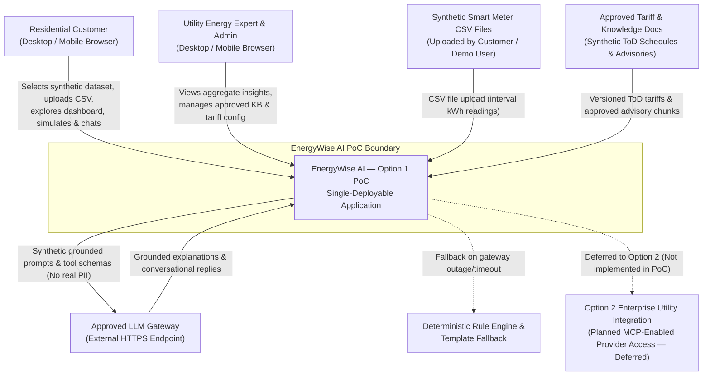
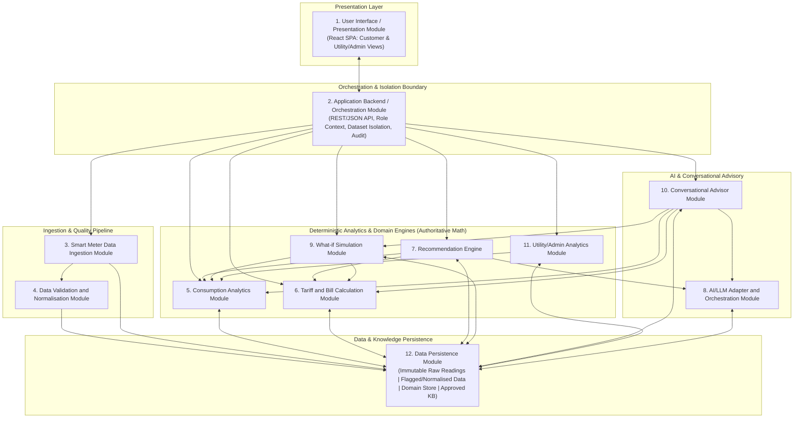
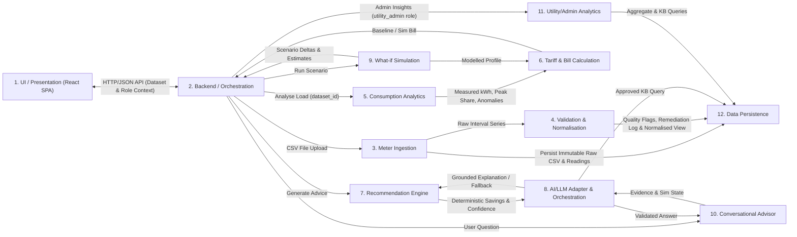
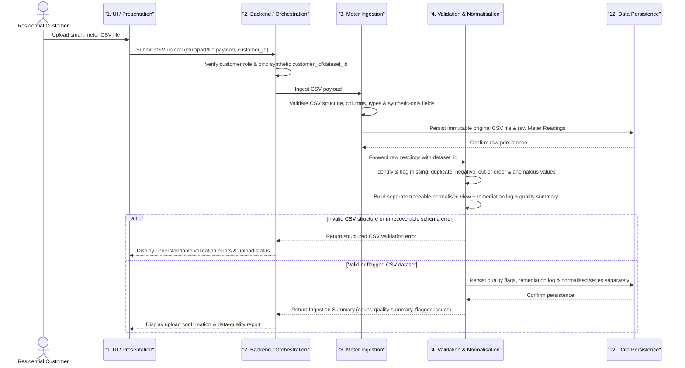
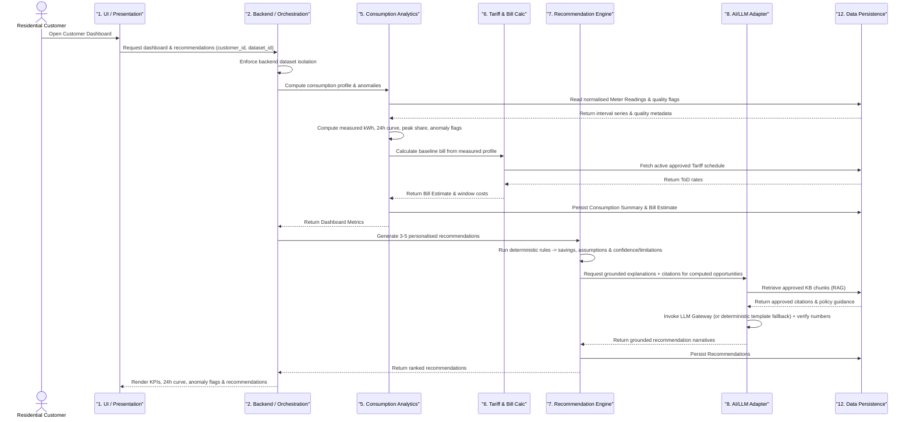
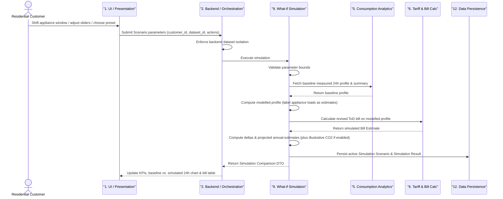
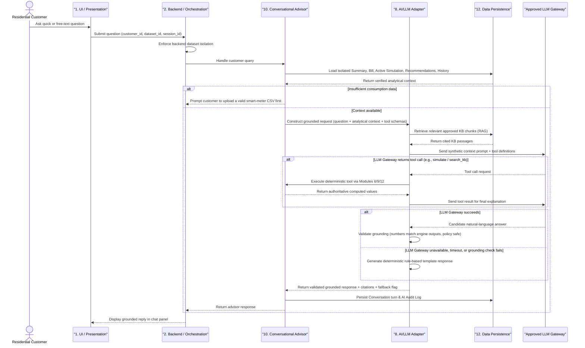
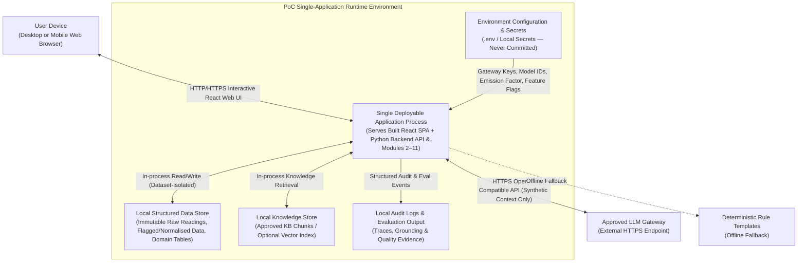
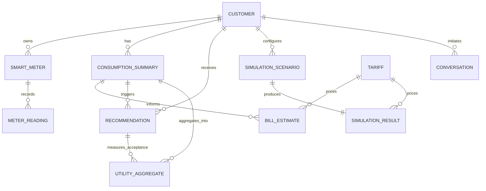

# EnergyWise AI — Detailed High-Level Design (HLD)
## Option 1: PoC Single-Application Architecture

---

## Document Control

| Attribute | Value |
| :--- | :--- |
| **Document Title** | EnergyWise AI — Detailed High-Level Design (Option 1: PoC Single-Application Architecture) |
| **Document ID** | `EW-HLD-OPT1-001` |
| **Version** | `1.3 (CSV-Only Pass 1 Ingestion; MCP Deferred to Option 2)` |
| **Date** | 2026-11-27 |
| **Author / Role** | Lead Solution Architect & Technical Design Authority (TDA) |
| **Target Audience** | Technical Design Authority, Business & Product Stakeholders, LLD & Engineering Team, Delivery & QA Leads |
| **Status** | Ready for Stakeholder Review & Sign-Off |

### Revision History

| Version | Date | Author | Summary of Changes |
| :--- | :--- | :--- | :--- |
| `0.1` | 2026-11-27 | Solution Architecture | Initial synthesis of use case, simplified requirements, tech stack draft, and UI prototype |
| `1.0` | 2026-11-27 | Lead Solution Architect / TDA | Complete Option 1 PoC HLD covering logical modules, 8 Mermaid views, E2E flows, data domains, calculation boundaries, AI guardrails, security, integrations, NFRs, deployment, RAC, ADRs, and LLD handover |
| `1.1` | 2026-11-27 | Lead Solution Architect / TDA | Updated PoC presentation stack from Streamlit to React SPA (served by the single PoC backend) across logical architecture, deployment, NFRs, risks, ADRs, LLD handover, and open decisions |
| `1.2` | 2026-11-27 | Lead Solution Architect / TDA | Remediated HLD per architecture review: simplified PoC synthetic privacy model; added backend dataset isolation; preserved raw readings with separate traceable remediation; clarified measured vs. estimated vs. modelled consumption; added recommendation/annual projection/CO₂ disclaimers; bounded PoC scalability; listed unresolved tech choices (`OD-01`–`OD-09`) |
| `1.3` | 2026-11-27 | Lead Solution Architect / TDA | **Integration Strategy Update (Part A & Part D):** Scoped Option 1 / Pass 1 ingestion strictly to **CSV file upload**; removed mock utility API from Pass 1 critical path and confirmed **no MCP client/server** in Option 1; deferred MCP-enabled utility-provider integration to **Option 2** (`EnergyWise_AI_Option2_Enterprise_Target_Architecture.md`); updated diagrams, Journey A, `M2`/`M3`/`M12`, `ADR-07`, `R-05`, traceability, and added the 15-point CSV-only Option 1 LLD Handover (Section 14) |

### Summary of Changes from v1.1 to v1.2

1. **Privacy & Data Handling Simplified (Finding A):** Removed the PoC PII identity-mapping vault/tokenisation mechanism because the PoC operates exclusively on synthetic customer and meter data. Clearly distinguished synthetic identifiers from real customer PII (deferred to target state).
2. **Backend Customer/Dataset Isolation Added (Finding B):** Defined how active synthetic customer/dataset context is passed and enforced on the backend (`M2` and `M12`) without authentication, keeping customer views isolated per dataset and logically separate from Utility/Admin views (`M11`).
3. **Smart-Meter Data Quality Refined (Finding C):** Mandated preservation of original uploaded readings, prohibited silent modification/capping/imputation in-place, required separate traceable remediation records, and deferred unconfirmed thresholds/rules to stakeholder confirmation.
4. **Measurement Clarity Strengthened (Finding D):** Explicitly separated *actual measured smart-meter consumption*, *estimated appliance-level consumption*, and *modelled/inferred consumption*.
5. **Recommendation & Projection Framing (Findings E & F):** Defined required recommendation elements (reason, data evidence, estimated savings with assumptions, confidence/limitations) and labelled annual savings as non-guaranteed projections subject to short-history limitations.
6. **CO₂ Estimates Clarified (Finding G):** Made CO₂ estimation configurable with an illustrative-only emission factor until an approved factor is supplied, and logged PoC inclusion as Open Decision `OD-06`.
7. **Scalability Claims Bounded (Finding H):** Removed claims that the PoC proves 100,000+ meter scalability; separated PoC performance expectations from future enterprise scalability objectives.
8. **Unresolved Technology Decisions Explicit (Finding I):** Marked Python backend framework (`OD-07`), database/storage technology (`OD-08`), vector-store technology (`OD-09`), and React charting library (`OD-01`) as open decisions for stakeholder/LLD resolution rather than pre-decided choices.
9. **Cross-Document Consistency & Open Decisions (Finding J & Section 3):** Aligned all 8+1 Mermaid diagrams, 12 modules, 11 data domains, 6 journeys, ADRs, and Open Decisions (`OD-01`–`OD-09`) with formal `Open` / `Proposed` statuses (none marked `Approved` without stakeholder sign-off).

### Controlling Baseline & Source Traceability

> [!NOTE]
> The workspace did not contain separate prior Solution Options (D2) or Option 1 HLD (D3) files. Accordingly, this document establishes the consolidated **Option 1 PoC HLD** aligned to the five supplied baseline artefacts and the confirmed React UI direction:
> 1. **Problem Statement / Use Case:** *AI-Driven Energy Consumption Optimization Advisor for Utilities* (Business Situation, Constraints, Data Considerations, Solution Expectations).
> 2. **Framework & Lab Governance:** *AI Friday Season 3 – Supplementary Guide* (D1–D5 structure, approved lab LLM gateway, privacy/synthetic-data rules).
> 3. **Functional & NFR Baseline:** *Simplified Requirements · EnergyWise AI v0.2* (referencing `FR-01`–`FR-17`, `NFR-01`–`NFR-12`).
> 4. **Indicative PoC Technology Stack:** *Tech Stack · EnergyWise AI Draft v0.1* (Python backend engines, approved LLM gateway, offline fallback, synthetic generator), updated per team direction to use **React** for the PoC UI, with specific backend framework/database/vector-store/charting selections tracked as explicit Open Decisions (`OD-01`, `OD-07`–`OD-09`).
> 5. **Experience Baseline:** *EnergyWise AI UI Prototype* (Customer & Utility Energy Expert/Admin personas, load curve, appliance load shifter, sliders, RAG recommendations, grounded advisor chat, tariff breakdown, DR console, KB governance).

---

## Table of Contents

1. [Architecture Objective & Scope Boundaries](#1-architecture-objective--scope-boundaries)
2. [Proposed Logical Architecture](#2-proposed-logical-architecture)
3. [Architecture Diagrams](#3-architecture-diagrams)
4. [End-to-End Business Flows](#4-end-to-end-business-flows)
5. [Data Architecture](#5-data-architecture)
6. [Business Calculation Boundaries](#6-business-calculation-boundaries)
7. [AI Design & Guardrails](#7-ai-design--guardrails)
8. [Security, Privacy and Data Quality](#8-security-privacy-and-data-quality)
9. [Integration Architecture](#9-integration-architecture)
10. [Non-Functional Design Considerations](#10-non-functional-design-considerations)
11. [Deployment Overview](#11-deployment-overview)
12. [Risks, Assumptions and Constraints](#12-risks-assumptions-and-constraints)
13. [Architecture Decisions](#13-architecture-decisions)
14. [HLD-to-LLD Handover](#14-hld-to-lld-handover)
15. [Capability Traceability & Open Decisions](#15-capability-traceability--open-decisions)

---

## 1. Architecture Objective & Scope Boundaries

### 1.1 Architecture Objective

The objective of **Option 1: PoC Single-Application Architecture** is to deliver a **lightweight, modular, single-deployable web application** that demonstrates the complete **EnergyWise AI** end-to-end business journey rapidly and safely, while establishing clean internal module boundaries so deterministic calculation engines, React UI components, and AI orchestration logic can evolve toward the future three-tier enterprise target architecture without throwaway rewrites.

The PoC application must demonstrate ten core capabilities across two primary personas (**Residential Customer** and **Utility Energy Expert / Administrator**):

1. **Smart meter data ingestion (CSV Upload — Pass 1):** Accept synthetic time-series interval kWh data strictly via **CSV file upload** through the EnergyWise AI user interface. Validate file structure, required columns, data types, and timestamps; preserve the original uploaded CSV file and raw readings; and make validated readings available to analytics, recommendations, and simulation modules. *(No MCP client/server, live utility-provider connection, real-time meter retrieval, or utility credentials are required in Option 1.)*
2. **Data validation and quality checks:** Preserve original uploaded readings, identify and flag missing, duplicate, negative, out-of-order, and anomalous readings, record any traceable remediation separately, and present a transparent data-quality summary.
3. **Consumption analysis:** Compute daily, monthly, and 24-hour load profiles from actual measured/normalised meter readings, identify baseline usage patterns, and (if included in PoC) provide plain-statistical next-month usage projections.
4. **Peak/off-peak usage analysis:** Classify consumption into Time-of-Day (ToD) tariff windows and quantify peak share.
5. **Estimated bill calculation:** Deterministically calculate baseline and simulated bills using configured ToD/slab tariffs.
6. **Consumption anomaly identification:** Flag abnormal demand spikes and elevated overnight loads on consumption visualisations.
7. **Personalised energy-saving recommendations:** Generate 3–5 tailored recommendations communicating the reason, consumption evidence, deterministic estimated savings with assumptions, confidence/limitations, approved source citation, and customer 👍/👎 feedback capture.
8. **What-if simulation:** Allow customers to test shifting declared appliances/loads between ToD windows, adjusting AC setpoint or runtime hours, reducing standby load, or applying presets, comparing baseline vs. simulated outcomes with appliance figures clearly labelled as estimates.
9. **Conversational AI advisor:** Provide quick-prompt and free-text Q&A grounded strictly in the customer's verified consumption, tariff schedule, active what-if simulation, and approved knowledge base, with deterministic rule-based fallback if AI services are unavailable.
10. **Utility/admin dashboard:** Provide a logically separated, read-only aggregate insights view (aggregate load curve, shiftable peak kWh potential, segment acceptance metrics) and governance over approved advisory documents and tariff configuration.

### 1.2 PoC Scope vs. Future Enterprise Capabilities

| Capability Area | Option 1 PoC Scope (In Scope) | Future Enterprise Target Scope (Out of PoC Scope) |
| :--- | :--- | :--- |
| **Deployment Topology** | Single-deployable application: React SPA served by a single Python backend hosting orchestration, deterministic modules, and AI adapter | Separate enterprise three-tier architecture (independently hosted React SPA, containerized API/BFF tier, dedicated data/messaging services) |
| **Customer Persona & Auth** | Synthetic residential customers selected via customer/dataset switcher; no login or authentication (`FR-15` deferred); backend enforces dataset isolation | Residential + Commercial/SME (`FR-14` demand-charge tariffs), SSO/OAuth2 authentication, explicit consent management |
| **Privacy & Data Model** | Synthetic customer and meter data only; zero real customer PII; synthetic identifiers (`customer_id`, `dataset_id`) used directly | Real customer PII isolation, dedicated tokenization/PII vault, regulated privacy & consent enforcement |
| **Meter Data Ingestion** | **CSV file upload only** in Pass 1 using an agreed synthetic sample CSV format (no MCP client/server, no live utility connection, no mock utility API in Pass 1 critical path) | Planned **MCP-enabled utility-provider integration** (utility MCP server or managed integration adapter over provider APIs), with CSV upload retained optionally as fallback/manual ingestion |
| **Appliance Disaggregation** | Customer-declared / benchmark flexible appliance profiles explicitly labelled as *estimated appliance-level consumption* (no IoT sensors) | Optional smart-plug/HEMS telemetry or NILM enrichment if approved |
| **Tariff & Knowledge Governance** | Versioned synthetic ToD tariff config & curated local KB documents with approval metadata (`NFR-12`) | Enterprise CMS/workflow approval pipeline with regulatory tariff sync |
| **Utility Operations** | Read-only aggregate demand/DR readiness insights (`FR-12`); no live grid/customer dispatch | Live Demand Response Management System (DRMS) dispatch, customer nudges, and CSR integration (`FR-17`) |
| **Persistence & Vector Store** | Lightweight single-node structured storage and optional local vector retrieval (specific technologies tracked in `OD-08`, `OD-09`) | Managed relational + time-series DB, enterprise vector DB, centralized audit/BI store |
| **AI Provider Integration** | Approved lab LLM gateway with deterministic rule fallback; no custom model training | Enterprise AI Gateway with HA routing, centralized FinOps/monitoring, and automated eval pipelines |

---

## 2. Proposed Logical Architecture

The application is structured as **twelve (12) logically separated modules** packaged within a single deployable unit (a built **React SPA** served by a single **Python backend** hosting Modules `2`–`12` in-process). Module `1` communicates with Module `2` via clean HTTP/JSON API contracts, while backend modules communicate exclusively through explicit in-process interfaces and typed DTOs, enforcing a strict **Separation of Concerns**:

- **Presentation (`M1`)** handles rendering, user interaction, and input capture only.
- **Orchestration (`M2`)** coordinates workflows, enforces backend customer/dataset isolation and role context (`customer` vs. `utility_admin`), and emits audit events.
- **Ingestion & Quality (`M3`–`M4`)** ingest synthetic/uploaded readings, preserve raw data, flag quality issues, and record traceable transformations separately.
- **Deterministic Domain & Analytics Modules (`M5`–`M7`, `M9`, `M11`)** hold **100% authority** over all quantitative metrics, quality flags, tariffs, bills, simulations, and aggregates.
- **AI & Advisory Modules (`M8`, `M10`)** handle retrieval, prompt construction, LLM gateway communication, grounding verification, and deterministic fallback—never performing unverified arithmetic.
- **Persistence (`M12`)** encapsulates structured storage for raw/remediated data, analytics, configuration, and approved knowledge retrieval.

### 2.1 Logical Module Inventory & Responsibilities

| # | Logical Module | Core Responsibilities | Primary Interactions |
| :-: | :--- | :--- | :--- |
| **1** | **User Interface / Presentation Module** | Responsive **React SPA** rendering desktop/mobile views for Customer (dashboard, 24h chart, anomaly markers, interactive what-if controls, bill breakdown, recommendations with 👍/👎, advisor chat) and Utility/Admin (aggregate insights, KB & tariff governance view). Passes active `customer_id`/`dataset_id` and `role_context` on API calls. | Calls `Application Backend / Orchestration Module` over HTTP/JSON APIs. |
| **2** | **Application Backend / Orchestration Module** | Central application coordinator and API boundary (serving the built React UI and REST/JSON endpoints in PoC). Validates `role_context` (`customer` vs. `utility_admin`), enforces **backend customer/dataset isolation** on every request, routes journeys (A–F), and emits structured audit events. | Orchestrates Modules `3`–`12`; serves `1`. |
| **3** | **Smart Meter Data Ingestion Module** | Accepts customer **CSV file uploads** through the React UI (`M1`/`M2`). Validates CSV file structure, required columns, data types, and timestamps against the agreed PoC synthetic CSV schema; rejects unexpected real-PII fields; assigns/binds synthetic `customer_id`/`dataset_id` and `meter_id`; and persists the **immutable original uploaded CSV file and raw readings** via `12` before validation. *(Implements CSV ingestion only; no MCP client/server or external utility API calls.)* | Invoked by `2`; calls `4` and `12`. |
| **4** | **Data Validation and Normalisation Module** | Inspects original readings for schema compliance, interval granularity, out-of-order timestamps, duplicates, missing intervals, negative values, and anomalous spikes. **Flags** issues without silently altering original readings; creates a **separate, traceable normalised/cleaned view** and remediation log; computes a Data Quality summary (exact rules/thresholds subject to stakeholder confirmation). | Invoked by `2`/`3`; reads raw readings and writes quality flags, remediation records & normalised view via `12`. |
| **5** | **Consumption Analytics Module** | Computes baseline metrics strictly from verified/normalised meter readings: total/daily/monthly kWh, 24-hour load profiles, Time-of-Day window totals, peak share %, anomaly markers, and optional statistical projections (clearly labelled as modelled). | Reads normalised readings & quality flags from `12`; serves `2`, `6`, `7`, `9`, `10`, `11`. |
| **6** | **Tariff and Bill Calculation Module** | Authoritative billing engine. Loads approved versioned ToD/slab tariff schedules, maps interval/window consumption to tariff rates, and computes baseline bills, simulated bills, window cost breakdowns, and financial deltas. | Reads Tariff config from `12`; called by `2`, `5`, `7`, `9`. |
| **7** | **Recommendation Engine** | Evaluates consumption metrics, data quality, anomalies, and tariff structure using deterministic rules to identify top 3–5 opportunities. Computes deterministic kWh and currency savings, records assumptions, assigns **confidence/limitations** based on data sufficiency and estimate reliance, attaches approved KB citations, delegates narrative phrasing to `8` (or templates on fallback), and records 👍/👎 feedback. | Consumes `5`, `6`; calls `8` for grounded explanation; stores recommendations & feedback via `12`. |
| **8** | **AI/LLM Adapter and Orchestration Module** | Sole gateway to approved LLM endpoints. Manages prompt assembly, tool/function definitions, RAG retrieval from approved KB, post-generation **numerical grounding & policy checks**, timeout/error handling, and automatic fallback to deterministic template explanations. | Called by `7` and `10`; retrieves KB chunks via `12`; invokes external Approved LLM Gateway. |
| **9** | **What-if Simulation Module** | Deterministic scenario engine. Validates user parameters (appliance shifts, load shifts, AC setpoint, runtime trim, standby cut, presets), applies mathematical adjustments to baseline profiles, invokes `6` for cost recalculation, computes baseline-vs-simulated deltas (and configurable illustrative CO₂ estimates if enabled), and labels appliance/annual figures as **estimates/projections**. | Invoked by `2`; uses `5` & `6`; persists scenario/results via `12`. |
| **10** | **Conversational Advisor Module** | Manages conversational session state and Q&A lifecycle. Classifies intent, fetches isolated customer context (Consumption Summary, Bill Estimate, active Simulation Result, Recommendations), executes read-only analytical tool calls, invokes `8` to produce grounded answers, handles unsupported/insufficient-data guardrails, and logs conversation turns. | Invoked by `2`; reads context from `5`, `6`, `9`, `12`; delegates LLM call/fallback to `8`. |
| **11** | **Utility/Admin Analytics Module** | Accessible only under `utility_admin` role context. Computes cross-customer aggregate insights across permitted synthetic datasets (feeder load curve, shiftable peak capacity, segment acceptance rates) and exposes governance views for approved KB advisories and tariff metadata (`NFR-12`). | Invoked by `2`; reads aggregate/config data from `12` and `5`. |
| **12** | **Data Persistence Module** | Encapsulates structured storage for synthetic profiles, **immutable raw uploaded CSV files and raw meter readings**, quality flags/remediation logs, normalised readings, summaries, tariffs, bills, recommendations, feedback, simulations, conversations, audit logs, and approved KB retrieval. Enforces dataset-scoped queries for customer operations. | Used by `2`–`11` under backend isolation rules. |

---

## 3. Architecture Diagrams

All diagrams use consistent module names from Section 2 and are syntactically validated Mermaid definitions.

### 3.1 System Context Diagram

### 3.2 Logical Application Architecture

### 3.3 Component Interactions

### 3.4 Smart Meter Data Ingestion Flow (Journey A)

### 3.5 Consumption Analytics and Recommendation Flow (Journeys B & C)

### 3.6 What-if Simulation Flow (Journey D)

### 3.7 Conversational AI Flow (Journey E)

### 3.8 Deployment Overview (PoC)

---

## 4. End-to-End Business Flows

### 4.1 Journey A — Customer Uploads Meter Data (CSV Upload)

1. **Trigger:** Customer or demo user selects a smart-meter CSV file to upload via the **Upload CSV** control in the React UI (`M1`) for the active synthetic `customer_id`. *(No MCP client/server or live utility connection is used.)*
2. **Submission & Isolation:** `M1` transmits the CSV file along with `customer_id` and `role_context=customer` to `Application Backend / Orchestration Module` (`M2`), which binds the request strictly to that `customer_id`/`dataset_id`.
3. **CSV Structure & Raw Preservation:** `Smart Meter Data Ingestion Module` (`M3`) checks file structure, required columns, data types, and timestamp format against the agreed synthetic PoC CSV schema; verifies no unexpected real customer PII fields are supplied; assigns a `dataset_id`/`meter_id`; and persists the **immutable original uploaded CSV file and raw readings** via `Data Persistence Module` (`M12`).
4. **Validation & Flagging (Non-Destructive):** `Data Validation and Normalisation Module` (`M4`) inspects the original readings to identify and flag:
   - Missing intervals / gaps.
   - Exact duplicate timestamps.
   - Negative or invalid numeric values.
   - Out-of-order timestamps.
   - Anomalous consumption spikes.
5. **Traceable Remediation & Quality Summary:** Rather than silently modifying original readings, `M4` writes a **separate normalised/cleaned series** and a **traceable remediation log** (linking each flagged/remediated record to its original raw reading ID) and computes a data-quality summary. *(Exact imputation/outlier thresholds and quality score weights require stakeholder confirmation before LLD.)*
6. **Confirmation:** `M1` displays upload status, record count, quality summary, and flagged/remediated items, then triggers Journey B to make validated readings available to analytics, recommendations, and simulation modules.
7. **Failure Handling:** Corrupt files, missing required columns, unsupported units/timestamps, or unparseable rows return understandable validation errors and clear upload status without overwriting or corrupting existing datasets.

### 4.2 Journey B — Customer Views Consumption

1. **Trigger:** Customer selects a synthetic dataset/period or completes Journey A.
2. **Backend Isolation Check:** `M2` validates `customer_id`/`dataset_id` ownership and invokes `Consumption Analytics Module` (`M5`).
3. **Analyse Measured Consumption:** `M5` loads normalised readings and quality flags from `M12` and computes metrics from **actual measured smart-meter consumption**: total kWh, daily average, 24-hour load curve, ToD window totals, peak hour share %, and anomaly markers. If statistical next-month forecasting (`FR-09`) is enabled, `M5` labels it explicitly as **modelled/projected consumption**.
4. **Calculate Metrics:** `Tariff and Bill Calculation Module` (`M6`) loads the active approved tariff schedule and deterministically calculates baseline estimated bill and cost per ToD window.
5. **Persist & Display:** `Consumption Summary` and `Bill Estimate` are persisted scoped to `dataset_id` and rendered on the dashboard (KPI cards, 24h load chart with shaded peak band and anomaly markers, data-quality indicator, and Tariff & Bill Breakdown view).

### 4.3 Journey C — Customer Receives Recommendations

1. **Trigger:** Dashboard load completes or customer requests refreshed advice.
2. **Analyse Consumption & Data Sufficiency:** `Recommendation Engine` (`M7`) reads the customer's `Consumption Summary`, quality flags, anomalies, and `Bill Estimate`.
3. **Identify Opportunity & Calculate Impact:** Deterministic rules evaluate candidate levers and invoke `M6` to calculate monthly kWh reduction, monthly financial savings, and (where applicable) **projected annual savings**—recording exact assumptions used.
4. **Assign Confidence & Limitations:** `M7` assigns a deterministic **confidence level** (e.g., `High`, `Medium`, `Low / Estimate`) and attaches explicit **limitations** when data is insufficient (e.g., short history, high flagged-gap ratio) or when savings rely on **estimated appliance-level consumption**.
5. **Generate Grounded Explanation:** `M7` passes the pre-computed opportunity objects (reason, consumption evidence, deterministic savings, assumptions, confidence/limitations) to `AI/LLM Adapter and Orchestration Module` (`M8`), which retrieves approved Knowledge Base citations and generates clear explanations (or falls back to deterministic rule templates).
6. **Display & Capture Feedback:** `M1` renders 3–5 recommendation cards clearly showing *Reason*, *Consumption Evidence*, *Estimated Savings & Assumptions*, *Confidence/Limitations*, and *Source Citation*, with 👍/👎 feedback controls persisted via `M12`.

### 4.4 Journey D — Customer Runs a What-if Scenario

1. **Trigger:** Customer shifts a declared appliance between ToD windows, adjusts controls (AC setpoint, peak runtime trim, standby reduction), or selects a preset.
2. **Validate Inputs:** `M2` enforces `dataset_id` isolation and routes to `What-if Simulation Module` (`M9`), which validates all inputs against safe domain bounds.
3. **Calculate Modelled Consumption:** `M9` clones the baseline measured 24h profile, applies deterministic adjustments, and produces a **modelled consumption profile**—explicitly tagging any appliance-level shifts as **estimated appliance-level consumption** (not measured sub-metering).
4. **Calculate Cost, Projections & Compare:** `M6` recalculates the simulated ToD bill. `M9` computes monthly deltas, **projected annual savings** (explicitly labelled as non-guaranteed projections subject to short-history/seasonal limitations), and optional configurable CO₂ estimates (if enabled per `OD-06`).
5. **Persist & Display:** Active `Simulation Scenario` and `Simulation Result` are persisted for `dataset_id` (making them available to Journey E) and rendered in `M1` alongside the baseline for comparison.

### 4.5 Journey E — Customer Uses Conversational AI

1. **Trigger:** Customer clicks a quick-question chip or submits a free-text question.
2. **Isolation & Input Check:** `M2` validates message length/safety and enforces `customer_id`/`dataset_id` isolation before invoking `Conversational Advisor Module` (`M10`).
3. **Retrieve Evidence:** `M10` loads only that customer's `Consumption Summary`, `Bill Estimate`, active `Simulation Result`, `Recommendations`, and session history. If valid consumption data is absent, `M10` returns a guided insufficient-data response.
4. **Construct Grounded Context & Invoke LLM:** `M8` retrieves approved KB passages, assembles a prompt containing the verified analytical snapshot and read-only tool schemas, and calls the Approved LLM Gateway.
5. **Tool Execution & Validation:** Any tool calls execute deterministically through `M6`/`M9`/`M12`. Before returning a reply, `M8` verifies numerical alignment with deterministic outputs (or triggers deterministic rule-based template fallback on error, timeout, or validation failure).
6. **Log & Return:** `M10` persists the conversation turn and audit record scoped to `dataset_id` and returns the cited answer to `M1`.

### 4.6 Journey F — Utility Administrator Views Aggregate Insights

1. **Trigger:** Utility Energy Expert / Administrator selects the **Utility/Admin** workspace (`role_context=utility_admin`).
2. **Role Separation & Aggregate Retrieval:** `M2` verifies `role_context=utility_admin` (logically separate from customer-scoped routes) and invokes `Utility/Admin Analytics Module` (`M11`). `M11` reads only cross-customer aggregated metrics and configuration metadata—never exposing individual customer workspaces as a customer session.
3. **Calculate Aggregate Trends:** `M11` computes synthetic fleet-level insights: active synthetic meter count, aggregated feeder 24-hour load profile, shiftable peak kWh potential, and recommendation 👍/👎 acceptance rates by segment.
4. **Display Insights & Governance:** `M1` renders the read-only **Demand & DR Console** (no live dispatch in PoC) and the **Approved KB & Tariff Governance** view (`NFR-12`).

---

## 5. Data Architecture

### 5.1 Logical Data Domains

The logical data model comprises **eleven (11) core data domains**, kept independent of physical database DDL/engines until storage technology (`OD-08`) is finalised.

| # | Logical Data Domain | Description & Key Attributes (Logical) | Owner Module | Lifecycle & Separation Notes |
| :-: | :--- | :--- | :--- | :--- |
| **1** | **Customer** | Synthetic customer profile (`customer_id`, synthetic label, customer segment, dwelling profile, declared appliance estimates). *Synthetic-only in PoC; contains zero real customer PII.* | `3` / `12` | Seeded or created on upload; used as primary backend isolation key. |
| **2** | **Smart meter** | Synthetic meter reference (`meter_id`, linked `customer_id`, `dataset_id`, interval granularity, CSV upload source metadata). | `3` | Created at seed/CSV upload. |
| **3** | **Meter reading** | **Two linked logical layers:** 1) **Raw File & Raw Reading (Immutable):** Original uploaded CSV file + raw `(reading_id, dataset_id, meter_id, timestamp, raw_kwh)`. 2) **Flagged / Normalised Reading:** `(reading_id, raw_reading_id, normalised_kwh, quality_flags, remediation_note, is_remediated)`. | `3` (Raw) / `4` (Flags & Normalised) | Original uploaded CSV and raw readings are preserved untouched; quality flags and transformations are stored separately and traceably. |
| **4** | **Consumption summary** | Aggregated metrics derived from normalised measured readings (`summary_id`, `dataset_id`, total/daily kWh, 24h profile, ToD window totals, peak share %, anomaly markers, data-quality summary, optional modelled forecast). | `5` | Recomputed when a dataset is validated; scoped strictly to `dataset_id`. |
| **5** | **Tariff** | Versioned tariff definition (`tariff_id`, plan name, ToD window boundaries, rates, currency, effective dates, `approval_status`, `approved_by`). | `6` / `11` | Seeded/configured by Utility Energy Expert; versioned for reproducibility. |
| **6** | **Bill estimate** | Deterministic cost calculation (`bill_id`, `dataset_id`, `tariff_id`, period, baseline cost, cost breakdown per ToD window). | `6` | Recomputed on consumption or tariff refresh; linked to exact tariff version. |
| **7** | **Recommendation** | Advisory record (`rec_id`, `dataset_id`, rule/opportunity type, consumption evidence, reason, deterministic monthly kWh & currency savings, projected annual estimate, assumptions, confidence/limitations, KB citation, explanation text, 👍/👎 feedback). | `7` | Generated per `dataset_id`; updated on customer feedback. |
| **8** | **Simulation scenario** | User-configured what-if inputs (`scenario_id`, `dataset_id`, baseline reference, declared appliance shifts, AC setpoint, runtime trim, standby cut %, preset). | `9` | Created/updated interactively per `dataset_id`. |
| **9** | **Simulation result** | Deterministic modelled output (`result_id`, `scenario_id`, modelled 24h profile, simulated kWh, simulated bill, peak share %, monthly & projected annual savings, optional configurable CO₂ estimate, estimate disclaimers). | `9` | Paired 1:1 with `Simulation scenario`; explicitly flagged as modelled/estimated. |
| **10** | **Conversation** | Grounded chat session & turns (`session_id`, `dataset_id`, turn index, user query, referenced `summary_id`/`scenario_id`, tool calls, grounding check status, fallback flag, assistant reply). | `10` | Scoped strictly to `dataset_id`; persisted for context and auditability. |
| **11** | **Utility aggregate** | Cross-customer analytical rollup (`cohort_segment`, active synthetic meter count, aggregated 24h load profile, shiftable peak kWh potential, recommendation 👍 acceptance rate). | `11` | Derived across synthetic datasets; accessible only under `utility_admin` role. |

### 5.2 Logical Entity Relationships

### 5.3 Consumption Measurement Distinction & Data Isolation

- **Three Consumption Categories:** All data contracts (`M5`, `M7`, `M9`, `M10`, `M1`) must distinguish:
  1. **Actual Measured Smart-Meter Consumption:** Interval kWh originating from the customer's smart-meter dataset.
  2. **Estimated Appliance-Level Consumption:** Customer-declared or benchmark appliance kWh allocations (never presented as actual sub-metered measurements).
  3. **Modelled / Inferred Consumption:** What-if simulated load profiles and optional statistical forecasts.
- **Backend Dataset Isolation:** Because there is no authentication in the PoC, `M2` and `M12` enforce isolation by requiring an explicit `customer_id` / `dataset_id` on all customer-role requests and scoping every read/write query to that single dataset.

---

## 6. Business Calculation Boundaries

**Architectural Rule (`NFR-01`):** Plain, deterministic application code in Modules `4`, `5`, `6`, `7`, and `9` is the **sole authoritative source** for all quantitative metrics. The LLM is strictly prohibited from independently computing, extrapolating, or inventing kWh, tariff bills, savings, or confidence scores.

| Calculation | Authoritative Module | Required Inputs | Assumptions, Limitations & Required Disclaimers |
| :--- | :---: | :--- | :--- |
| **kWh Aggregations & Baseline Consumption** | `5` | Normalised `Meter reading` series + quality flags | Derived from actual measured smart-meter readings; any flagged/remediated intervals are surfaced in the Data Quality summary. |
| **Peak / Off-Peak Classification** | `5` & `6` | Interval timestamps + approved `Tariff` ToD window definitions | Assumes timestamps are in local utility time; exact window boundaries come from the configured `Tariff` record. |
| **Tariff & Estimated Bill Calculation** | `6` | Windowed/hourly kWh totals + approved `Tariff` rates | Uses synthetic illustrative ToD tariff schedules; taxes/surcharges excluded unless explicitly configured. |
| **Anomaly Identification** | `5` | Measured/normalised interval series for `dataset_id` | Uses deterministic rules/thresholds (exact statistical thresholds to be confirmed with stakeholders in LLD). |
| **Scenario Consumption (What-if)** | `9` | Baseline measured 24h profile + validated scenario actions | **Appliance Estimate Disclaimer:** Individual appliance kWh figures are customer-declared or benchmark estimates—not measured sub-metering—and must be labelled as estimates. |
| **Monthly & Projected Annual Savings** | `9`, `7` & `6` | `(Baseline Bill - Simulated Bill)` for period; annualisation multiplier | **Annual Projection Disclaimer:** Annual savings are **non-guaranteed projections** extrapolated from available short-period history (e.g., 30–90 days) and do not account for unmeasured seasonal weather, tariff changes, or occupancy shifts. |
| **Carbon-Emission (CO₂) Estimates** *(Configurable / Open Decision `OD-06`)* | `9` | Simulated kWh reduction × configured grid emission factor | **If included in PoC:** Emission factor must be externally configurable (not hardcoded) and labelled as an **illustrative estimate** until an approved utility/grid factor is supplied. Inclusion in PoC is tracked in `OD-06`. |
| **Statistical Next-Month Forecast** *(PoC if time)* | `5` | Minimum historical baseline days | Modelled projection using plain statistics; suppressed with an "insufficient history" notice when history is below the stakeholder-confirmed minimum span. |

---

## 7. AI Design & Guardrails

### 7.1 Design Principles

- **No Custom Training:** Zero fine-tuning, RLHF, or custom ML forecasting/disaggregation model training in the PoC.
- **Deterministic Authority:** All numbers (savings, bills, kWh, confidence) are computed in Python (`M5`–`M9`) before or via tool calls to `M8`/`M10`.
- **Approved Gateway Only:** All external LLM calls route exclusively through the approved lab/enterprise LLM gateway.

### 7.2 Core AI Mechanisms

| Component | Design Specification |
| :--- | :--- |
| **AI Adapter (`M8`)** | Wraps an OpenAI-compatible client pointing to the approved LLM gateway, configured via `.env` (model IDs, timeouts, fallback flags). |
| **Prompt Orchestration** | Separates **System Policy** (no invented math, cite sources, label estimates/projections), **Verified Analytical Context** (JSON snapshot from `M5`/`M6`/`M9`), **Retrieved KB Passages**, and **User Query**. |
| **Context Retrieval (RAG)** | Synthetic utility documents carry version and `approval_status` metadata (`NFR-12`). Only approved documents are indexed/retrieved. *(Specific vector/retrieval technology tracked in `OD-09`.)* |
| **Grounding Verification** | Post-generation validator checks that numerical values in AI output match supplied deterministic outputs or tool results; rejects/falls back if ungrounded numbers are detected. |
| **Recommendation Explanation (`M7` + `M8`)** | Explains each recommendation using 5 required elements: (1) **Reason**, (2) **Consumption evidence**, (3) **Deterministic estimated savings & assumptions**, (4) **Confidence / limitations**, and (5) **Approved KB citation**. |
| **Conversational Q&A (`M10` + `M8`)** | Handles quick prompts and free-text questions anchored to the active `dataset_id` and active what-if scenario; invokes deterministic calculation tools rather than guessing. |

### 7.3 Guardrails, Edge Cases & Deterministic Fallback

1. **Response Constraints:** Never invent kWh, bill amounts, or savings; never present appliance estimates as measured meter data; never present short-period annual projections as guaranteed; cite approved KB sources.
2. **Unsupported Questions:** Out-of-scope queries (billing disputes, electrical wiring/safety DIY, competitor tariffs, prompt-injection attempts, cross-customer data requests) are intercepted and answered with a clear boundary message.
3. **Insufficient Data:** When a dataset has missing/unvalidated readings, short history, or no active simulation, `M10`/`M7` explicitly surface data limitations and lowered confidence rather than letting the LLM extrapolate.
4. **Deterministic Fallback:** On gateway outage, timeout, rate limit, or grounding check failure, `M8` switches seamlessly to **Rules Mode** (deterministic template text populated directly from `M5`/`M6`/`M7`/`M9` outputs). Core dashboard, bill calculation, and what-if simulation remain 100% operational (`FR-13`, `NFR-07`).

---

## 8. Security, Privacy and Data Quality

### 8.1 PoC Privacy & Customer Data Isolation Controls

| Control Area | PoC Design Implementation | Future Enterprise Evolution |
| :--- | :--- | :--- |
| **Synthetic Data & No Real PII** | PoC uses **synthetic customer and meter data only** (`customer_id`, `dataset_id`, synthetic labels). No real customer-identifiable information (names, addresses, emails, phone numbers, real utility account/meter IDs) is ingested, stored, or sent to the LLM. | Real customer onboarding introduces a dedicated PII vault, tokenization, and regulated data-retention policies. |
| **Backend Customer/Dataset Isolation** | No login/auth in PoC (`FR-15` deferred). Active customer/dataset is identified by an explicit `customer_id`/`dataset_id` context passed from the React UI. **Backend Orchestration (`M2`) and Persistence (`M12`) enforce strict per-dataset query scoping** on all customer-role endpoints so a customer view cannot access other customer datasets—isolation is not merely a UI filter. | OAuth2 / OIDC authentication, session-bound identity claims, row-level security, and consent management (`FR-15`). |
| **Customer vs. Utility/Admin Separation** | `M2` enforces `role_context` (`customer` vs. `utility_admin`). Customer routes cannot invoke `M11` aggregate/admin endpoints; Utility/Admin routes return only cross-customer aggregates and governance metadata. | Enterprise RBAC / IAM roles with separate admin portal authentication. |
| **Prompt & Conversation Protection** | Prompt-injection delimiters around user text; input length bounds; read-only tool allow-lists; rejection of unexpected PII patterns on upload/input; audit logging of AI calls (`NFR-08` if in PoC scope). | Enterprise AI firewall / DLP inspection and automated red-teaming. |
| **Secrets & Transport Security** | Gateway keys and configuration stored in `.env` (excluded from Git via `.gitignore`, template in `.env.example`). HTTPS to approved LLM gateway. | Cloud secret manager / vault, mutual TLS, encryption at rest with KMS. |

### 8.2 Smart-Meter Data Quality Management (`FR-03`, `FR-04`, `NFR-05`)

`Data Validation and Normalisation Module` (`M4`) enforces a **preserve-and-flag** policy:

- **Preserve Original File & Readings:** Original uploaded CSV files and raw meter readings are stored untouched in an immutable raw layer (`M12`).
- **No Silent Modification:** The application must **never** silently modify, floor, cap, or impute missing or invalid readings in-place.
- **Identify & Flag:** `M4` inspects raw readings and attaches explicit flags for:
  - **Missing intervals** (gaps in expected 15-min/60-min sequence).
  - **Duplicate timestamps** (identical `meter_id` + `timestamp`).
  - **Negative or non-numeric values.**
  - **Out-of-order timestamps.**
  - **Anomalous spikes / extreme outliers.**
- **Separate Traceable Remediation:** Any cleaning, deduplication, timestamp sorting, or optional gap handling is written to a **separate normalised view** alongside a **traceable remediation log** referencing the original raw reading IDs and explaining what was flagged or transformed.
- **Pending Rule Confirmation:** Specific numerical thresholds (e.g., spike detection bounds, maximum allowable gap for interpolation vs. exclusion, and exact Data Quality Score weighting formula) are **not invented in this HLD** and require stakeholder confirmation prior to LLD implementation.

---

## 9. Integration Architecture

Option 1 (Pass 1 PoC) uses **CSV file upload** as the sole smart-meter ingestion mechanism and requires **no MCP client/server, no live utility-provider connection, no real-time meter retrieval, and no utility credentials**. All external boundaries are isolated behind adapter interfaces so Option 2 can later add planned MCP-enabled utility-provider integration (see [EnergyWise_AI_Option2_Enterprise_Target_Architecture.md](file:///c:/Users/GenAIBLRANCUSR31/Documents/EnergyWise%20Ai/EnergyWise_AI_Option2_Enterprise_Target_Architecture.md)).

| Integration Point | Option 1 PoC Implementation (Pass 1) | Logical Contract (HLD) | Option 2 Target Evolution (Planned) |
| :--- | :--- | :--- | :--- |
| **Smart Meter Data Ingestion** | **CSV file upload only** via React UI (`M1` → `M2` → `M3`) using an agreed synthetic sample CSV format. *(No MCP client/server and no mock utility API in Pass 1 critical path.)* | Input: `customer_id`, uploaded CSV file stream. Output: Immutable raw CSV + canonical `(timestamp, kwh, interval_minutes)` + validation report. | **Planned MCP-enabled utility-provider integration** (utility MCP server or EnergyWise-managed adapter over provider APIs), with CSV upload retained optionally as manual/fallback ingestion. |
| **Tariff Information** | Local versioned configuration / structured table containing synthetic ToD schedules and approval metadata (`NFR-12`). | Input: `tariff_id`, effective date. Output: Ordered ToD windows, rates, currency, approval status. | Governed tariff retrieval via approved utility-provider MCP resources/tools or tariff master API. |
| **Approved LLM Provider** | OpenAI-compatible HTTP/JSON adapter (`M8`) connecting to the approved lab gateway; deterministic rule templates as offline fallback. | Input: Model ID, synthetic analytical context, tool schemas, bounds. Output: Text completion or tool-call payload + latency metadata. | Enterprise AI Gateway with HA routing and FinOps quotas. |
| **Future Utility APIs** *(Deferred)* | Excluded in Option 1 (`M11` provides read-only aggregate view without outbound dispatch). | Logical boundaries reserved for Option 2: CIS/CRM, DRMS, Consent Service. | Governed MCP / authenticated REST integrations with CRM, DRMS nudge dispatch, and CSR portals. |

---

## 10. Non-Functional Design Considerations

> [!IMPORTANT]
> PoC targets below are **proposed design assumptions** pending stakeholder/TDA sign-off. Future enterprise scalability objectives are separated from PoC expectations and are **not** validated by the PoC.

| NFR Category | PoC Expectation *(Assumption — Pending Approval)* | Architectural Enablers in Option 1 | Future Enterprise Objective *(Not Validated by PoC)* |
| :--- | :--- | :--- | :--- |
| **Responsiveness** | Interactive UI & what-if simulation recalculation **< 500 ms**; grounded AI chat response **< 5 s** (timeout fallback at ~10 s). | In-memory deterministic calculations in Python; lightweight REST/JSON calls; async/timeout guard on LLM gateway. | Sub-200 ms API P95 via pre-aggregated time-series views and streaming chat responses. |
| **PoC Performance** | Support small synthetic PoC dataset (e.g., ~100 synthetic profiles × 90 days hourly) smoothly on a single workstation/VM. | Indexed queries scoped by `dataset_id` and cached `Consumption summary` records. | N/A — PoC validates single-node synthetic workloads only. |
| **Reliability** | **100% core feature availability** (dashboard, bill calc, what-if simulator, rule-based advice) even when LLM gateway is offline. | Circuit-breaker/timeout in `M8` falling back automatically to deterministic rule templates (`FR-13`, `NFR-07`). | Multi-AZ HA deployment, managed DB failover, dead-letter queues. |
| **Maintainability** | Clean separation between React SPA (`M1`), API orchestration (`M2`), and UI-agnostic Python domain packages (`M3`–`M11`). | Domain modules have zero UI coupling and communicate via typed DTOs; React UI and Python engines carry forward into Target. | CI/CD pipelines, versioned API contracts, automated regression & LLM eval gates. |
| **Security & Isolation** | Zero real PII in PoC; backend-enforced per-dataset isolation (`M2`/`M12`); no secrets committed to Git. | Synthetic-only ingestion validation (`M3`), dataset-scoped backend queries, `.env` secret isolation. | Enterprise OIDC/SSO, dedicated PII vault, KMS encryption, WAF/DLP. |
| **Usability** | Responsive React web UI usable on desktop and mobile viewports; plain-language advice with explicit estimate/projection labels (`FR-16`, `NFR-04`). | Aligns with interactive UI prototype (baseline vs. simulated visuals, shaded peak bands, quick-question chips). | WCAG 2.1 AA compliance in production React SPA. |
| **Observability** | Structured local logs capturing ingestion quality flags, AI latency, grounding pass rate, fallback frequency, and 👍/👎 ratings. | Centralised audit emitter in `M2`/`M8` and evaluation script output. | Enterprise APM, centralized dashboards, cost & drift alerting. |
| **Future Scalability** | Architectural modularity allows extracting `M2`–`M12` into the separate three-tier enterprise target without rewriting domain logic. | Clean HTTP/JSON boundary (`M1` ↔ `M2`) and abstracted persistence interfaces (`M12`). *Note: Large-scale throughput (e.g., 100,000+ meters) is a future target objective, not a proven PoC capability.* | Horizontal API autoscaling, partitioned time-series DB, streaming ingestion, multi-tenant isolation. |

---

## 11. Deployment Overview

The PoC adopts a **platform-agnostic, single-deployable logical topology** designed to run on a lab workstation, container, or single application VM without assuming a specific cloud vendor.

- **User Interface:** Built **React SPA** static bundle served directly by the single Python application backend over HTTP/HTTPS (with optional local dev-server proxy during development).
- **Single Application Backend:** One Python runtime process hosting static UI delivery (`M1` bundle), API Orchestration (`M2`), Ingestion/Validation (`M3`–`M4`), Deterministic Engines (`M5`–`M7`, `M9`, `M11`), and AI/Advisory Modules (`M8`, `M10`).
- **Data & Knowledge Store:** Local persistence tier (`M12`) storing immutable raw readings, quality flags/remediation logs, normalised readings, domain summaries/results, and approved knowledge documents *(specific storage and vector-store technologies remain open in `OD-08` and `OD-09`)*.
- **LLM Provider Connection:** Outbound HTTPS connection from `M8` to the approved LLM Gateway using OpenAI-compatible configuration, with automatic fallback to local deterministic rule templates.
- **Configuration & Secrets:** Externalised via environment configuration (`.env`) holding gateway URLs, API credentials, model IDs, configurable emission factor (if enabled), and feature flags (never committed to source control).
- **Logging & Monitoring:** Local structured audit logs and offline evaluation outputs capturing quality flags, grounding checks, fallback events, latency, and feedback metrics.

*(Evolution Path: In the future three-tier enterprise target architecture, the React SPA can be hosted independently behind a CDN, `M2`–`M11` extracted into containerized API/worker services, and `M12` backed by enterprise relational/time-series, vector, and PII-vault services.)*

---

## 12. Risks, Assumptions and Constraints

### 12.1 Risks Register

| ID | Description | Impact | Mitigation | Owner / Decision Required |
| :--- | :--- | :--- | :--- | :--- |
| **R-01** | **LLM Numerical Hallucination:** LLM invents kWh savings, bill amounts, or unsupported tariff claims in chat/recommendations. | High — Erodes trust and violates `NFR-01`. | Restrict LLM to explanation/tool-calling only; compute all numbers deterministically in `M5`–`M9`; enforce post-generation grounding check with rule-template fallback. | AI & Architecture Lead |
| **R-02** | **LLM Gateway Outage or Latency:** Approved gateway is slow, rate-limited, or unreachable during demo/usage. | Medium — Degrades conversational experience. | Enforce strict request timeout in `M8` with automatic fallback to deterministic Rules Mode; core analytics and simulator remain 100% operational. | Engineering Lead |
| **R-03** | **Estimated / Projected Figures Misinterpreted as Measured or Guaranteed:** Users treat appliance estimates, modelled forecasts, or short-period annual projections as exact meter measurements or guaranteed savings. | Medium — Misaligned expectations. | Explicitly separate measured vs. estimated vs. modelled consumption across UI and AI responses; label annual savings as non-guaranteed projections with limitations. | Product / UX Lead |
| **R-04** | **Cross-Dataset Leakage Without Authentication:** Without login in PoC, UI-only filtering could allow accidental access to another synthetic customer's dataset or admin views. | Medium — Breaks dataset isolation. | Enforce `customer_id`/`dataset_id` scoping and `role_context` checks in Backend Orchestration (`M2`) and Persistence (`M12`). | Backend / Security Lead |
| **R-05** | **UI Prototype Alignment & React PoC Delivery Effort:** React SPA build and API integration require frontend setup within a compressed PoC window; the existing HTML prototype also displays an illustrative `MCP` badge and `Sync Meter` button that are out of scope for Option 1. | Low–Medium — Schedule risk or scope confusion if MCP/sync UI elements remain. | Scaffold React components from the prototype, **remove the `MCP` badge and live/mock utility sync from Option 1 UI** (replacing with CSV upload controls), and resolve `OD-01` early. | Delivery / UI Lead |
| **R-06** | **Unconfirmed Data Quality & Tech Choices Delaying LLD:** Unresolved rules (imputation/outlier thresholds) and unresolved stack choices (`OD-07`–`OD-09`) block LLD start. | Medium — Delays detailed design. | Track explicitly in Open Decisions Register (`OD-01`–`OD-09`) for resolution at HLD sign-off. | TDA / Delivery Lead |

### 12.2 Assumptions Register

| ID | Description | Impact | Mitigation / Validation | Owner / Decision Required |
| :--- | :--- | :--- | :--- | :--- |
| **A-01** | **Baseline Continuity:** Separate prior D2/D3 files were not in the workspace; the five supplied artefacts plus the React UI update represent the controlling baseline for Option 1 PoC. | High — Controls scope and alignment. | Confirm consolidated baseline during HLD sign-off. | TDA / Solution Architect |
| **A-02** | **PoC NFR Expectations:** Proposed latency (<500 ms sim, <5 s chat) and synthetic dataset size (~100 profiles × 90 days) are sufficient for PoC validation. | Medium — Guides LLD sizing. | Approve or adjust at HLD sign-off (`OD-05`). | TDA / QA Lead |
| **A-03** | **Synthetic Data Representativeness:** Seeded synthetic meter profiles and illustrative ToD tariffs realistically represent residential load shapes and data-quality faults. | Medium — Affects demo credibility. | Review synthetic generator parameters and fault types with domain SME. | Data / Domain Lead |
| **A-04** | **Gateway Connectivity:** Outbound HTTPS access to the approved LLM gateway with valid credentials is available in the PoC runtime environment. | Medium — Required for live LLM demo. | Verify connectivity early; keep Rules Mode fallback tested and demo-ready. | DevOps / Engineering Lead |
| **A-05** | **Data Quality Rules Confirmation:** Stakeholders will confirm acceptable spike/gap thresholds and quality-scoring criteria prior to LLD completion. | Medium — Prevents invented business rules. | Present candidate validation rules for business sign-off at LLD kickoff. | Product / Domain SME |

### 12.3 Constraints Register

| ID | Description | Impact | Mitigation / Compliance Approach | Owner / Decision Required |
| :--- | :--- | :--- | :--- | :--- |
| **C-01** | **No Custom AI Training:** Solution must not train or fine-tune custom ML/LLM models. | High — Governs forecasting, anomalies, and advice. | Use deterministic statistics, rule engines, and prompt/RAG orchestration over pre-approved models. | Architecture Lead |
| **C-02** | **Approved AI Gateway Only:** External commercial AI APIs must not be called directly outside the approved gateway. | High — Lab security constraint. | Route all external LLM/embedding requests strictly through `M8` configured to the approved gateway. | Security / Engineering Lead |
| **C-03** | **Smart-Meter CSV-Only Input:** No IoT sub-metering, home automation hardware, live utility-provider connections, or MCP integrations are permitted in Option 1 PoC. | Medium — Bounds ingestion and appliance disaggregation fidelity. | Rely strictly on uploaded synthetic smart-meter CSV files + declared/benchmark appliance estimates labelled as estimates. | Product / Architecture Lead |
| **C-04** | **Synthetic Data Only (No Real PII):** Real utility customer data and proprietary brand assets must not be used in PoC. | High — Privacy compliance. | Enforce synthetic-only datasets and reject unexpected real PII fields at `M3`. | Security / Delivery Lead |

---

## 13. Architecture Decisions

| Decision ID | Topic | Decision | Rationale | Trade-offs & Implications |
| :--- | :--- | :--- | :--- | :--- |
| **ADR-01** | **Single Deployable Application** | Build Option 1 PoC as a single deployable unit: a Python backend serving the built **React SPA** and hosting Modules `2`–`12` in-process. | Eliminates distributed service orchestration and separate frontend hosting overhead in PoC while preserving a clean HTTP/JSON UI-to-backend boundary for future three-tier evolution. | Requires a React static build served by the backend; easily decoupled in Target. |
| **ADR-02** | **Modular Internal Design (React + Python Core)** | Enforce 12 logically separated modules: **React SPA** (`M1`) over HTTP/JSON API (`M2`) + UI-agnostic Python domain packages (`M3`–`M12`). | Aligns PoC UI and Python domain engines with the target three-tier architecture, avoiding throwaway UI rewrites and enabling unit testing of domain math. | Specific backend framework, DB, vector store, and charting library remain open (`OD-01`, `OD-07`–`OD-09`) until approved. |
| **ADR-03** | **Deterministic Calculations** | Keep all kWh, ToD classification, tariff, bill, anomaly, and what-if math in plain deterministic code (`M5`, `M6`, `M7`, `M9`). | Guarantees repeatability, auditability, zero numerical hallucination, and fast simulation responsiveness. | Requires explicit formula/rule definitions in LLD rather than ML black boxes. |
| **ADR-04** | **LLM Usage Boundaries** | Use approved gateway LLMs strictly for grounded explanation, RAG synthesis, and tool-assisted chat; no custom training; deterministic fallback. | Complies with no-training constraint, prevents fabricated financial claims, and ensures graceful degradation during gateway outages. | Chat capability is bounded to supported energy advisory intents. |
| **ADR-05** | **Simplified Synthetic Privacy & Backend Isolation** | Use synthetic customer/meter data only (omitting unnecessary PoC PII vault/tokenisation) and enforce backend `customer_id`/`dataset_id` + `role_context` isolation in `M2`/`M12`. | Eliminates over-engineered PII vaulting in a synthetic PoC while still preventing cross-dataset leakage without authentication. | Real PII vaulting and OAuth2/consent (`FR-15`) must be added when onboarding real customers in Target. |
| **ADR-06** | **Preserve-and-Flag Data Quality** | Preserve original uploaded readings untouched; flag missing, duplicate, negative, out-of-order, and anomalous values; store transformations separately and traceably. | Ensures auditability and prevents silent data corruption of customer bills or analytics. | Requires separate storage/view for raw vs. normalised readings and stakeholder confirmation of exact thresholds. |
| **ADR-07** | **CSV Upload for Pass 1; MCP Deferred to Option 2** | Option 1 uses **CSV file upload only** for Pass 1 smart-meter ingestion. No MCP client/server, live utility connection, or mock utility API is implemented in Option 1; **MCP-enabled utility-provider integration is deferred to Option 2**. | Keeps Pass 1 lightweight, self-contained, and free of external utility credentials or protocol overhead while preserving a clean `M3` ingestion boundary for Option 2 evolution. | Prototype's illustrative `MCP` badge and `Sync Meter` flow must be removed from Option 1 React UI; Option 1 LLD must design CSV ingestion only. |

---

## 14. HLD-to-LLD Handover (Option 1 — CSV Ingestion Only)

> [!IMPORTANT]
> **Gating Rule:** Do **not** baseline or start Option 1 LLD implementation until this HLD is formally approved and Open Decisions (`OD-01`–`OD-09`) are resolved. The Option 1 LLD must implement **CSV ingestion only** and must **not** design MCP client/server implementations or external utility-provider API contracts.

Following HLD approval, the Option 1 LLD team must define:

1. **CSV File Format & Sample Dataset:** Agreed synthetic sample CSV schema (not an invented real utility provider format) with illustrative sample dataset(s) for PoC validation.
2. **CSV Upload User Journey:** End-to-end React UI (`M1`) upload interaction, progress/status display, understandable error presentation, and post-upload dashboard refresh.
3. **File Validation & Parsing Workflow:** File size/type checks, header/column verification, row-by-row parsing, and structured rejection rules for malformed CSV files.
4. **Required Fields & Data Types:** Exact required vs. optional CSV columns, data types, and synthetic identifier rules (`customer_id`/`meter_id`, rejecting unexpected real PII fields).
5. **Timestamp & Measurement-Unit Handling:** Accepted timestamp format/timezone conventions, interval granularity (e.g., 15-min vs. 60-min), and kWh unit expectations.
6. **Data-Quality Validation Rules & Error Handling:** Stakeholder-confirmed rules/thresholds for missing intervals, duplicates, negative values, out-of-order timestamps, outlier/spike detection, quality summary scoring, and UI simulation input bounds.
7. **Raw File & Raw Reading Preservation:** Immutable persistence of the original uploaded CSV file and raw readings (`M3`/`M12`).
8. **Validated / Normalised Data Representation:** Canonical internal representation of cleaned/normalised interval series separate from raw readings (`M4`/`M12`).
9. **Data Remediation & Validation Audit Records:** Traceable linkage between flagged/remediated records, original raw reading IDs, and remediation notes (`M4`/`M12`).
10. **Backend Module Interfaces & DTOs:** React SPA component hierarchy/state (`M1`), Python package layout, and typed DTO contracts across `M2`–`M12`.
11. **Storage & Repository Design:** Physical storage schemas and dataset-scoped repository interfaces using the approved storage/vector choices (`OD-08`, `OD-09`).
12. **API Contracts for CSV Upload & Validation Results:** REST/JSON endpoint contracts between React (`M1`) and Backend Orchestration (`M2`) for CSV upload, validation report retrieval, analytics, simulations, and chat (plus LLM tool-calling JSON schemas).
13. **Integration with Analytics & Recommendation Modules:** Handoff from validated/normalised readings (`M4`/`M12`) into `M5`, `M6`, `M7`, and `M9`, plus calculation worked examples, AI prompt/context contracts, and deterministic fallback templates.
14. **Upload Failure & Retry Behaviour:** Error taxonomy, partial/malformed file rejection, non-destructive retry behaviour, and LLM gateway timeout/fallback triggers.
15. **Security & Dataset-Isolation Controls:** Backend enforcement of `customer_id`/`dataset_id` scoping, `role_context` guards (`customer` vs. `utility_admin`), synthetic-only upload validation, and technical test scenarios.

### 14.1 Architectural Evolution Note (Coexistence with Option 2 MCP Integration)

The Option 1 CSV Ingestion Module (`M3`) is isolated behind an internal ingestion interface feeding `M4` (`Data Validation and Normalisation Module`) and `M12` (`Data Persistence Module`). In **Option 2 (Enterprise Target State)**, a separate utility-provider/MCP integration adapter can be added alongside `M3` to ingest approved utility readings into the same canonical `M4` validation and `M12` persistence pipeline—allowing manual CSV upload to coexist as a fallback/admin capability without rewriting downstream analytics, billing, simulation, or advisory modules.

---

## 15. Capability Traceability & Open Decisions

### 15.1 Business Capability & Requirements Traceability Matrix

| Business Capability / Requirement | Scope Tag | Owning Logical Modules | End-to-End Flow |
| :--- | :---: | :--- | :---: |
| Smart meter CSV file upload ingestion (`FR-01` Pass 1 scope; `FR-02` API/MCP deferred to Option 2) | **PoC** | `1`, `2`, `3`, `12` | Journey A |
| Raw reading preservation, validation flagging & traceable remediation (`FR-03`, `FR-04`, `NFR-05`) | **PoC** | `4`, `12` | Journey A |
| Synthetic-only data & backend dataset/role isolation (`NFR-02` adapted for PoC) | **PoC** | `2`, `3`, `11`, `12` | All Journeys |
| Dashboard KPIs, ToD peak analysis, 24h profile & anomalies (`FR-05`, `FR-06`) | **PoC** | `1`, `2`, `5`, `6`, `12` | Journey B |
| Deterministic recommendations with evidence, assumptions, confidence & 👍/👎 (`FR-07`, `FR-11`, `NFR-01`) | **PoC** | `1`, `5`, `6`, `7`, `8`, `12` | Journey C |
| What-if simulator with baseline comparison, estimate labels & annual projections (`FR-08`) | **PoC** | `1`, `2`, `5`, `6`, `9`, `12` | Journey D |
| Grounded conversational AI advisor (`FR-10`) | **PoC** | `1`, `2`, `6`, `8`, `9`, `10`, `12` | Journey E |
| Statistical next-month forecast (`FR-09`) | **PoC (Stretch)** | `5`, `6` | Journey B |
| Rules-based fallback on AI outage (`FR-13`, `NFR-07`) | **PoC (Core / Stretch)** | `7`, `8`, `10` | Journeys C, E |
| Utility aggregate DR insights & KB/tariff approval metadata (`FR-12`, `NFR-12`) | **PoC (Core / Stretch)** | `1`, `2`, `11`, `12` | Journey F |
| AI/tool audit logging (`NFR-08`) | **PoC (Stretch)** | `2`, `8`, `10`, `12` | Journeys C, E |
| Multi-device responsive React UI (`FR-16`, `NFR-04`) | **PoC** | `1` | All Journeys |
| Commercial/SME demand tariffs, real PII vault/auth/consent, live CRM/MDM/DR dispatch (`FR-14`, `FR-15`, `FR-17`) | **Future Target** | Target Three-Tier Architecture | Roadmap |

### 15.2 Open Decisions Register (For Stakeholder & TDA Sign-Off)

> [!NOTE]
> No open decision below is marked **Approved**; formal stakeholder/TDA sign-off is required before LLD implementation.

| Decision ID | Description / Issue | Recommendation | Impact on PoC | Approval Required From | Status |
| :--- | :--- | :--- | :--- | :--- | :---: |
| **OD-01** | **React Charting Library & Appliance Shifting UX:** React is selected for the PoC UI, but the specific React charting library (e.g., Recharts vs. Chart.js vs. Plotly.js) and whether appliance shifting uses drag-and-drop plus accessible selector controls remain undecided. | Use a lightweight React charting library and provide accessible click/selector controls alongside optional drag-and-drop matching the prototype. | Determines frontend dependencies and UI component effort in LLD. | UI Lead, Delivery Lead, TDA | **Proposed** |
| **OD-02** | **Admin Tariff Configurator Scope:** Prototype includes an interactive ToD rate editor in the Admin tab, whereas Tech Stack v0.1 proposed deferring the rate editor to the roadmap. | Show read-only approved tariff schedules and approval metadata (`NFR-12`) in PoC; defer interactive rate editing to Roadmap. | Keeps PoC Admin scope focused and avoids tariff-mutation complexity during demo. | Product Lead, Business SME, TDA | **Proposed** |
| **OD-03** | **RAG Document Corpus & Tool Contracts:** Finalise approved synthetic KB document list and confirm `search_kb` (with doc-type filter) and `shift_kwh` tool contracts. | Adopt `search_kb(doc_type)` and `shift_kwh` deterministic tool contracts over the curated synthetic KB set. | Defines AI tool schemas and RAG metadata in LLD. | AI Lead, Backend Lead, Domain SME | **Proposed** |
| **OD-04** | **Stretch PoC Prioritisation:** Confirm which `[PoC if time]` items (`FR-09` forecast, `FR-12` admin aggregate view, `FR-13` fallback, `NFR-08` audit log) are mandatory for the PoC demo vs. stretch. | Prioritise `FR-13` fallback and `FR-12` read-only aggregate view as core demo pillars; include `FR-09` and `NFR-08` if schedule permits. | Controls PoC sprint scope and demo readiness. | Delivery Lead, Product Lead | **Proposed** |
| **OD-05** | **PoC NFR Target Sign-Off:** Confirm proposed PoC latency (<500 ms sim, <5 s chat) and synthetic dataset scale (~100 profiles × 90 days) assumptions. | Approve proposed PoC targets as baseline for LLD sizing and evaluation tests. | Sets acceptance criteria for PoC performance testing. | TDA, QA Lead | **Open** |
| **OD-06** | **CO₂ Emission Estimates in PoC:** Decide whether CO₂ reduction estimates are included in PoC (`M9`) and, if so, which configurable illustrative emission factor is used. | If included, make emission factor configurable via `.env`/config and label output as illustrative until an approved grid factor is supplied; otherwise defer to Roadmap. | Affects simulation result DTOs and UI KPI sub-text. | Product Lead, Domain SME | **Open** |
| **OD-07** | **Python Backend Framework:** Select the Python web/API framework for `M2` (e.g., FastAPI vs. Flask) to serve the React bundle and REST/JSON endpoints. | Recommend **FastAPI** for typed Pydantic DTO alignment and seamless reuse in the three-tier Target architecture. | Governs backend API scaffolding, validation, and static-asset serving in LLD. | Backend Lead, TDA | **Proposed** |
| **OD-08** | **PoC Database / Storage Technology:** Select the local structured storage engine for `M12` (e.g., SQLite vs. DuckDB vs. local PostgreSQL). | Recommend **SQLite** (or local relational store abstracted behind repository interfaces in `M12`) for zero-setup PoC portability. | Determines physical schema DDL and query layer in LLD. | Backend Lead, Data Lead, TDA | **Proposed** |
| **OD-09** | **Vector-Store Technology (If Required):** Decide whether PoC RAG uses a dedicated local vector store (e.g., Chroma vs. FAISS) or lightweight metadata/keyword retrieval over the small curated KB. | Recommend lightweight local vector store (e.g., **Chroma**) only if semantic retrieval is needed beyond metadata filtering; abstract behind `M12`. | Affects PoC dependencies, indexing step, and local deployment footprint. | AI Lead, TDA | **Proposed** |
