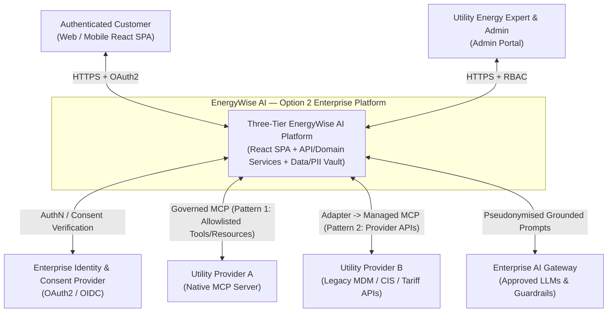
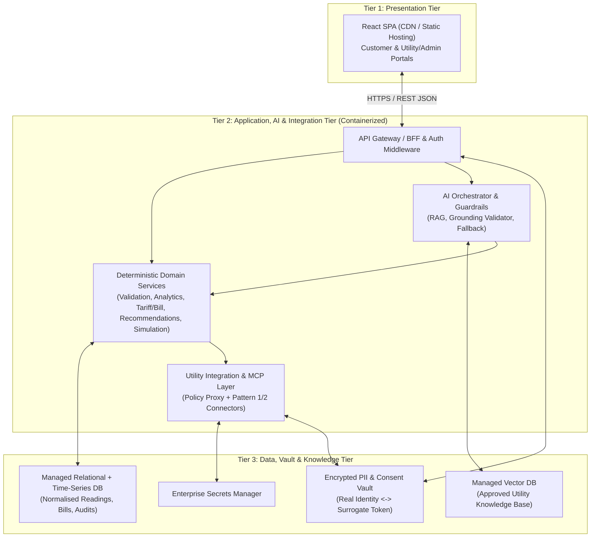
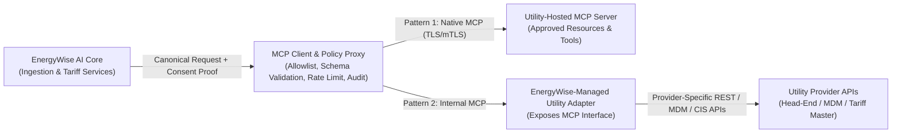
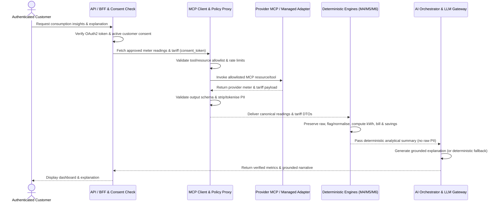
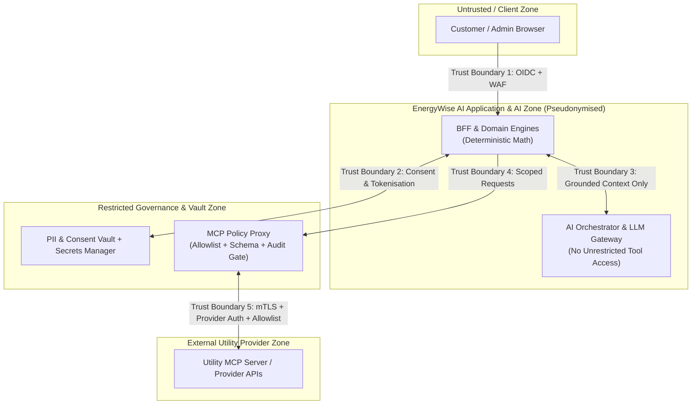

# EnergyWise AI — Option 2: Enterprise Target-State Architecture
## Planned Three-Tier Architecture & MCP-Enabled Utility-Provider Integration

---

## Document Control

| Attribute | Value |
| :--- | :--- |
| **Document Title** | EnergyWise AI — Option 2: Enterprise Target-State Architecture (Planned MCP Utility Integration) |
| **Document ID** | `EW-HLD-OPT2-001` |
| **Version** | `0.1 (Proposed Target-State Deliverable — Pending Architecture & Stakeholder Approval)` |
| **Date** | 2026-11-27 |
| **Author / Role** | Lead Solution Architect & Technical Design Authority (TDA) |
| **Status** | Draft Proposed Target-State Deliverable *(Not an approved design; not implemented in Option 1 PoC)* |
| **Companion PoC HLD** | [EnergyWise_AI_Option1_PoC_HLD_v1.2.md](file:///c:/Users/GenAIBLRANCUSR31/Documents/EnergyWise%20Ai/EnergyWise_AI_Option1_PoC_HLD_v1.2.md) (v1.3) |

> [!IMPORTANT]
> **Baseline Status Notice:** No prior Option 2 Enterprise HLD existed in the workspace. This document is authored as the required **Target-State Architecture Deliverable** defining the planned enterprise direction. All **MCP-enabled utility-provider integration** capabilities described here are **planned target-state capabilities**—they are **not** delivered in Option 1 PoC.

---

## Table of Contents

1. [Target-State Architecture Objectives](#1-target-state-architecture-objectives)
2. [Three-Tier Enterprise Target-State Architecture](#2-three-tier-enterprise-target-state-architecture)
3. [MCP-Enabled Utility-Provider Integration Architecture](#3-mcp-enabled-utility-provider-integration-architecture)
4. [Target-State Architecture Diagrams](#4-target-state-architecture-diagrams)
5. [Enterprise Security, Privacy & Governance Controls](#5-enterprise-security-privacy--governance-controls)
6. [Target-State ADRs & Assumptions](#6-target-state-adrs--assumptions)
7. [Migration & Evolution Path: Option 1 (CSV) → Option 2 (MCP)](#7-migration--evolution-path-option-1-csv--option-2-mcp)

---

## 1. Target-State Architecture Objectives

Option 2 evolves the validated Option 1 PoC (CSV-only single application) into a **three-tier enterprise platform** capable of serving residential and commercial/SME customers (`FR-14`) with authenticated consent (`FR-15`), enterprise observability, and governed utility-provider integrations.

### 1.1 Target-State Utility Integration Objectives

The target-state integration layer supports secure, governed, read/query-focused access to approved utility-provider capabilities:

1. **Smart-meter consumption and reading history:** Retrieve validated interval consumption series for consented customer meters.
2. **Meter and customer account context:** Access approved meter metadata and account/segment context, strictly subject to customer consent and authorisation.
3. **Tariff and Time-of-Day (ToD) rate information:** Retrieve authoritative utility tariff schedules, slab structures, and effective dates.
4. **Approved utility usage or service information:** Access utility demand-response programme eligibility, advisories, and service notices.
5. **Extensible approved capabilities:** Onboard additional utility capabilities only through formally approved, versioned contracts and allowlisted interfaces.

> [!NOTE]
> **Provider Heterogeneity Assumption:** Not every utility provider supports Model Context Protocol (MCP) natively or exposes identical data models and capabilities. The integration architecture must abstract provider differences behind modular adapters.

---

## 2. Three-Tier Enterprise Target-State Architecture

Option 2 decouples the Option 1 single-application modules into three independently scalable tiers while reusing the core React UI and Python deterministic engines:

1. **Presentation Tier:** Independently hosted/CDN-served **React SPA** (web & mobile responsive), authenticated via Enterprise OAuth2/OIDC (`FR-15`).
2. **Application & Integration Tier:** Containerized **Backend-for-Frontend (BFF) & Domain Services** hosting API orchestration, deterministic analytics/billing/recommendation/simulation engines, AI/LLM Gateway adapter, and the **Utility Integration & MCP Layer**.
3. **Data & Vault Tier:** Managed relational + time-series database (e.g., PostgreSQL + TimescaleDB) for consumption/domain data, a **dedicated encrypted PII & Consent Vault** (isolating real customer identities from analytics/AI), and a managed vector database for approved utility knowledge bases.

---

## 3. MCP-Enabled Utility-Provider Integration Architecture

To accommodate diverse utility IT landscapes without coupling core EnergyWise AI domain logic to provider-specific protocols, Option 2 supports **two interchangeable MCP integration patterns**:

| Pattern | When Used | How It Works |
| :--- | :--- | :--- |
| **Pattern 1: Provider-Hosted MCP Server** | Utility provider natively exposes a governed MCP server with approved resources and tools. | EnergyWise AI's **MCP Integration Client & Policy Proxy** connects over authenticated TLS/mTLS to the provider's MCP server, enforcing EnergyWise AI's tool/resource allowlists, consent tokens, and schema validation. |
| **Pattern 2: EnergyWise-Managed Integration Adapter** | Utility provider exposes traditional REST/SOAP/MDM/CIS APIs (no native MCP server). | An **EnergyWise-Managed Utility Adapter** connects to the provider's supported APIs, normalises payloads into canonical schemas, and exposes approved read-only capabilities internally via a **Managed MCP Server Interface**. |

### 3.1 Integration Component Responsibilities

| Component | Responsibility | Isolation & Boundary Rule |
| :--- | :--- | :--- |
| **Utility Integration Orchestrator** | Selects the active provider connector (Pattern 1 or Pattern 2) by `utility_provider_id` and contract version; manages consent verification before any outbound call. | Core domain engines (`Consumption Analytics`, `Tariff & Bill`, `Simulation`) never call provider APIs directly. |
| **MCP Client / Policy Proxy** | Connects to Provider MCP Server (Pattern 1) or Managed MCP Adapter (Pattern 2); enforces allowlists, rate limits, timeouts, retries, and input/output schema validation. | Blocks any unapproved MCP tools/resources; strips or tokenises PII before analytical/AI consumption. |
| **Provider-Specific Adapter** *(Pattern 2)* | Translates canonical EnergyWise requests into provider-specific MDM/CIS/Tariff API calls and maps responses back to canonical DTOs. | Isolates provider API quirks, pagination, and auth schemes from the rest of EnergyWise AI. |
| **Consent & Token Broker** | Verifies active customer consent (`FR-15`) and retrieves scoped provider credentials/tokens from the Enterprise Secrets Vault. | Rejects integration calls if consent is absent, expired, or revoked. |
| **Deterministic Domain Engines** | Receive canonical meter readings and tariff schedules from the integration layer; execute all kWh, bill, anomaly, recommendation, and simulation calculations. | **All calculations remain 100% deterministic in EnergyWise AI backend code—never delegated to LLM or external MCP tools.** |

---

## 4. Target-State Architecture Diagrams

### 4.1 Enterprise Context Diagram (Option 2 — Planned)

### 4.2 Three-Tier Target-State Architecture

### 4.3 Utility-Provider MCP Integration Architecture (Pattern 1 & Pattern 2)

### 4.4 MCP Interaction & Data-Flow Diagram

### 4.5 Security & Trust-Boundary View

---

## 5. Enterprise Security, Privacy & Governance Controls

| Control Area | Target-State Requirement |
| :--- | :--- |
| **Authentication & Authorisation** | OAuth2/OIDC for customers and utility staff; role-based access control (`customer`, `utility_expert`, `admin`) enforced at the API gateway/BFF. |
| **Customer Consent & Permissions** | Explicit, revocable customer consent scopes governing which meter IDs, reading histories, and account attributes may be retrieved from utility providers (`FR-15`). |
| **Provider Credentials & Secrets** | Utility API keys, OAuth client secrets, and mTLS certificates stored in an Enterprise Secrets Manager with automated rotation; never exposed to the React UI or LLM prompts. |
| **Secure Transport** | TLS 1.2+ (and mTLS where required by utility providers) for all external MCP and provider API traffic. |
| **Tool & Resource Allowlisting** | The MCP Policy Proxy maintains a strict, version-controlled allowlist of permitted MCP tools and resources per provider. Unlisted tools are blocked by default. |
| **Input & Output Validation** | Strict JSON-schema validation on all MCP tool arguments and provider responses; unexpected fields or oversized payloads are rejected before entering domain engines. |
| **LLM & Tool Restrictions** | **MCP tools must not receive unrestricted access** to customer or utility data. **The LLM must never independently decide to access unauthorised resources or execute unrestricted utility operations.** All calculations remain in deterministic backend code. |
| **Audit Logging & Traceability** | Immutable audit records linking `request_id`, `consent_id`, `provider_id`, `mcp_tool_name`, response status, latency, and AI grounding checks. |
| **Resilience (Rate Limits, Retries, Timeouts)** | Per-provider rate limiting, bounded exponential backoff for transient errors, strict timeouts, circuit breakers, and graceful degradation (serving cached validated readings or manual CSV fallback if a provider is unavailable). |
| **Data Minimisation & Privacy** | Request only the minimum time range and fields needed; isolate real customer PII inside the PII Vault so analytics and LLM prompts operate strictly on surrogate tokens. |
| **Versioning & Provider Contracts** | Provider connectors and MCP tool schemas are explicitly versioned so upstream utility API changes do not silently break EnergyWise AI ingestion. |

---

## 6. Target-State ADRs & Assumptions

| ID | Topic | Target-State Decision / Assumption | Rationale |
| :--- | :--- | :--- | :--- |
| **T-ADR-01** | **Dual-Pattern MCP Integration** | Support both native utility MCP servers (Pattern 1) and EnergyWise-managed adapters exposing MCP internally (Pattern 2). | Avoids assuming all utilities support MCP natively while giving EnergyWise AI one uniform integration contract. |
| **T-ADR-02** | **Policy Proxy Isolation** | Route all MCP/provider calls through a dedicated Policy Proxy enforcing allowlists, consent, and schema validation. | Prevents prompt-driven or accidental over-privileged access to utility systems. |
| **T-ADR-03** | **Deterministic Backend Authority** | Retain all tariff, bill, consumption, and savings calculations inside EnergyWise AI deterministic services. | Ensures consistent, auditable math regardless of provider data quirks or LLM behaviour. |
| **T-ASSUMP-01** | **Provider Readiness** | Assumes utility providers will supply sandbox/production API or MCP documentation, consent hooks, and credentials during enterprise onboarding. | Cannot be validated in Option 1 PoC; must be verified per utility during Phase 2 discovery. |

---

## 7. Migration & Evolution Path: Option 1 (CSV) → Option 2 (MCP)

| Evolution Step | From (Option 1 — PoC / Pass 1) | To (Option 2 — Enterprise Target) | Reused Assets |
| :--- | :--- | :--- | :--- |
| **1. Ingestion** | `M3` accepts uploaded synthetic CSV files only. | Add `Utility Integration & MCP Layer` feeding the same canonical `M4` validation & `M12` persistence pipeline; keep CSV upload as manual/fallback ingestion. | `M4` validation/flagging logic, canonical reading DTOs. |
| **2. Identity & Privacy** | Synthetic `customer_id`/`dataset_id` without login; backend dataset isolation. | Introduce OAuth2/OIDC, Consent Broker (`FR-15`), and encrypted PII Vault. | Backend `dataset_id` / `role_context` isolation pattern. |
| **3. Application & UI** | Single-deployable Python backend serving built React SPA. | Host React SPA on CDN; deploy `M2`–`M11` as containerized BFF/domain services. | React UI components and Python domain packages (`M4`–`M10`). |
| **4. Persistence** | Single-node PoC storage. | Migrate `M12` repositories to managed PostgreSQL/TimescaleDB and managed vector DB. | Repository interfaces defined in Option 1 LLD. |
