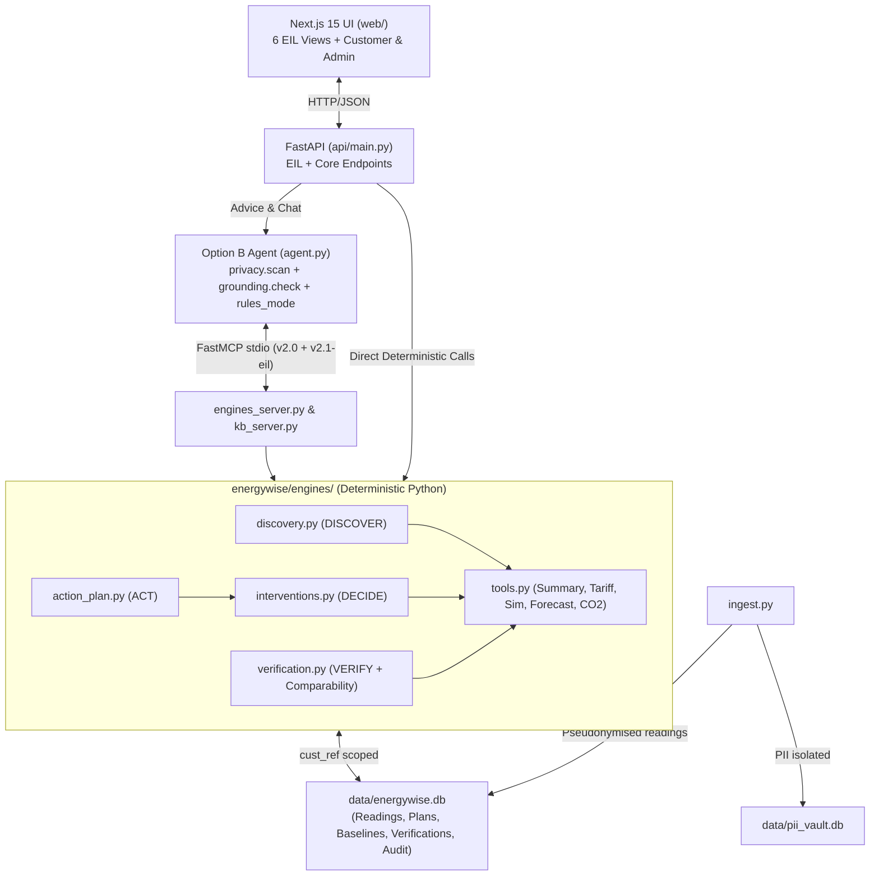
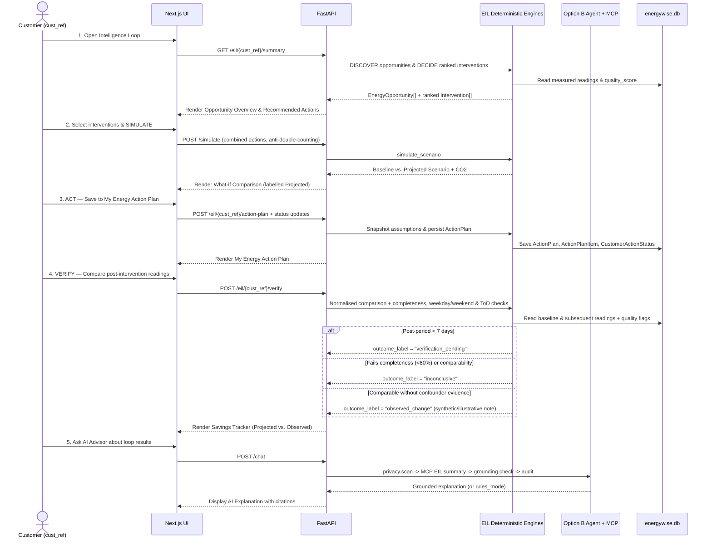

# EnergyWise AI — Option B PoC Low-Level Design (LLD)
## Enhanced with EnergyWise Intelligence Loop (EIL)

| Attribute | Value |
| :--- | :--- |
| **Document ID** | `EW-LLD-OPTB-003.1` |
| **Version** | `0.3.1 (Review Corrections Applied — Pending Final Gate Approval)` |
| **Date** | 2026-11-27 |
| **Authors** | Sandeep / Dinesh (Lead Solution Architecture & Engineering) |
| **Scope** | **Option B PoC** (Frozen Baseline `9e2c8df`) + **EnergyWise Intelligence Loop (EIL):** `DISCOVER → DECIDE → SIMULATE → ACT → VERIFY` |

> [!IMPORTANT]
> **Frozen Baseline & Review Gate Notice:** Sections `1`–`12` preserve the frozen Option B PoC baseline (`9e2c8df`, `EW-LLD-OPTB-002`). Sections `13`–`23` specify the **EnergyWise Intelligence Loop (EIL)** LLD enhancement with v0.3.1 review corrections (`EIL-OD-01`, `EIL-OD-02`, `EIL-A-01`, `EIL-AI`). **Implementation gate remains CLOSED. No code, dependencies, DB migrations, or gateway calls are authorised until v0.3.1 is explicitly approved, at which point branch `feature/energywise-intelligence-loop` will be created from `9e2c8df`.**

---

## 1. Architecture Background (Deliverable D2: Options A, B, C)

The team evaluated three architectural options for **where the intelligence sits**:

| Option | Description | Decision |
| :--- | :--- | :--- |
| **Option A: LLM-centric advisor (RAG)** | LLM reads a data summary / JSON snapshot plus retrieved tips and computes advice, savings, and what-ifs itself. | **Rejected:** Risk of invented/mis-stated ₹ and kWh figures, data leakage into prompts, and no deterministic fallback. |
| **Option B: Calculation engine + tool-calling LLM agent** | Plain Python code computes **every number**. The LLM chooses which engine tools to call (function calling via MCP), receives tool outputs, and only **explains**. A grounding checker verifies every number in the reply; falls back to rules mode on failure. | **CHOSEN** (Score: 91/100). |
| **Option C: Rules + analytics only, no GenAI** | If-then rules and templated text only. | **Rejected as main design** (does not satisfy conversational AI advice); **retained inside Option B as the fallback "rules mode"**. |

---

## 2. Settled Team Decisions (D-1 to D-11)

| # | Topic | Settled Decision |
| :--- | :--- | :--- |
| **D-1** | **Architecture** | **Option B** (deterministic engines + tool-calling LLM agent + rules-mode fallback). |
| **D-2** | **AI ↔ Engine Boundary** | **Tool calling** using frozen **tool contracts v2** (`energywise/contracts.py`). |
| **D-3** | **Tool Protocol** | **MCP is required.** Engines and knowledge base are exposed as **MCP servers** (`FastMCP`, stdio); the agent is the **MCP client** (`USE_MCP=1/0` toggle). |
| **D-4** | **Grounding** | **Every number** in an AI reply must match a number in that request's tool outputs (after rounding); mismatch triggers 1 regeneration, else rules mode. |
| **D-5** | **Privacy** | **Pseudonymise at ingestion** (`meter_id` → `cust_ref` such as `C001`). Personal fields live only in a separate **PII vault** (`data/pii_vault.db`) unreachable by AI and MCP servers. Outgoing LLM requests pass `privacy.scan()`. |
| **D-6** | **Tariff (`TAR-ILL-001`)** | **One peak window: 18:00–22:00** (`₹10.20/kWh`). Off-peak `23:00–06:00` (`₹6.00/kWh`), Standard `06:00–18:00` (`₹7.50/kWh`), Shoulder `22:00–23:00` (`₹7.50/kWh`). ToU only, no slabs, no fixed charge. |
| **D-7** | **UI & API Stack** | **Next.js 15 + Tailwind** (`web/`, port `3000`) calling **FastAPI** (`api/`, port `8000`). Engines, agent, and MCP servers in **Python**. |
| **D-8** | **Scope** | **In scope:** CO₂ estimate (`FR-18`), forecast (`FR-09`), **admin / demand-response view** (`FR-12`), approved-documents list, and audit log. |
| **D-9** | **Simulator Controls** | Appliance move (dropdown), shift % of peak to night, **AC runtime trim**, standby cut (`0–30%`), and presets. **No AC set-point control** (no cited basis). |
| **D-10** | **Models & Gateway** | LiteLLM gateway `https://genailab.tcs.in` only. Chat: `azure/genailab-maas-gpt-4.1`; fallback: `gemini-3-flash-preview`; embeddings: `azure/genailab-maas-text-embedding-3-large`. App budget cap (team quota USD 25). *(Live gateway model authorisation & `verify=False` TLS remediation remain tracked in the separate compliance audit.)* |
| **D-11** | **Knowledge Base (RAG)** | Tejus's **illustrative set 1** (6 Markdown docs in `data/kb/`) with `version`, `status`, `approved_by`, `effective_from`. Only published + approved docs are retrievable. Docs explain only; they never supply ₹/kWh savings. |

---

## 3. Component Design & Built Repository Structure (Frozen Baseline `9e2c8df`)

```text
energywise/
  config.py              # Tariff (D-6 / TAR-ILL-001), appliance estimates, model IDs, paths
  contracts.py           # Tool contracts v2 (frozen; change only by team agreement)
  data/generate.py       # Synthetic generator: 100 customers, 90 days hourly, faults injected, synthetic CIS
  ingest/ingest.py       # Clean + quality score + pseudonymise (meter_id -> cust_ref); PII vault
  engines/tools.py       # Analytics, tariff, recommendations, simulator, forecast, CO2, search_kb, REGISTRY
  mcp_servers/
    engines_server.py    # FastMCP stdio server exposing engine tools
    kb_server.py         # FastMCP stdio server exposing search_kb
    smart_meter_server.py# FastMCP stdio server exposing fetch_intervals (backend sync only)
  agent/
    agent.py             # Tool-calling agent loop (max 6 rounds) + rules mode fallback
    mcp_client.py        # MCP client connecting to FastMCP servers
    llm.py               # LiteLLM gateway client + USD budget cap enforcement
    privacy.py           # Outbound privacy.scan() PII redaction / blocking
    grounding.py         # Number-level grounding validator
api/main.py              # FastAPI REST API (port 8000)
web/app/                 # Next.js 15 + Tailwind UI (port 3000): page.tsx, components.tsx, lib.ts
data/kb/                 # 6 approved illustrative Markdown documents (Tejus set 1)
data/pii_vault.db        # Isolated PII mapping & personal fields (unreachable by AI/MCP)
data/energywise.db       # Pseudonymised readings, profiles, feedback, audit log
```

---

## 4. Upload User Journey & CSV Contract

### 4.1 Upload Journey (Port 3000 → Port 8000)
1. User selects a synthetic customer by pseudonym (`C001`…) or uploads a CSV in the **Next.js UI** (`http://localhost:3000`).
2. UI posts the file to FastAPI `POST /upload` (`http://localhost:8000`).
3. `energywise/ingest/ingest.py` cleans/validates the CSV, computes the quality score, pseudonymises `meter_id → cust_ref` (storing any personal fields only in `data/pii_vault.db`), and writes readings to `data/energywise.db`.
4. Dashboard, bill breakdown, recommendations, and simulator refresh immediately via FastAPI direct engine calls (no LLM involved).

### 4.2 CSV Contract
- **Built Loader Columns:** `meter_id, ts, kwh` plus aliases `timestamp` and `consumption_kwh`.
- **Validation (Built Today):** Gaps imputed with hour-of-day mean; spikes > 5× hourly median replaced; raw rows preserved in `raw_readings` alongside `validation_issues`.

---

## 5. Data Structures, Tool Contracts v2 & DTOs

### 5.1 Frozen Tool Contracts v2 (`energywise/contracts.py`)

| Tool | MCP Server | Input | Output (Key Fields) |
| :--- | :--- | :--- | :--- |
| `get_usage_summary` | `energywise-engines` | `cust_ref, period` | `total_kwh, est_cost_inr, peak_share_pct, baseload_kw, top_hours[], anomalies[], quality_score` |
| `get_tariff` | `energywise-engines` | `cust_ref` | `plan, peak_window, rates_inr_per_kwh` |
| `get_recommendation_candidates` | `energywise-engines` | `cust_ref` | `[{id, pattern, action, kwh_shift, kwh_saving, inr_saving, confidence}]` |
| `simulate_scenario` | `energywise-engines` | `cust_ref, actions[]` (`shift_load`, `reduce_load`, `ac_hours`, `shift_kwh`) | `baseline/scenario/delta {kwh, cost_inr, peak_kwh, co2_kg}, assumptions[]` |
| `forecast` | `energywise-engines` | `cust_ref, actions?` | `next_month_kwh, next_month_cost_inr, method, confidence` |
| `search_kb` | `energywise-kb` | `query, doc_type?` | `[{text, source, doc_type, version, effective_from}]` |
| `fetch_intervals` | `smart-meter` | `meter_ref, days` | Readings from mock smart-meter API (**backend sync only; never called by LLM**) |

---

## 6. SQLite Databases & Schema (Frozen Baseline)

1. **`data/pii_vault.db`:** `pii_customers` (`cust_ref`, `meter_id`, `name`, `email`, `phone`, `address`). Never opened by AI or MCP servers.
2. **`data/energywise.db`:** `profiles`, `raw_readings`, `validation_issues`, `readings`, `feedback`, `audit`.

---

## 7. FastAPI Endpoints (Frozen Baseline)

`GET /health`, `GET /customers`, `GET /dashboard/{cust_ref}`, `POST /simulate`, `GET /advice/{cust_ref}`, `POST /chat`, `POST /feedback`, `POST /upload`, `GET /admin/aggregates`, `GET /admin/documents`, `GET /admin/audit`.

---

## 8. Tariff, Time-of-Day Windows & Calculations (`D-6`, `D-8`, `D-9`)

- **Tariff (`TAR-ILL-001`):** Off-Peak (`23–06`): `₹6.00/kWh`, Standard (`06–18`): `₹7.50/kWh`, **Peak (`18–22`): `₹10.20/kWh`**, Shoulder (`22–23`): `₹7.50/kWh`.
- **Reconciliation Rule:** `simulate_scenario` anchors `baseline` directly to `get_usage_summary` (`total_kwh`, `est_cost_inr`) and computes `scenario = baseline + delta` so Dashboard, Simulator, Forecast, and AI Chat match to `₹0.00` discrepancy.

---

## 9. Agent Flow, MCP Orchestration & Grounding

- **Agent Loop:** `messages` → `privacy.scan()` → LLM tool calls via FastMCP (`max 6 rounds`) → `grounding.check(reply, tool_outputs)` (1 regeneration retry on mismatch, else `rules_mode`) → `audit` log.
- **Number-Level Grounding:** Extracts numbers from reply (`HH:MM` → `HH`), matches against tool output numbers after rounding (ignoring sign, list markers, user-typed numbers, and `0–5`); KB-only numbers reported separately as `from_documents`.

---

## 10. Privacy & Security Controls

- Pseudonymisation at ingestion (`meter_id → cust_ref`); isolated `data/pii_vault.db`; outbound `privacy.scan()` redacting user PII and blocking PII in system/tool/assistant messages.

---

## 11. Configuration & Run Instructions

- `.env`: `LITELLM_BASE_URL`, `LITELLM_API_KEY`, `CHAT_MODEL`, `FALLBACK_MODEL`, `EMBED_MODEL`, `USE_MCP`, `LLM_BUDGET_USD`.
- Run: `python -m energywise.data.generate` → `python -m energywise.ingest.ingest` → `uvicorn api.main:app --port 8000` → `web/`: `npm run dev`.

---

## 12. Planned Additions (From v0.1 / v0.2)

1. Flag-don't-impute policy toggle (preserve gaps un-imputed and spikes visible).
2. `sample_with_faults` one-click loader in UI.
3. Non-guaranteed annual savings label (`monthly × 12`).

---

# PART II — EnergyWise Intelligence Loop (EIL) LLD Enhancement (v0.3.1)

---

## 13. Intelligence Loop Overview & Functional Requirements

The **EnergyWise Intelligence Loop (EIL)** evolves EnergyWise AI from a point-in-time advisor into a closed-loop five-stage optimisation cycle:

```text
[1. DISCOVER] ──► [2. DECIDE] ──► [3. SIMULATE] ──► [4. ACT] ──► [5. VERIFY]
     ▲                                                                 │
     └─────────────── Feed verified outcomes & new baseline ───────────┘
```

### 13.1 EIL Functional Requirements

| Req ID | Stage | Requirement Summary & Guardrails |
| :--- | :--- | :--- |
| **EIL-01** | **DISCOVER** *(Consumption Intelligence & Opportunity Discovery)* | Analyse historical readings; identify peak-period exposure (`18:00–22:00`), unusual changes/spikes, bill drivers, flexible load-shifting potential, and standby/excessive runtime evidence; explain supporting data. **Constraint:** Never claim appliance-level measurements where only aggregate meter readings exist; distinguish inferred/estimated appliance usage from measured meter usage. |
| **EIL-02** | **DECIDE** *(Intelligent Intervention Selection)* | Generate actionable interventions from discovered opportunities; rank by estimated financial benefit, kWh reduction, ease of adoption, confidence, and evidence; consider ToD tariff windows and customer patterns; exclude incompatible/unsupported actions; attach rationale, assumptions, evidence, and limitations. **Constraint:** Deterministic backend rules validate all actions and numerical impacts; LLM only explains/supports prioritisation. |
| **EIL-03** | **SIMULATE** *(What-If Simulation & Impact Assessment)* | Simulate one or more proposed interventions; calculate baseline vs. proposed kWh, bill (`₹`), and CO₂ (`kg`); show individual and combined impacts while **preventing double-counting** (capping combined peak-window reductions to available peak load); display **projected savings** separately from **realised savings**; maintain `₹0.00` reconciliation across Dashboard, Simulator, Recommendations, and AI Chat. |
| **EIL-04** | **ACT** *(Personalised Action Plan)* | Convert selected interventions into a prioritised action plan showing action, expected benefit, priority, and suggested execution window; explain customer relevance; allow consumers to mark actions `accepted`, `declined`, or `completed` (preserving action history and simulation assumptions). **Constraint:** Zero physical device control or automatic switching. |
| **EIL-05** | **VERIFY** *(Savings Verification & Comparability)* | Compare post-intervention meter readings against a baseline period using **normalised** (daily / 30-day equivalent) metrics over comparable intervals and ToD windows. Check: (a) configurable preliminary data completeness (`>= 80%`), (b) observation duration (`7 days` = early observation only; `>= 28 days` preferred for stronger comparison), (c) **weekday/weekend coverage**, (d) **tariff/ToD window coverage**, and (e) missing intervals & comparability. Distinguish `verification_pending`, `observed_change`, `inconclusive`, and `verified_savings` (see §13.3). **Constraint:** Never automatically label a result as causal or `verified_savings` merely because a numerical threshold is met. |

### 13.2 Verification Outcome Definitions & Evidence Gates (`EIL-OD-02`)

| Outcome Status | Trigger Conditions & Required Evidence |
| :--- | :--- |
| **`verification_pending`** | Post-intervention period has `< 7 days` of observations, or post-period has not yet started/elapsed. |
| **`inconclusive`** | Post-period `>= 7 days` but fails preliminary completeness (`< 80%` configurable threshold), lacks weekday+weekend coverage, lacks comparable ToD window coverage, or uses incompatible tariff versions. |
| **`observed_change`** | Passes comparability checks (`>= 80%` completeness, weekday/weekend & ToD coverage, `>= 7 days` early observation or `>= 28 days` stronger comparison) **without** external confounder evidence (weather, occupancy, seasonal normalization). Must be labelled as an **observed change**, not proven causal savings. |
| **`verified_savings`** | **Stronger status (strictly gated):** Requires `>= 28 days` post-intervention data, `>= 80%` completeness, full weekday/weekend & ToD comparability, recorded `completed`/`accepted` action(s), **and** documented external-factor/confounder evidence ruling out non-intervention drivers. *(Note: Not claimed in synthetic PoC unless confounder evidence is explicitly supplied.)* |

### 13.3 EIL Traceability Matrix

| Req ID | Owning Backend Modules | EIL Logical Entities | API / MCP Tools (`v2.1-eil`) | UI View |
| :--- | :--- | :--- | :--- | :--- |
| **EIL-01** | `tools.py`, `discovery.py` (new) | `EnergyOpportunity`, `InterventionEvidence` | `discover_opportunities` | Opportunity Overview |
| **EIL-02** | `tools.py`, `interventions.py` (new) | `Intervention`, `InterventionEvidence` | `rank_interventions` | Recommended Actions |
| **EIL-03** | `tools.py` (`simulate_scenario`) | `SimulationScenario` | `simulate_scenario` *(existing v2.0)* | What-if Comparison |
| **EIL-04** | `action_plan.py` (new), `db` | `ActionPlan`, `ActionPlanItem`, `CustomerActionStatus` | API-only write routes + `get_intelligence_loop_summary` | My Energy Action Plan |
| **EIL-05** | `verification.py` (new), `tools.py` | `SavingsBaseline`, `VerificationPeriod`, `SavingsVerificationResult` | `get_savings_verification` | Savings Tracker |
| **All** | `agent.py`, `grounding.py`, `privacy.py` | All EIL entities (read-only context) | `get_intelligence_loop_summary` | AI Explanation |

---

## 14. EIL Architecture & Component Responsibilities

### 14.1 Reuse vs. Enhancement vs. New Modules

No microservices or external infrastructure are added; all EIL logic resides inside `energywise/` and `data/energywise.db`.

| Capability | Existing Module(s) Reused | Enhancement / New Logical Module | Responsibility |
| :--- | :--- | :--- | :--- |
| **Consumption Analytics & Anomalies** | `energywise/engines/tools.py` (`get_usage_summary`) | **Reuse + Minor Enhance** | Provide measured kWh, peak share, baseload, top hours, spike flags, and date-range slicing (`start_ts`, `end_ts`). |
| **Opportunity Discovery (`DISCOVER`)** | `tools.py` | **New:** `energywise/engines/discovery.py` | Deterministic rules emitting `EnergyOpportunity` records with `InterventionEvidence`. |
| **Intervention Ranking (`DECIDE`)** | `tools.py` (`get_recommendation_candidates`) | **New:** `energywise/engines/interventions.py` | Ranks `Intervention` candidates deterministically, filters incompatible actions. |
| **Impact & Simulation (`SIMULATE`)** | `tools.py` (`simulate_scenario`, `forecast`) | **Enhance `tools.py`** | Multi-intervention simulation with **anti-double-counting guards**. |
| **Action-Plan Management (`ACT`)** | `energywise.db` | **New:** `energywise/engines/action_plan.py` | Manages `ActionPlan`, `ActionPlanItem`, and append-only `CustomerActionStatus`. |
| **Savings Verification (`VERIFY`)** | `tools.py`, `ingest.py` | **New:** `energywise/engines/verification.py` | Locks `SavingsBaseline`, normalises periods, checks weekday/weekend/ToD/completeness comparability, and assigns `verification_pending` / `inconclusive` / `observed_change` / `verified_savings`. |
| **AI Explanation & Grounding** | `agent.py`, `grounding.py`, `privacy.py` | **Enhance `agent.py` & `engines_server.py`** | Expose 4 additive read-only EIL MCP tools (`v2.1-eil`); enforce EIL grounding & causal-claim guardrails. |
| **Persistence** | `data/energywise.db` | **Extend SQLite schema** | Add EIL tables keyed strictly by `cust_ref`. |

### 14.2 Updated Component Architecture Diagram



### 14.3 Complete 5-Stage Intelligence Loop Sequence Diagram



---

## 15. EIL Logical Data Model & Contracts

### 15.1 Logical Entities Specification

All EIL entities are keyed by `cust_ref` (`Privacy: Pseudonymised`), never store direct PII, and write audit records for state changes.

| Entity | Primary ID | Key Attributes & Association | Lifecycle / Status | Source Evidence & Versioning |
| :--- | :--- | :--- | :--- | :--- |
| **`EnergyOpportunity`** | `opp_id` | `cust_ref`, `dataset_ref`, `category`, `severity`, `detected_at`, `evidence_ids[]` | `active` → `addressed` / `dismissed` | Linked to `InterventionEvidence`; `tariff_version = TAR-ILL-001`. |
| **`Intervention`** | `int_id` | `cust_ref`, `opp_id`, `action_type`, `rank`, `est_kwh_saving`, `est_inr_saving`, `est_co2_kg`, `ease_score`, `confidence`, `assumptions[]`, `limitations` | `proposed` → `selected` / `rejected` | Backed by `InterventionEvidence`; deterministic rule version `v1`. |
| **`InterventionEvidence`** | `ev_id` | `cust_ref`, `metric_name`, `measured_value`, `period_start`, `period_end`, `quality_score`, `is_inferred` (bool) | Immutable snapshot | Traceable to `readings` window; distinguishes measured vs. inferred. |
| **`SimulationScenario`** | `sim_id` | `cust_ref`, `actions[]`, `baseline_snapshot`, `projected_snapshot`, `delta`, `anti_double_count_notes[]`, `created_at` | `draft` → `locked_in_plan` | Snapshot of `TAR-ILL-001` & `CO2_KG_PER_KWH`. |
| **`ActionPlan`** | `plan_id` | `cust_ref`, `sim_id`, `title`, `created_at`, `updated_at`, `total_projected_inr`, `total_projected_kwh` | `active` → `completed` / `archived` | Preserves simulation assumptions at plan creation. |
| **`ActionPlanItem`** | `item_id` | `plan_id`, `int_id`, `priority`, `execution_window`, `relevance_reason`, `expected_inr_saving` | `pending` / `accepted` / `declined` / `completed` | Inherits `InterventionEvidence` & assumptions. |
| **`CustomerActionStatus`** | `status_id` | `item_id`, `cust_ref`, `status` (`accepted`/`declined`/`completed`), `recorded_at`, `note` | Append-only history | Audited status transitions. |
| **`SavingsBaseline`** | `baseline_id` | `cust_ref`, `plan_id`, `period_start`, `period_end`, `day_count`, `daily_avg_kwh`, `daily_avg_cost_inr`, `peak_share_pct`, `weekday_days`, `weekend_days`, `quality_score`, `tariff_version` | `locked` | Immutable normalised baseline reference. |
| **`VerificationPeriod`** | `ver_period_id` | `cust_ref`, `baseline_id`, `period_start`, `period_end`, `day_count`, `completeness_pct`, `weekday_days`, `weekend_days`, `tod_windows_covered`, `quality_score` | `pending_data` → `ready` | Raw readings preserved; missing intervals flagged (not imputed). |
| **`SavingsVerificationResult`** | `ver_id` | `cust_ref`, `baseline_id`, `ver_period_id`, `comparison_basis` (`normalised_30d_rate`), `projected_daily_kwh_delta`, `observed_daily_kwh_delta`, `projected_30d_inr_delta`, `observed_30d_inr_delta`, `outcome_label` (`verification_pending` / `inconclusive` / `observed_change` / `verified_savings`), `observation_tier` (`early_7d` / `strong_28d`), `comparability_checks`, `confounding_factors[]`, `limitations` | `computed` (immutable per period) | Enforces comparability & confounder gates; never auto-claims causality. |

### 15.2 Example Request / Response Contracts

**Action Plan Creation (`POST /eil/{cust_ref}/action-plan`):**
```json
{
  "cust_ref": "C001",
  "intervention_ids": ["INT-SHIFT-PEAK", "INT-AC-TRIM"],
  "actions": [{"type": "shift_load", "pct": 20}, {"type": "ac_hours", "hours": 1.0}]
}
```
Response:
```json
{
  "plan_id": "PLN-C001-01",
  "status": "active",
  "total_projected_inr_saving": 507.66,
  "projection_label": "Projected (not yet verified)",
  "items": [
    {"item_id": "ITM-01", "priority": 1, "status": "pending", "execution_window": "Shift 18:00-22:00 -> 23:00-06:00"}
  ]
}
```

**Normalised Savings Verification (`POST /eil/{cust_ref}/verify`):**
```json
{
  "cust_ref": "C001",
  "baseline_id": "BAS-C001-01",
  "post_start": "2026-09-30T00:00:00+05:30",
  "post_end": "2026-10-29T23:00:00+05:30"
}
```
Response (normalised 30-day comparison for 60d baseline vs. 30d post-period):
```json
{
  "ver_id": "VER-C001-01",
  "contracts_version": "2.1-eil",
  "comparison_basis": "normalised_30d_equivalent",
  "observation_tier": "strong_28d",
  "outcome_label": "observed_change",
  "is_synthetic_demo": true,
  "projected_30d_inr_delta": -507.66,
  "observed_30d_inr_delta": -412.40,
  "comparability_checks": {
    "completeness_pct": 99.7,
    "preliminary_threshold_pct": 80.0,
    "weekday_coverage_ok": true,
    "weekend_coverage_ok": true,
    "tod_windows_covered": 4,
    "tariff_consistent": true
  },
  "limitations": "Synthetic verification demonstration showing observed changes in illustrative data. Weather, occupancy, and seasonal factors are unavailable; not proven causal savings."
}
```

---

## 16. EIL API & MCP Tool Design (`EIL-OD-01`)

### 16.1 Additive Contract Versioning & Compatibility Impact

- **Contract Version:** Frozen D-2 contracts remain **`v2.0`** unchanged (`get_usage_summary`, `get_tariff`, `get_recommendation_candidates`, `simulate_scenario`, `forecast`, `search_kb`, `fetch_intervals`).
- **Additive Extension (`v2.1-eil`):** Adds **4 read-only, deterministic, side-effect-free MCP tools** to `engines_server.py` (`energywise/contracts.py` extension).
- **Compatibility Impact:** **Zero breaking changes.** Existing v2.0 callers, DTOs, and `test_option_b.py` tests remain 100% compatible. Regression tests for all 7 existing MCP tools are mandatory before merging Phase 1.

| Operation | FastAPI Endpoint | Internal MCP Tool (`v2.1-eil`, Read-Only) | Validation, Isolation & Audit |
| :--- | :--- | :--- | :--- |
| **Discover Opportunities** | `GET /eil/{cust_ref}/opportunities` | `discover_opportunities(cust_ref, period)` | Requires ≥ 7 days valid readings; scoped to `cust_ref`; deterministic & side-effect-free. |
| **Rank Interventions** | `GET /eil/{cust_ref}/interventions` | `rank_interventions(cust_ref)` | Filters incompatible actions; scoped to `cust_ref`; deterministic. |
| **Simulate Combined** | `POST /simulate` *(existing)* | `simulate_scenario` *(existing v2.0)* | Caps combined peak shifts to prevent double-counting; scoped to `cust_ref`. |
| **Create/Update Action Plan** | `POST /eil/{cust_ref}/action-plan` | *(API-only — LLM cannot mutate plans)* | Validates `int_id` belongs to `cust_ref`; audited. |
| **Record Action Status** | `PATCH /eil/{cust_ref}/action-plan/{item_id}` | *(API-only)* | Enum `accepted`/`declined`/`completed`; `404` on cross-customer access; audited. |
| **Establish Baseline** | `POST /eil/{cust_ref}/baseline` | *(API-only)* | Requires ≥ 14 days & `quality_score >= 70`; `422` otherwise; scoped to `cust_ref`. |
| **Verify Savings** | `POST /eil/{cust_ref}/verify` | `get_savings_verification(cust_ref, plan_id)` | Normalises periods; checks completeness (`80%`), duration (`7d`/`28d`), weekday/weekend & ToD coverage; scoped to `cust_ref`; audited. |
| **EIL Summary** | `GET /eil/{cust_ref}/summary` | `get_intelligence_loop_summary(cust_ref)` | Aggregates all 5 stages; omits unstarted stages cleanly; scoped to `cust_ref`. |

---

## 17. EIL AI Agent & Grounding Design

- **Agent Capabilities:** Explains discovered opportunities, intervention rankings, comparisons, simulation deltas, action-plan progress, projected vs. observed savings, and why a verification result is `verification_pending`, `inconclusive`, or `observed_change`.
- **Strict EIL Grounding & Guardrails:**
  - `grounding.check()` verifies every number against tool outputs (with 1 retry, else `rules_mode`).
  - System rules forbid: inventing measured kWh, presenting `projected` or `observed_change` as `verified_savings` / causal proof, presenting `< 80%` completeness or `< 28d` early observations as conclusive, or leaking PII (`privacy.scan()`).

---

## 18. EIL User Experience & Presentation Design

### 18.1 Six Logical Views in Next.js (`web/app/`)

```text
+-----------------------------------------------------------------------------+
| EnergyWise AI [C001 v]   [Dashboard] [Intelligence Loop] [Admin & Audit]    |
| Banner (Synthetic Demo): Illustrative synthetic meter data; no real customer|
+-----------------------------------------------------------------------------+
| EIL Stage Bar: [1.Discover] -> [2.Decide] -> [3.Simulate] -> [4.Act] -> [5.Verify] |
+------------------------------------+----------------------------------------+
| LEFT: Stage Workspace              | RIGHT: AI Explanation (Grounded Chat)  |
| - 1. Opportunity Overview          | - "Why is Peak 35% my top driver?"     |
| - 2. Recommended Actions (Ranked)  | - "Compare Shifting vs. AC Trim"       |
| - 3. What-if Comparison (Projected)| - "Why is my verification labelled     |
| - 4. My Energy Action Plan         |    Observed Change?"                   |
| - 5. Savings Tracker (Normalised   | [Rules Mode / Grounded Badge]          |
|      Projected vs. Observed)       |                                        |
+------------------------------------+----------------------------------------+
```

### 18.2 Mandatory Visual Badge Distinction
- `MEASURED` (Slate/Blue): Smart-meter interval readings.
- `ESTIMATED` (Amber): Inferred/declared appliance loads.
- `PROJECTED (SIMULATED)` (Teal): What-if simulation savings.
- `OBSERVED CHANGE (SYNTHETIC DEMO)` (Indigo): Normalised post-period comparison without confounder proof.
- `INCONCLUSIVE` / `VERIFICATION PENDING` (Gray/Amber): Insufficient or incomparable data.
- `VERIFIED SAVINGS` (Emerald): Strictly reserved for `>= 28d` comparable data + documented confounder evidence.

---

## 19. EIL Non-Functional Requirements

| Category | Requirement & Acceptance Criterion |
| :--- | :--- |
| **Accuracy & Reproducibility** | Identical inputs produce identical opportunity scores, rankings, normalised verification deltas, and `₹0.00` reconciliation across views. |
| **Comparability & Incomplete Periods** | Verification checks completeness (`>= 80%` configurable), duration (`7d` early vs. `>= 28d` strong), weekday/weekend coverage, and ToD coverage; raw readings never silently altered. |
| **Performance** | Deterministic EIL endpoints respond in `< 300 ms` for 90-day hourly customer datasets. |
| **Privacy & Isolation** | All EIL tables and MCP tools enforce `cust_ref` isolation; cross-customer queries return `404`; `pii_vault.db` untouched. |
| **Auditability** | Action-plan changes, baseline locks, verification runs, and AI explanations are logged with timestamps and grounding status. |
| **Reliability & Grounding** | `rules_mode` supports all 5 EIL stages if gateway is offline; `grounding.check()` blocks ungrounded figures. |

---

## 20. EIL Acceptance Test Scenarios (15 Scenarios)

| # | Scenario | Expected Outcome | Req Trace |
| :-: | :--- | :--- | :---: |
| **1** | Detect peak-period opportunity (`C001`, 35% peak) | Emits `EnergyOpportunity` (`peak_exposure`) with `35.0%` & `167.22 kWh` evidence. | `EIL-01` |
| **2** | Generate tariff-aware intervention | Recommends shifting load from `18:00–22:00` (`₹10.20`) to `23:00–06:00` (`₹6.00`). | `EIL-02` |
| **3** | Compare two alternative interventions | Ranks Peak Shift vs. AC Trim with individual ₹/kWh/CO₂, ease, and confidence. | `EIL-02` |
| **4** | Combined savings without double-counting | Combined `shift_load` + `ac_hours` caps peak reduction to available peak load; `delta <= peak_kwh`. | `EIL-03` |
| **5** | Create an action plan | Persists `ActionPlan` + `ActionPlanItem[]` with locked simulation assumptions and `Projected` label. | `EIL-04` |
| **6** | Record `accepted`, `declined`, `completed` | `CustomerActionStatus` appends each transition; declined items excluded from attribution. | `EIL-04` |
| **7** | Normalised 60d vs. 30d synthetic demo (`C001` Days 1–60 vs. 61–90) | Compares normalised daily/30d rates (not raw 60d vs 30d totals), verifies weekday/weekend & ToD coverage, labels `observed_change` + synthetic disclaimer. | `EIL-05`, `EIL-A-01` |
| **8** | Incomplete or incomparable readings | Period with `< 80%` completeness or missing weekend coverage returns `inconclusive`; no silent imputation. | `EIL-05`, `EIL-OD-02` |
| **9** | Distinguish projected vs. observed savings | UI & API return separate `projected_30d_inr_delta` and `observed_30d_inr_delta` fields. | `EIL-03`, `EIL-05` |
| **10** | Reject unsupported causal savings claims | Without weather/occupancy data, `outcome_label = "observed_change"` (never `"verified_savings"`). | `EIL-05`, `EIL-OD-02` |
| **11** | Early 7-day vs. strong 28-day observation | 7–27 day comparable period tagged `observation_tier = "early_7d"`; `>= 28d` tagged `"strong_28d"`. | `EIL-05`, `EIL-OD-02` |
| **12** | Verify numerical grounding in AI explanations | `grounding.check()` passes `grounded=True` on EIL chat replies; ungrounded numbers trigger retry/fallback. | `EIL-01`–`EIL-05` |
| **13** | Customer isolation & PII protection | `C002` cannot read `C001`'s action plan or verification; `privacy.scan()` blocks PII. | `D-5`, `EIL-OD-01` |
| **14** | Missing post-intervention data | `POST /eil/C001/verify` with `< 7` post-period days returns `outcome_label = "verification_pending"`. | `EIL-05` |
| **15** | Existing MCP v2.0 regression suite | All 7 existing v2.0 MCP tools & `tests/test_option_b.py` pass unchanged after `v2.1-eil` addition. | `EIL-OD-01` |

---

## 21. Phased Implementation Plan & Effort Estimates

| Phase | Features Included | Est. Effort |
| :--- | :--- | :---: |
| **Existing & Reusable (Frozen `9e2c8df`)** | `get_usage_summary`, `get_tariff`, `simulate_scenario`, `forecast`, `search_kb`, `privacy.scan()`, `grounding.check()`, `rules_mode`, SQLite + PII vault, Next.js UI. | `0 days` *(Built)* |
| **Phase 1 — Intelligence & Action** | `discovery.py` (`EIL-01`), `interventions.py` (`EIL-02`), anti-double-counting guard (`EIL-03`), `action_plan.py` (`EIL-04`), EIL UI views 1–4 + AI explanation + v2.0 regression tests. | `~2–3 dev days` |
| **Phase 2 — Savings Verification** | `verification.py` (`EIL-05`), normalised period comparison, weekday/weekend/ToD comparability checks, `C001` synthetic Days 1–60 vs. 61–90 demo, Savings Tracker UI view 5. | `~2 dev days` |
| **Phase 3 — Advanced Intelligence** *(Post-PoC)* | Weather/temperature normalization, occupancy/calendar context, ML anomaly diagnosis, utility-wide DR optimization. | `Future Roadmap` |

---

## 22. Open Decisions, Assumptions, Risks & Dependencies

| ID | Type | Description | Status |
| :--- | :---: | :--- | :---: |
| **EIL-OD-01** | Open Decision | Extend `contracts.py` (`v2.1-eil`) with 4 additive read-only MCP tools + versioning + v2.0 regression tests. | **Revised (Pending Final Gate Approval)** |
| **EIL-OD-02** | Open Decision | Configurable `80%` preliminary completeness; `7d` early observation vs. `>= 28d` stronger comparison; weekday/weekend/ToD checks; separate `verified_savings` gate. | **Revised (Pending Final Gate Approval)** |
| **EIL-A-01** | Assumption | `C001` Days 1–60 (baseline) vs. Days 61–90 (illustrative post-period) normalised synthetic verification demo with explicit synthetic/non-causal labelling. | **Revised (Pending Final Gate Approval)** |
| **EIL-AI** | Compliance | EIL adds no external service/model; live LLM gateway authorisation and `verify=False` TLS remediation tracked in separate audit. | **Tracked in Separate Audit** |
| **EIL-R-01** | Risk | Users misinterpret `observed_change` as guaranteed causal savings. **Mitigation:** Mandatory UI badges + non-causal disclaimers. | **Active** |

---

## 23. Backward-Compatibility Assessment & Mandatory Review Gate

- **Backward Compatibility:** 100% backward-compatible with frozen Option B baseline (`9e2c8df`). Existing endpoints and `contracts.py` v2.0 tools remain unchanged; EIL adds additive tables, `/eil/*` routes, and `v2.1-eil` read-only MCP tools.
- **Mandatory Review Gate:** Implementation remains **CLOSED** until `EW-LLD-OPTB-003.1` (`v0.3.1`) is explicitly approved. Upon approval, create branch `feature/energywise-intelligence-loop` from frozen commit `9e2c8df` without modifying `9e2c8df`.
