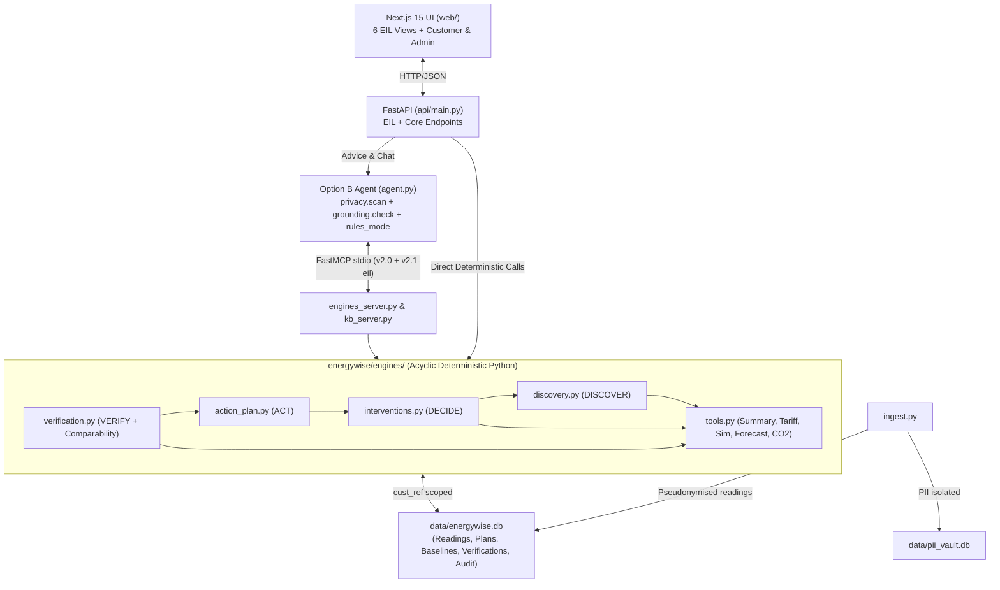
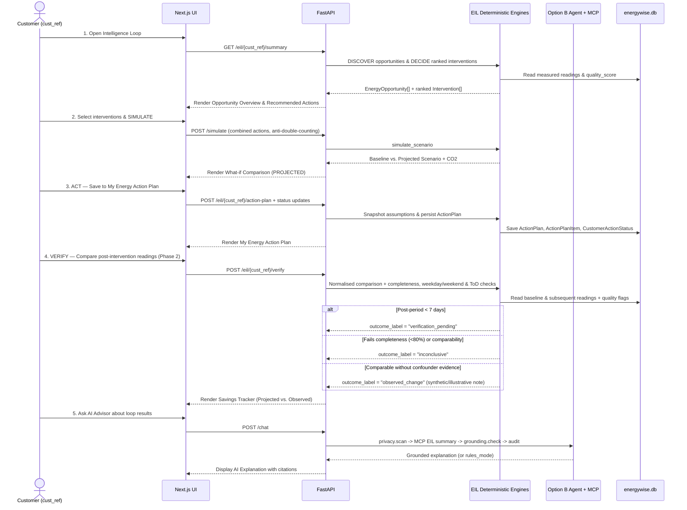

# EnergyWise AI — Option B PoC Low-Level Design (LLD)
## Enhanced with EnergyWise Intelligence Loop (EIL)

| Attribute | Value |
| :--- | :--- |
| **Document ID** | `EW-LLD-OPTB-003.2` |
| **Version** | `0.3.2 (Final Technical Review Corrections — Ready for Approval Gate)` |
| **Date** | 2026-11-27 |
| **Authors** | Sandeep / Dinesh (Lead Solution Architecture & Engineering) |
| **Scope** | **Option B PoC** (Frozen Baseline `9e2c8df`) + **EnergyWise Intelligence Loop (EIL):** `DISCOVER → DECIDE → SIMULATE → ACT → VERIFY` |

> [!IMPORTANT]
> **Frozen Baseline & Review Gate Notice:** Sections `1`–`12` preserve the frozen Option B PoC baseline (`9e2c8df`, `EW-LLD-OPTB-002`). Sections `13`–`23` specify the **EnergyWise Intelligence Loop (EIL)** LLD enhancement with final technical review corrections (`F-01`–`F-07`). **Implementation gate remains CLOSED. No code, dependencies, DB migrations, or gateway calls are authorised until v0.3.2 is explicitly approved, at which point branch `feature/energywise-intelligence-loop` will be created from `9e2c8df`.**

### Concise Change Log (v0.3.1 → v0.3.2)

1. **`F-01` (End-to-End Entity Linkage & Abandoned Workflows):** Added explicit foreign keys (`SimulationScenario.int_ids[]`, `SavingsVerificationResult.plan_id`, `SavingsVerificationResult.attributed_item_ids[]`), state-transition rules, and handling for ephemeral simulations and declined/unstarted action plans (§15.1–§15.2).
2. **`F-02` (Causal Verification Scope):** Explicitly deferred causal `verified_savings` to **Phase 3** (since Phase 2 PoC lacks weather, occupancy, and control-group data) and added a 12-factor verification & attribution assessment table (§13.2).
3. **`F-03` (Calculation Formulas, Anti-Double-Counting & Worked Examples):** Added exact formulas for peak-shifting vs. load-reduction, sequential anti-double-counting capping, and worked numerical examples for `C001` simulation (`-36.0 kWh`, `-₹507.66`, `-29.52 kg CO₂`) and normalised 60d vs. 30d verification (§16.2).
4. **`F-04` (Contract & Field Alignment):** Standardised `period_start`/`period_end`, ISO 8601 + timezone, `INR`/`kWh`/`kg` units, sign conventions (`saving` = positive reduction, `delta` = `scenario - baseline`), and `400`/`404`/`422` error responses (§15.2, §16.1).
5. **`F-05` (Module DAG & No Circular Dependencies):** Defined strict one-way dependency DAG so `tools.py` never imports EIL modules (§14.1).
6. **`F-06` (Retention, Deletion & Consent Controls):** Added PoC reset/retention rules, explicit user-triggered action-plan updates, and kept separate AI Friday audit findings visible (§19).
7. **`F-07` (Phase 1 Standalone Demo Readiness):** Clarified that Phase 1 (`DISCOVER → DECIDE → SIMULATE → ACT`) is a complete, compelling standalone competition demo (§21).

---

## 1. Architecture Background (Deliverable D2: Options A, B, C)

| Option | Description | Decision |
| :--- | :--- | :--- |
| **Option A: LLM-centric advisor (RAG)** | LLM reads a data summary / JSON snapshot plus retrieved tips and computes advice, savings, and what-ifs itself. | **Rejected:** Risk of invented/mis-stated ₹ and kWh figures, data leakage into prompts, and no deterministic fallback. |
| **Option B: Calculation engine + tool-calling LLM agent** | Plain Python code computes **every number**. The LLM chooses which engine tools to call (function calling via MCP), receives tool outputs, and only **explains**. A grounding checker verifies every number in the reply; falls back to rules mode on failure. | **CHOSEN** (Score: 91/100). |
| **Option C: Rules + analytics only, no GenAI** | If-then rules and templated text only. | **Rejected as main design** (does not satisfy conversational AI advice); **retained inside Option B as the fallback "rules mode"**. |

---

## 2. Settled Team Decisions (D-1 to D-11)

| # | Topic | Settled Decision |
| :--- | :--- | :--- |
| **D-1** | **Architecture** | **Option B** (deterministic engines + tool-calling LLM agent + rules-mode fallback). |
| **D-2** | **AI ↔ Engine Boundary** | **Tool calling** using frozen **tool contracts v2** (`energywise/contracts.py`). |
| **D-3** | **Tool Protocol** | **MCP is required.** Engines and knowledge base are exposed as **MCP servers** (`FastMCP`, stdio); the agent is the **MCP client** (`USE_MCP=1/0` toggle). |
| **D-4** | **Grounding** | **Every number** in an AI reply must match a number in that request's tool outputs (after rounding); mismatch triggers 1 regeneration, else rules mode. |
| **D-5** | **Privacy** | **Pseudonymise at ingestion** (`meter_id` → `cust_ref` such as `C001`). Personal fields live only in a separate **PII vault** (`data/pii_vault.db`) unreachable by AI and MCP servers. Outgoing LLM requests pass `privacy.scan()`. |
| **D-6** | **Tariff (`TAR-ILL-001`)** | **One peak window: 18:00–22:00** (`₹10.20/kWh`). Off-peak `23:00–06:00` (`₹6.00/kWh`), Standard `06:00–18:00` (`₹7.50/kWh`), Shoulder `22:00–23:00` (`₹7.50/kWh`). ToU only, no slabs, no fixed charge. |
| **D-7** | **UI & API Stack** | **Next.js 15 + Tailwind** (`web/`, port `3000`) calling **FastAPI** (`api/`, port `8000`). Engines, agent, and MCP servers in **Python**. |
| **D-8** | **Scope** | **In scope:** CO₂ estimate (`FR-18`), forecast (`FR-09`), **admin / demand-response view** (`FR-12`), approved-documents list, and audit log. |
| **D-9** | **Simulator Controls** | Appliance move (dropdown), shift % of peak to night, **AC runtime trim**, standby cut (`0–30%`), and presets. **No AC set-point control** (no cited basis). |
| **D-10** | **Models & Gateway** | LiteLLM gateway `https://genailab.tcs.in` only. Chat: `azure/genailab-maas-gpt-4.1`; fallback: `gemini-3-flash-preview`; embeddings: `azure/genailab-maas-text-embedding-3-large`. App budget cap (team quota USD 25). *(Live gateway model authorisation & `verify=False` TLS remediation remain tracked in the separate compliance audit.)* |
| **D-11** | **Knowledge Base (RAG)** | Tejus's **illustrative set 1** (6 Markdown docs in `data/kb/`) with `version`, `status`, `approved_by`, `effective_from`. Only published + approved docs are retrievable. Docs explain only; they never supply ₹/kWh savings. |

---

## 3. Component Design & Built Repository Structure (Frozen Baseline `9e2c8df`)

```text
energywise/
  config.py              # Tariff (D-6 / TAR-ILL-001), appliance estimates, model IDs, paths
  contracts.py           # Tool contracts v2 (frozen; change only by team agreement)
  data/generate.py       # Synthetic generator: 100 customers, 90 days hourly, faults injected, synthetic CIS
  ingest/ingest.py       # Clean + quality score + pseudonymise (meter_id -> cust_ref); PII vault
  engines/tools.py       # Analytics, tariff, recommendations, simulator, forecast, CO2, search_kb, REGISTRY
  mcp_servers/
    engines_server.py    # FastMCP stdio server exposing engine tools
    kb_server.py         # FastMCP stdio server exposing search_kb
    smart_meter_server.py# FastMCP stdio server exposing fetch_intervals (backend sync only)
  agent/
    agent.py             # Tool-calling agent loop (max 6 rounds) + rules mode fallback
    mcp_client.py        # MCP client connecting to FastMCP servers
    llm.py               # LiteLLM gateway client + USD budget cap enforcement
    privacy.py           # Outbound privacy.scan() PII redaction / blocking
    grounding.py         # Number-level grounding validator
api/main.py              # FastAPI REST API (port 8000)
web/app/                 # Next.js 15 + Tailwind UI (port 3000): page.tsx, components.tsx, lib.ts
data/kb/                 # 6 approved illustrative Markdown documents (Tejus set 1)
data/pii_vault.db        # Isolated PII mapping & personal fields (unreachable by AI/MCP)
data/energywise.db       # Pseudonymised readings, profiles, feedback, audit log
```

---

## 4. Upload User Journey & CSV Contract (Frozen Baseline)

1. User selects `cust_ref` (`C001`…) or uploads a CSV (`meter_id, ts, kwh` or `timestamp, consumption_kwh`) via Next.js (`:3000`) → FastAPI `POST /upload` (`:8000`).
2. `ingest.py` cleans/validates, preserves raw rows in `raw_readings` + `validation_issues`, pseudonymises `meter_id → cust_ref` into `pii_vault.db`, and writes `readings` into `energywise.db`.

---

## 5. Data Structures, Tool Contracts v2 & DTOs (Frozen Baseline)

Frozen `v2.0` MCP tools in `energywise/contracts.py`: `get_usage_summary`, `get_tariff`, `get_recommendation_candidates`, `simulate_scenario`, `forecast`, `search_kb`, `fetch_intervals` (backend sync only).

---

## 6. SQLite Databases & Schema (Frozen Baseline)

1. **`data/pii_vault.db`:** `pii_customers` (`cust_ref`, `meter_id`, `name`, `email`, `phone`, `address`).
2. **`data/energywise.db`:** `profiles`, `raw_readings`, `validation_issues`, `readings`, `feedback`, `audit`.

---

## 7. FastAPI Endpoints (Frozen Baseline)

`GET /health`, `GET /customers`, `GET /dashboard/{cust_ref}`, `POST /simulate`, `GET /advice/{cust_ref}`, `POST /chat`, `POST /feedback`, `POST /upload`, `GET /admin/aggregates`, `GET /admin/documents`, `GET /admin/audit`.

---

## 8. Tariff, Time-of-Day Windows & Calculations (`D-6`, `D-8`, `D-9`)

- **Tariff (`TAR-ILL-001`):** Off-Peak (`23–06`): `₹6.00/kWh`, Standard (`06–18`): `₹7.50/kWh`, **Peak (`18–22`): `₹10.20/kWh`**, Shoulder (`22–23`): `₹7.50/kWh`.
- **Reconciliation Rule:** `simulate_scenario` anchors `baseline` directly to `get_usage_summary` (`total_kwh`, `est_cost_inr`) and computes `scenario = baseline + delta` (`₹0.00` discrepancy).

---

## 9. Agent Flow, MCP Orchestration & Grounding (Frozen Baseline)

`messages` → `privacy.scan()` → LLM tool calls via FastMCP (`max 6 rounds`) → `grounding.check()` (1 retry on mismatch, else `rules_mode`) → `audit` log.

---

## 10. Privacy & Security Controls (Frozen Baseline)

Pseudonymisation at ingestion (`meter_id → cust_ref`), isolated `pii_vault.db`, and outbound `privacy.scan()`.

---

## 11. Configuration & Run Instructions (Frozen Baseline)

`.env`: `LITELLM_BASE_URL`, `LITELLM_API_KEY`, `CHAT_MODEL`, `FALLBACK_MODEL`, `EMBED_MODEL`, `USE_MCP`, `LLM_BUDGET_USD`. Run: `generate` → `ingest` → `uvicorn api.main:app --port 8000` → `web/`: `npm run dev`.

---

## 12. Planned Additions (From v0.1 / v0.2)

1. Flag-don't-impute policy toggle.
2. `sample_with_faults` one-click loader in UI.
3. Non-guaranteed annual savings label (`monthly × 12`).

---

# PART II — EnergyWise Intelligence Loop (EIL) LLD Enhancement (v0.3.2)

---

## 13. Intelligence Loop Overview, Functional Requirements & Verification Rigour

```text
[1. DISCOVER] ──► [2. DECIDE] ──► [3. SIMULATE] ──► [4. ACT] ──► [5. VERIFY]
     ▲                                                                 │
     └─────────────── Feed observed outcomes & new baseline ───────────┘
```

### 13.1 EIL Functional Requirements

| Req ID | Stage | Requirement Summary & Guardrails |
| :--- | :--- | :--- |
| **EIL-01** | **DISCOVER** | Analyse historical readings; identify peak-period exposure (`18:00–22:00`), spikes, bill drivers, flexible load potential, and standby/runtime evidence; explain supporting data. Never claim appliance-level measurements where only aggregate meter readings exist. |
| **EIL-02** | **DECIDE** | Generate actionable interventions from discovered opportunities; rank by financial benefit, kWh reduction, ease, confidence, and evidence; exclude incompatible actions; attach rationale, assumptions, evidence, and limitations. Deterministic backend rules validate all actions and numbers. |
| **EIL-03** | **SIMULATE** | Simulate one or more interventions; calculate baseline vs. proposed kWh, bill (`₹`), and CO₂ (`kg`); prevent double-counting (see §16.2); display **projected** savings separately from **observed** outcomes; maintain `₹0.00` reconciliation. |
| **EIL-04** | **ACT** | Convert selected interventions into a prioritised action plan with execution window and customer relevance; allow recording `accepted`, `declined`, or `completed` status with full history and locked simulation assumptions. Zero physical device control. |
| **EIL-05** | **VERIFY** | Compare post-intervention readings against a baseline using **normalised** (daily / 30-day equivalent) metrics over comparable intervals and ToD windows. Check preliminary completeness (`>= 80%` configurable), duration (`7d` early vs. `>= 28d` stronger), weekday/weekend coverage, ToD coverage, and missing intervals. Never automatically label a result as causal or `verified_savings` merely because a threshold is met. |

### 13.2 Verification Outcome Definitions & 12-Factor Attribution Assessment (`EIL-OD-02`)

| Outcome Status | Trigger Conditions & Required Evidence | PoC Phase 2 Availability |
| :--- | :--- | :---: |
| **`verification_pending`** | Post-period `< 7 days` or post-period has not elapsed. | **Active in Phase 2** |
| **`inconclusive`** | Post-period `>= 7 days` but fails preliminary completeness (`< 80%`), lacks weekday+weekend coverage, lacks all 4 ToD windows, or tariff version differs from baseline. | **Active in Phase 2** |
| **`observed_change`** | Passes comparability checks (`>= 80%` completeness, weekday/weekend & ToD coverage, `>= 7d` early observation or `>= 28d` stronger comparison) **without** external confounder evidence. Labelled as an **observed change**, not causal savings. | **Active in Phase 2** |
| **`verified_savings`** | Requires `>= 28 days`, `>= 80%` completeness, weekday/weekend & ToD comparability, `completed`/`accepted` action(s), **and** documented weather/occupancy/control-group attribution ruling out confounders. | **Deferred to Phase 3** *(PoC lacks confounder data)* |

**Mandatory 12-Factor Attribution Assessment:**
1. *Baseline/post duration:* Normalised to daily/30d rates; `7d` = `early_7d`, `>= 28d` = `strong_28d`.
2. *Missing hourly intervals:* Counted and reported; never silently imputed to manufacture savings.
3. *Data completeness:* `valid_intervals / expected_intervals >= 80%` (configurable preliminary check).
4. *Weekday/weekend coverage:* Both periods must contain `>= 2` weekdays and `>= 1` weekend day (for `>= 7d` windows).
5. *ToD tariff coverage:* All 4 `TAR-ILL-001` windows (`off_peak`, `standard`, `peak`, `shoulder`) must be represented.
6. *Tariff changes:* Baseline and post-period must use matching `tariff_version`; mismatches force `inconclusive`.
7. *Weather/temperature:* Unavailable in Phase 2 PoC → forces `observed_change` (Phase 3).
8. *Occupancy/behavioural changes:* Unavailable in Phase 2 PoC → forces `observed_change` (Phase 3).
9. *Seasonal effects:* Unavailable across short PoC windows → forces `observed_change` (Phase 3).
10. *Unrelated appliance changes:* Cannot be isolated from aggregate smart-meter data → stated in `limitations`.
11. *Control/comparison group:* No matched control cohort in PoC → stated in `limitations` (Phase 3).
12. *Correlation vs. causation:* Phase 2 PoC explicitly reports correlation/observed change only; causal `verified_savings` is **deferred to Phase 3**.

### 13.3 EIL Traceability Matrix

| Req ID | Backend Module | EIL Entities | API / MCP Tools (`v2.1-eil`) | UI View | Phase | Acceptance Test(s) |
| :--- | :--- | :--- | :--- | :--- | :---: | :---: |
| **EIL-01** | `discovery.py` | `EnergyOpportunity`, `InterventionEvidence` | `GET /eil/{cust_ref}/opportunities` / `discover_opportunities` | Opportunity Overview | Phase 1 | AT-01, AT-12 |
| **EIL-02** | `interventions.py` | `Intervention`, `InterventionEvidence` | `GET /eil/{cust_ref}/interventions` / `rank_interventions` | Recommended Actions | Phase 1 | AT-02, AT-03 |
| **EIL-03** | `tools.py` | `SimulationScenario` | `POST /simulate` / `simulate_scenario` (`v2.0`) | What-if Comparison | Phase 1 | AT-04, AT-09 |
| **EIL-04** | `action_plan.py` | `ActionPlan`, `ActionPlanItem`, `CustomerActionStatus` | `POST /eil/{cust_ref}/action-plan`, `PATCH .../action-plan/{item_id}` | My Energy Action Plan | Phase 1 | AT-05, AT-06, AT-13 |
| **EIL-05** | `verification.py` | `SavingsBaseline`, `VerificationPeriod`, `SavingsVerificationResult` | `POST /eil/{cust_ref}/baseline`, `POST /eil/{cust_ref}/verify` / `get_savings_verification` | Savings Tracker | Phase 2 | AT-07, AT-08, AT-09, AT-10, AT-11, AT-14 |
| **All** | `agent.py` | All EIL entities (read-only) | `POST /chat` / `get_intelligence_loop_summary` | AI Explanation | Phase 1/2 | AT-12, AT-15 |

---

## 14. EIL Architecture, Component DAG & Diagrams

### 14.1 Module Responsibilities & Strict Dependency DAG (`F-05`)

To prevent circular imports, modules follow a strict acyclic dependency order:
`config.py` / `contracts.py` ← `tools.py` ← `discovery.py` ← `interventions.py` ← `action_plan.py` & `verification.py` ← `api/main.py` & `mcp_servers/engines_server.py`.
`tools.py` **never** imports `discovery.py`, `interventions.py`, `action_plan.py`, or `verification.py`.

### 14.2 Updated Component Architecture Diagram



### 14.3 Complete 5-Stage Intelligence Loop Sequence Diagram



---

## 15. EIL Logical Data Model, Lifecycle & Contracts (`F-01`, `F-04`)

### 15.1 Logical Entities, Foreign Keys & Lifecycle

All timestamps use **ISO 8601 with timezone offset** (e.g., `2026-11-01T00:00:00+05:30`); units are `kWh`, `INR` (`₹`), and `kg` (`CO₂`); all tables key on `cust_ref` (`Privacy: Pseudonymised`).

| Entity | PK & FKs | Lifecycle States & Valid Transitions | Abandoned / Partial Workflow Handling |
| :--- | :--- | :--- | :--- |
| **`EnergyOpportunity`** | `opp_id` (`cust_ref`, `evidence_ids[]`) | `active` → `addressed` \| `dismissed` | Remains `active` if user never simulates/acts. |
| **`Intervention`** | `int_id` (`cust_ref`, `opp_id`, `evidence_ids[]`) | `proposed` → `selected` \| `rejected` | Unselected interventions remain `proposed`. |
| **`InterventionEvidence`** | `ev_id` (`cust_ref`) | Immutable snapshot (`is_inferred` bool) | Always preserved for auditability. |
| **`SimulationScenario`** | `sim_id` (`cust_ref`, `int_ids[]`) | `draft` → `locked_in_plan` | Ephemeral `draft` unless saved to an `ActionPlan`. |
| **`ActionPlan`** | `plan_id` (`cust_ref`, `sim_id`) | `active` → `completed` \| `archived` | If all items are `declined`, plan cannot lock a `SavingsBaseline` (`422`). |
| **`ActionPlanItem`** | `item_id` (`plan_id`, `int_id`) | `pending` → `accepted` \| `declined` → `completed` | `declined` items are excluded from verification attribution. |
| **`CustomerActionStatus`** | `status_id` (`item_id`, `cust_ref`) | Append-only audit log | Preserves exact timestamp of consumer decision. |
| **`SavingsBaseline`** | `baseline_id` (`cust_ref`, `plan_id`) | `locked` (immutable once created) | Requires `>= 14d` & `>= 1` `accepted`/`completed` item. |
| **`VerificationPeriod`** | `ver_period_id` (`cust_ref`, `baseline_id`) | `pending_data` → `ready` | Raw readings preserved; gaps flagged, never imputed. |
| **`SavingsVerificationResult`** | `ver_id` (`cust_ref`, `baseline_id`, `ver_period_id`, `plan_id`, `attributed_item_ids[]`) | `computed` (immutable per period) | Reports `verification_pending`, `inconclusive`, or `observed_change` (Phase 2). |

### 15.2 Standardised Request / Response Contracts (`F-04`)

Sign convention: `saving` fields are positive magnitudes (`507.66`), while `delta` fields are signed `scenario - baseline` (`-507.66`).

**Normalised Savings Verification (`POST /eil/{cust_ref}/verify`):**
```json
{
  "cust_ref": "C001",
  "baseline_id": "BAS-C001-01",
  "period_start": "2026-09-30T00:00:00+05:30",
  "period_end": "2026-10-29T23:00:00+05:30"
}
```
Response:
```json
{
  "ver_id": "VER-C001-01",
  "plan_id": "PLN-C001-01",
  "attributed_item_ids": ["ITM-01", "ITM-02"],
  "contracts_version": "2.1-eil",
  "comparison_basis": "normalised_30d_equivalent",
  "observation_tier": "strong_28d",
  "outcome_label": "observed_change",
  "is_synthetic_demo": true,
  "projected_30d_inr_delta": -507.66,
  "observed_30d_inr_delta": -412.40,
  "comparability_checks": {
    "completeness_pct": 99.7,
    "preliminary_threshold_pct": 80.0,
    "weekday_coverage_ok": true,
    "weekend_coverage_ok": true,
    "tod_windows_covered": 4,
    "tariff_consistent": true
  },
  "limitations": "Synthetic verification demonstration showing observed changes in illustrative data. Weather, occupancy, and seasonal factors are unavailable; not proven causal savings."
}
```
Error responses: `400` (invalid dates/enum), `404` (`cust_ref` / `plan_id` / `baseline_id` isolation mismatch), `422` (baseline prerequisites not met).

---

## 16. EIL API, MCP Tools & Calculation Integrity (`F-03`)

### 16.1 Additive MCP Contracts (`v2.1-eil`) & Compatibility

- **Frozen `v2.0`:** All 7 existing D-2 tools remain unchanged; mandatory v2.0 regression suite runs before any Phase 1 merge.
- **Additive `v2.1-eil` (Read-Only, Side-Effect-Free, `cust_ref`-Isolated):**
  1. `discover_opportunities(cust_ref, period)`
  2. `rank_interventions(cust_ref)`
  3. `get_savings_verification(cust_ref, plan_id)`
  4. `get_intelligence_loop_summary(cust_ref)`
- **API-Only Mutations (Never LLM-Callable):** `POST /eil/{cust_ref}/action-plan`, `PATCH /eil/{cust_ref}/action-plan/{item_id}`, `POST /eil/{cust_ref}/baseline`, `POST /eil/{cust_ref}/verify`.

### 16.2 Deterministic Formulas, Anti-Double-Counting & Worked Examples (`F-03`)

1. **Authoritative Bill:** $\text{Bill} = \sum_{i} \text{kwh}_i \times \text{rate}(\text{hour}_i)$ using `TAR-ILL-001`.
2. **Peak-Shifting (Energy-Neutral):** $\Delta\text{kWh} = 0$; $\Delta\text{Cost} = Q_{\text{shift}} \times (\text{rate}_{\text{target}} - \text{rate}_{\text{peak}})$.
3. **Load-Reduction (kWh-Reducing):** $\Delta\text{kWh} = -Q_{\text{cut}}$; $\Delta\text{Cost} = \Delta\text{kWh} \times \text{rate}(h)$; $\Delta\text{CO}_2 = \Delta\text{kWh} \times 0.82$.
4. **Anti-Double-Counting Order for Combined Interventions:**
   - Step A: Apply kWh reductions (`ac_hours`, `reduce_load`) to each hourly bucket first (floored at `0.05 kWh/hr`).
   - Step B: Compute remaining shiftable peak load (`remaining_peak_kwh`). Cap `shift_load` / `shift_kwh` to `remaining_peak_kwh` so total shifted + reduced peak kWh never exceeds actual baseline peak kWh.
   - Step C: Anchor `baseline` to `get_usage_summary`, compute `delta` from profile difference, and set `scenario = baseline + delta`.
5. **Worked Example 1 (`C001` Combined Simulation — 30d):**
   - Baseline: `478.26 kWh`, `₹3,926.82`, `167.22 peak kWh`.
   - Actions: `ac_hours = 1.0h` (`-1.2 kWh/day × 30 = -36.0 kWh` in `18–22h` @ `₹10.20` → `-₹367.20`) + `shift_load = 20%` applied to **remaining** peak (`(167.22 - 36.0) × 20%` ≈ `33.44 kWh` shifted from `₹10.20` to `₹6.00`, spread `₹4.20/kWh` → `-₹140.46`).
   - Combined Delta: `-36.0 kWh`, `-₹507.66`, `-29.52 kg CO₂` (`-36.0 × 0.82`).
   - Scenario: `478.26 - 36.0 = 442.26 kWh`, `3926.82 - 507.66 = ₹3,419.16` (`₹0.00` discrepancy).
6. **Worked Example 2 (Normalised 60d vs. 30d Synthetic Verification):**
   - Baseline Days `1–60`: `956.52 kWh` (`15.942 kWh/day` → `478.26 kWh` 30d-normalised; `₹3,926.82` 30d-normalised).
   - Post Days `61–90`: `437.00 kWh` over `30` days (`14.567 kWh/day` → `437.00 kWh` 30d-normalised; `₹3,514.42` 30d-normalised).
   - Observed 30d-Normalised Delta: `-41.26 kWh`, `-₹412.40` (`outcome_label = "observed_change"`, `is_synthetic_demo = true`).

---

## 17. EIL AI Agent & Grounding Design

`grounding.check()` and `rules_mode` remain preserved. System rules forbid inventing consumption, treating `projected` or `observed_change` as `verified_savings`/causal proof, or leaking PII (`privacy.scan()`).

---

## 18. EIL UX & Presentation Design

Six views in Next.js (`Opportunity Overview`, `Recommended Actions`, `What-if Comparison`, `My Energy Action Plan`, `Savings Tracker`, `AI Explanation`) with mandatory badges: `MEASURED`, `ESTIMATED`, `PROJECTED (SIMULATED)`, `OBSERVED CHANGE (SYNTHETIC DEMO)`, `INCONCLUSIVE` / `VERIFICATION PENDING`, and `VERIFIED SAVINGS` (Phase 3 only).

---

## 19. EIL Non-Functional, Privacy & Retention Controls (`F-06`)

- **Accuracy & Performance:** `< 300 ms` for EIL deterministic endpoints; `₹0.00` reconciliation.
- **Retention & Deletion:** PoC synthetic data and EIL tables reside in local `energywise.db` and can be cleanly reset/purged via `python -m energywise.ingest.ingest`; Target Phase 3 adds consent-driven erasure (`FR-15`).
- **Consent & Autonomy:** Action-plan status updates and baseline locks require explicit user clicks; zero autonomous LLM mutations or appliance control.
- **Compliance Visibility:** Live LLM gateway model authorisation and `verify=False` TLS remediation in `energywise/agent/llm.py` remain open in the separate AI Friday compliance audit.

---

## 20. EIL Acceptance Test Scenarios (`AT-01`–`AT-15`)

All 15 scenarios from v0.3.1 are retained and mapped in §13.3: peak opportunity (`AT-01`), tariff-aware intervention (`AT-02`), intervention comparison (`AT-03`), anti-double-counting (`AT-04`), action plan creation (`AT-05`), `accepted`/`declined`/`completed` transitions (`AT-06`), normalised 60d vs. 30d synthetic demo (`AT-07`), incomplete/incomparable rejection (`AT-08`), projected vs. observed separation (`AT-09`), causal-claim rejection (`AT-10`), `early_7d` vs. `strong_28d` tagging (`AT-11`), AI grounding (`AT-12`), `cust_ref` isolation & PII (`AT-13`), missing post-data `verification_pending` (`AT-14`), and existing v2.0 MCP regression suite (`AT-15`).

---

## 21. Phased Implementation Plan (`F-07`)

- **Phase 1 — Intelligence & Action (`DISCOVER → DECIDE → SIMULATE → ACT`, ~2–3 dev days):** Delivers a **complete, standalone competition demonstration** without Phase 2 (`discovery.py`, `interventions.py`, anti-double-counting `tools.py`, `action_plan.py`, EIL UI views 1–4, AI explanation, v2.0 regression tests). *Excludes:* verification & weather normalization.
- **Phase 2 — Savings Verification (`VERIFY`, ~2 dev days):** `verification.py`, `SavingsBaseline`/`VerificationPeriod`/`SavingsVerificationResult`, normalised `C001` Days 1–60 vs. 61–90 synthetic demo, Savings Tracker view 5. *Excludes:* causal `verified_savings` attribution.
- **Phase 3 — Advanced Intelligence (Roadmap):** Weather/temperature normalization, occupancy/control-group attribution enabling `verified_savings`, ML anomaly diagnosis, DR optimization.

---

## 22. Open Decisions & Risks

`EIL-OD-01` (v2.1-eil additive MCP contracts), `EIL-OD-02` (verification thresholds & Phase 3 causal deferral), `EIL-A-01` (`C001` normalised synthetic demo), `EIL-AI` (separate compliance audit), `EIL-R-01` (preventing causal misinterpretation).

---

## 23. Mandatory Review Gate

Implementation remains **CLOSED** until `EW-LLD-OPTB-003.2` (`v0.3.2`) is explicitly approved. Upon approval, create branch `feature/energywise-intelligence-loop` from frozen commit `9e2c8df` without modifying `9e2c8df`.
